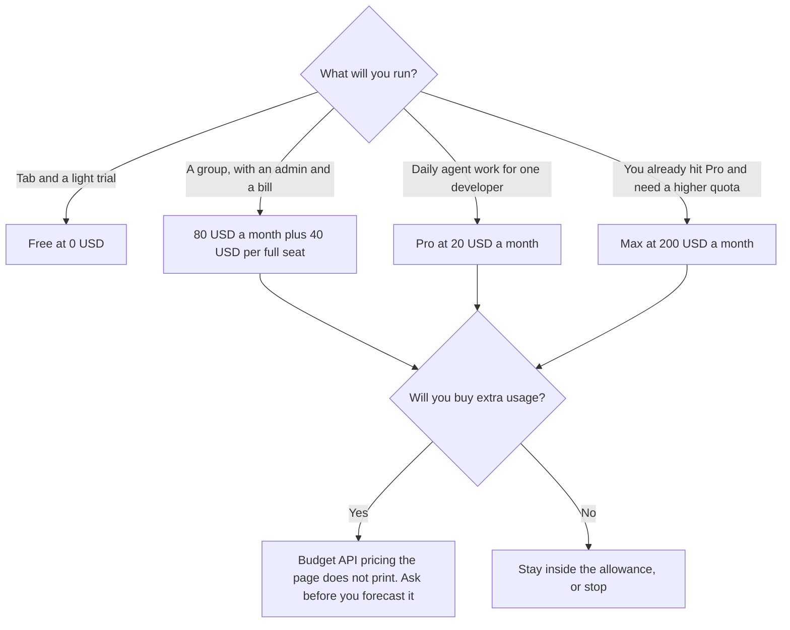

**Budget Devin Desktop on the seat you will renew, not on a quota the page does not number.** Free is $0, with a light agent quota, limited models, unlimited inline edits, and unlimited Tab completions. Pro is $20 a month. Max is $200 a month. Teams is $80 a month for the team plan plus $40 a month per full developer seat, up to 200 users. Enterprise is "let's talk," with no dollar figure on the page.

The editor choice next to this invoice is [Cursor vs GitHub Copilot](/blog/cursor-vs-github-copilot-2026/). Those meters are [Cursor pricing explained](/blog/cursor-pricing-explained-2026/) and [GitHub Copilot pricing explained](/blog/github-copilot-pricing-explained-2026/). A comment-sized job, which does not need this IDE, is [Cursor vs Copilot for docs and comments](/blog/cursor-vs-copilot-for-docs-comments-2026/).

These are US dollar figures from Devin's pricing page, fetched October 24, 2026. They match the directory card checked October 16, 2026. Published October 24, 2026. We did not score agent quality. Tax can change checkout. The page does not print a numeric quota, so this article does not invent one.

## The seats

| Plan | Price | What the page says you get | What it does not say |
|---|---|---|---|
| Free | $0 | Light quota to code with agents, limited models, unlimited inline edits, unlimited Tab completions | A number of agent runs |
| Pro | $20 a month | Increased quotas, frontier models, full model availability, free use of SWE-2, Devin Cloud, extra usage at API pricing | The API rate for that extra usage |
| Max | $200 a month | Everything in Pro, plus significantly higher quotas | How much higher |
| Teams | $80 a month plus $40 a month per full developer seat | Up to 200 users, shared work, centralized billing, an admin dashboard, priority support | A discount for annual billing |
| Enterprise | Contact sales | SSO, a dedicated account team, and a dedicated deployment option are on the page | A list price |

The FAQ on that page says each paid plan includes a usage allowance that refreshes daily and weekly, that cost per message varies by model and task, and that extra usage is consumed at API pricing. It also says most users will not hit the limit. "Most" is not a number you can put in a forecast. Run a week of the work you actually do, then decide whether Pro's $20 holds or you are shopping Max.

## How to read Teams

One full developer seat on Teams is not $40. It is $40 plus a share of the $80 base. Two full seats are $80 + $80 = $160 a month. Ten full seats are $80 + $400 = $480 a month. The page caps the plan at 200 users. Enterprise is the row past what that plan states, and it has no public price here.

Do not compare a Teams seat to [Cursor](/tools/cursor/) Plus at $8, or to [GitHub Copilot](/tools/github-copilot/) Pro at $10, as if the products were the same meter. Cursor's new individual plans and Copilot's credit packs are different invoices. Compare them on the job: an editor with Tab and one agent, versus a command center the directory describes as dispatching Devin and other agents. The dollar is comparable. The quota is not, until both vendors print a number. A terminal agent on a Claude plan is [Claude Code](/tools/claude-code/), a third meter.

## What not to assume

The page says you can purchase extra usage at API pricing. It does not list that price. Do not copy an API rate from a model provider's card and call it Devin's overage. Ask, or leave the overage line blank in the forecast.

SWE-2 is included on Pro as "free use," in the page's words. That does not mean Max is unnecessary, and it does not mean Free includes it. Free's model list is "limited." If a workflow depends on a named model, check that model on the plan you will buy. This article does not invent which models sit on which side of that line beyond what the page stated.

Windsurf became Devin Desktop, on the directory card's June 2, 2026 note. A Windsurf invoice is not this table. Read the plan name on the current bill.

## FAQ

### Is Devin Desktop free?

Yes. Free is $0 and includes unlimited Tab completions and unlimited inline edits, with a light agent quota and limited models. A daily agent habit is the reason the page sells Pro.

### What is the difference between Pro and Max?

Pro is $20 and Max is $200. The page's distinction is "significantly higher quotas," plus everything in Pro. It does not publish the multiplier. Pay $200 only after Pro's allowance is the constraint you actually hit.

### Does Teams include the $80 if we have one developer?

The page prices Teams as $80 a month for the team plan plus $40 a month per full developer seat. One developer is $120 a month on that reading, not $40. If you are one person, Pro at $20 is the individual row.

### Do allowances roll over?

The FAQ says the allowance refreshes daily and weekly. It does not describe rollover of unused usage. Assume unused allowance does not pile up until the page you are looking at says it does.

## Last verified

October 24, 2026, from devin.ai/pricing. The same dollar figures are on the directory card checked October 16, 2026. Cursor and Copilot comparisons use that October 16 directory check. Published October 24, 2026.

**Sources:** [Devin plans and pricing](https://devin.ai/pricing), [Devin Desktop](https://devin.ai).

*Published by Andrew for [AI Tools Optimizer](https://aitoolsoptimizer.com).*

[Devin Desktop](/tools/devin-desktop/) is in the [coding directory](/tools/category/coding/). Directory pages may use affiliate links. A purchase through them may earn us a commission at no extra cost to you.
