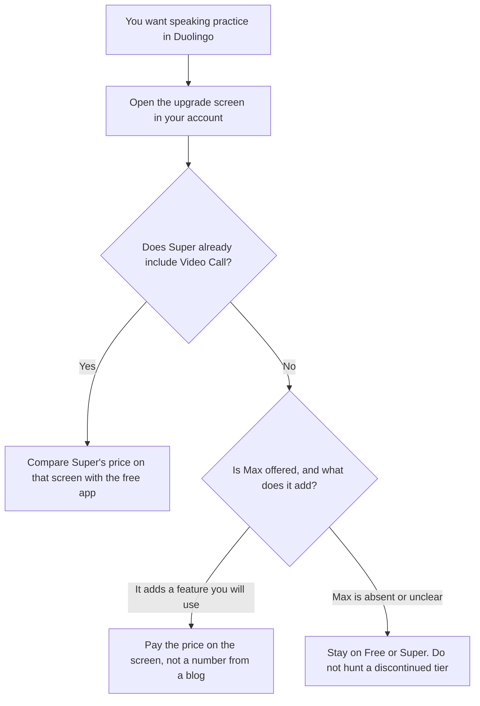

**Duolingo does not publish a single USD price for Max on its website, and Max may not be offered in your account.** In 2026 Duolingo moved Video Call, the feature Max was known for, into Super for most new subscribers. Before you pay for Max, open the upgrade screen and see whether Super already includes the speaking practice you want. The price on that screen is the price. This article will not invent one.

A tutor for school subjects is a different bill: [Khanmigo pricing explained](/blog/khanmigo-pricing-explained-2026/). A teacher planning tool is [MagicSchool pricing explained](/blog/magicschool-pricing-explained-2026/). The classroom roundup is [best AI tools for teachers](/blog/best-ai-tools-for-teachers-2026/).

The directory recorded Duolingo's plan story on October 16, 2026, from Duolingo's help center and a Class Central report on the Q2 2026 update. A live fetch of the help page returned HTTP 401 on October 24, 2026. Published October 24, 2026. We did not score language-learning outcomes. Figures below that came from a third-party test account are labeled as observations, not as Duolingo's official list.

## What the plans were when the directory was checked

| Plan | What the directory recorded | Price |
|---|---|---|
| Free | Core lessons, with ads and Energy limits | $0 |
| Lite | A test of an ad-supported plan with more Energy | Not an official list price. One US test account reported by Class Central showed $35.99 a year |
| Super, including a family option in that test | No ads, unlimited Energy, and Video Call for most new subscribers | Not on Duolingo's public price page. The same test account showed $119.99 a year for Super/Individual and for Family |
| Max | Historically Super plus Explain My Answer, Roleplay, and Video Call | Not offered in that test account. Treat Max as "only if your upgrade screen still sells it" |

Class Central's report, as summarized in the directory, also said Duolingo's CEO discussed restructuring or sunsetting Max, with a decision expected within a couple of quarters of that call, and that Video Call's cost had fallen after a model change, which is why it moved into Super. Those are product-direction statements from that report. They are not a promise that your account matches the test account. App-store prices can differ from the web. Promotions differ by region. This site publishes in US dollars and US English for a global reader, and your storefront can still show another currency.

## What you might be paying for

**The free app** is the habit: short lessons, streaks, ads, and an Energy limit. Most learners should start here and learn whether they will open the app. A subscription does not create the habit.

**Super** is the paid plan to read first in 2026, because Video Call moved there for most new subscribers on the story the directory recorded. Family, in the Class Central test, was the same $119.99 a year as Individual and covered up to six accounts in the directory's table. Confirm the seat count on your screen. Do not email a household a $119.99 quote from this article. Email them the instruction to open the app.

**Max** launched with Explain My Answer, Roleplay, and later Video Call with the character Lily. If those rows now sit on Super, Max needs a new reason. If your screen still sells Max, write down the extra feature in a sentence before you subscribe. "It is the top tier" is not a feature.

**A general chatbot** can role-play a conversation. [ChatGPT](/tools/chatgpt/) Free can do a short practice. Plus is $20 a month if you want projects and higher limits. It will not keep your Duolingo streak, and it is not a substitute for the lesson path. The ladder is [ChatGPT Go vs Plus vs Pro](/blog/chatgpt-go-vs-plus-vs-pro-2026/).

**[Khanmigo](/tools/khanmigo/)** at $4 a month or $44 a year is a tutor for Khan Academy subjects, free for teachers. It is not a language course. Compare jobs, not stickers.

[MagicSchool](/tools/magicschool/) Plus at $8.33 a user a month billed annually is for teachers building lessons. A learner's Duolingo subscription does not buy that.

## What to check before you renew

Open the plan name, the renewal date, and the feature list in the account that will be charged. If you subscribed to Max for Video Call, and Video Call is now on a cheaper plan you can switch to, that switch is the point of this article. If a free trial is offered, set a reminder before it renews. The directory does not record a universal trial length, so this page does not invent one.

A model that explains a grammar point can still be wrong. Check a sentence you will rely on against a source you trust. That habit is [how to fact-check AI writing](/blog/how-to-fact-check-ai-writing-2026/). An invented rule is [what an AI hallucination is](/blog/what-is-ai-hallucination-2026/).

## FAQ

### How much is Duolingo Max?

Whatever the upgrade screen in your account says, in your currency, if Max is offered at all. Duolingo does not publish one official USD list price on its website. A 2026 US test account reported by Class Central did not see Max, and saw Super at $119.99 a year. That observation is not your invoice.

### Is Max being shut down?

The directory's summary of the Q2 2026 commentary said Max might keep a difference, gain features, or be sunset, and that a decision was expected later. Your account is the status. If Max is not on the screen, you cannot buy it from this article.

### Is Super enough for Video Call?

For most new subscribers, that was the 2026 change the directory recorded, with a plan to extend Video Call to existing Super users. Existing subscribers should look at their own feature list. Do not assume a news summary updated your account.

### Is the free app enough?

For a daily habit, often yes. Paid plans remove ads and change Energy, and they add AI speaking features depending on the tier your account is offered. Pay when the interruption or the Energy limit is the reason you stop, and only for a tier whose extra feature you can name.

## Last verified

October 16, 2026, from Duolingo's Max help page and Class Central's Q2 2026 report, as recorded in the directory. Live fetch of the help page on October 24, 2026 returned HTTP 401. Published October 24, 2026. Checkout in the app is the price.

**Sources:** [What is Duolingo Max?](https://www.duolingo.com/help/what-is-duolingo-max), [Class Central on Duolingo's Q2 2026 plan changes](https://www.classcentral.com/report/duolingo-q2-2026/).

*Published by Andrew for [AI Tools Optimizer](https://aitoolsoptimizer.com).*

[Duolingo Max](/tools/duolingo-max/) is in the [education directory](/tools/category/education/). Directory pages may use affiliate links. A purchase through them may earn us a commission at no extra cost to you.
