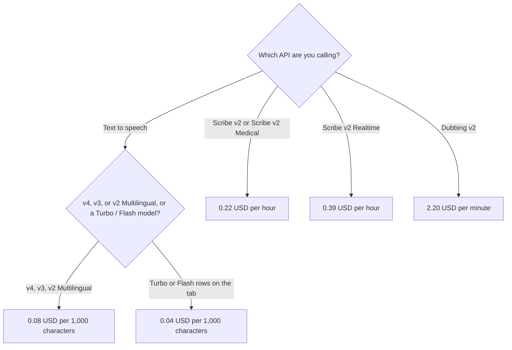

**ElevenLabs API text to speech is $0.08 per 1,000 characters on v4, v3, and v2 Multilingual, and $0.04 per 1,000 characters on v4 Turbo, v3 Conversational, and Flash / Turbo.** Scribe v2 and Scribe v2 Medical are $0.22 per hour. Scribe v2 Realtime is $0.39 per hour. Those rates are the API tab at elevenlabs.io/pricing/api, fetched October 24, 2026. Prices exclude taxes. The credit subscription ladder, which is a different meter, is [ElevenLabs pricing explained](/blog/elevenlabs-pricing-explained-2026/).

The product review is [ElevenLabs review](/blog/elevenlabs-review-2026/). This page is the API rate card. It does not convert Creative credits into these dollars.

## The rate card

| API | Published rate on October 24, 2026 | Unit |
|---|---|---|
| Text to speech v4, v3, v2 Multilingual | $0.08 | 1,000 characters |
| Text to speech v4 Turbo, v3 Conversational, Flash / Turbo | $0.04 | 1,000 characters |
| Scribe v2 and Scribe v2 Medical | $0.22 | Hour |
| Scribe v2 Realtime | $0.39 | Hour |
| Speech Engine | $0.08 | Minute |
| Music | $0.15 | Minute |
| Voice Isolator, Voice Changer, Sound Effects | $0.12 | Minute |
| Dubbing v1, with watermark | $0.33 | Minute |
| Dubbing v2 | $2.20 | Minute |

The same fetch showed Dubbing v1 without a watermark at $0.50 per minute on the plan table, beside the $0.33 with-watermark rate. A FAQ on that tab still summarized dubbing as $0.33 with a watermark, $0.50 without, or $0.50 for Dubbing Studio. That FAQ sentence does not list Dubbing v2 at $2.20. Use the model row for the dubbing API you will call. If the two blocks disagree on a future visit, the row for that model wins.

Realtime v1 Mini and Realtime v1 Max were listed at $0.08 per minute of connected audio, plus LLM usage. Mini showed input at $0.20 per 1 million tokens and output at $6.00 per 1 million. Max showed input at $1.80 per 1 million and output at $9.00 per 1 million. Burst pricing above the concurrency limit was $0.160 per minute on both. The page said included minutes are estimates. Do not quote an included-minute figure as a guarantee.

The FAQ said API usage is billed in US dollars, not credits. Pay as you go is on the same tab: no commitment, pay for what you use. A subscription is the other way to prepay. Do not add the two and call them one pool.

## What a subscription includes, on the API tab

The API tab listed characters included for v4, at the $0.08 rate:

| Plan | Monthly list | v4 characters included, as the tab printed them |
|---|---|---|
| Free | $0 | 10,000 |
| Starter | $6 | 75,000 |
| Creator | $22 | 275,000 |
| Pro | $99 | 1,238,000 |
| Scale | $299 | 3,738,000 |
| Business | $990 | 12,375,000 |

Those character counts are not the Creative credit pools (10,000, 30,000, 121,000, 600,000, 1.8 million, 6 million). The pricing article explains the credit pools. This table is the API tab's v4 inclusion. v4 Turbo at $0.04 listed about twice the characters on that same tab, including 150,000 on Starter and 550,000 on Creator. Quote the column for the model you will call.

Starter's first month was shown at $1, labeled until November 1, 2026. Creator's first month was shown at $11. The list prices are $6 and $22. The main pricing FAQ said annual billing is two months free, with equivalent monthly prices of $5, $18.33, $82.50, $249.17, and $825. Budget the list price after a promo month.

Commercial license and commercial music use start on Starter, on the main pricing tab fetched the same day. The music API card says commercial use licensing is on Starter and above. 44.1 kHz PCM via the API is a Pro line on that main tab, at $99, not a separate per-character rate on the API cards we read. Business lists low-latency text to speech as low as 5¢ a minute. That sentence is on the Business plan. It is not the $0.08 character rate.

Ten thousand characters of v4 at $0.08 per 1,000 is $0.80, before tax. A second generation spends the characters again. The meter in the developer dashboard wins if it disagrees with this arithmetic.

## What this page is not

**The Creative credit story.** [ElevenLabs](/tools/elevenlabs/) credits are the other tab. A YouTube voiceover you render in the product is the pricing article. An API key is this page.

**A cloned voice you do not have rights to use.** Professional Voice Cloning starts on Creator, at $22, on the main tab. The steps are [how to clone a voice with ElevenLabs](/blog/how-to-clone-a-voice-with-elevenlabs/). Rights are not a rate.

**Murf, if you wanted a different character price.** [Murf](/tools/murf-ai/) is a different card. Do not paste Murf's rate onto this table. The split is [Murf vs ElevenLabs](/blog/murf-vs-elevenlabs-2026/).

**HeyGen, if the output is an avatar.** [HeyGen](/tools/heygen/) Creator is $29 a month on the October 16 directory card. A talking head is not this API. [Descript](/tools/descript/) is an editor. It is not an ElevenLabs character rate.

## What not to assume

Do not multiply a Creative credit by $0.08 and call it the API bill. Do not quote the FAQ's dubbing sentence when you are calling Dubbing v2. Do not treat the first-month promo as the renewal. Do not assume Pro's PCM line changes the $0.08 or $0.04 character price. The API tab did not print a separate PCM character rate.

## FAQ

### How much does the ElevenLabs text-to-speech API cost?

$0.08 per 1,000 characters for v4, v3, and v2 Multilingual. $0.04 per 1,000 characters for v4 Turbo, v3 Conversational, and Flash / Turbo. Fetched October 24, 2026, from the API tab. Taxes are extra.

### Are API calls billed in credits?

The FAQ on that tab said API usage is billed in US dollars, not credits. Subscriptions on the same tab also list included characters. Pay-as-you-go is the no-commitment row. Do not add included characters to a pay-as-you-go balance unless the dashboard shows that.

### How is this different from the ElevenLabs pricing article?

That article is the Creative plan ladder: Free through Business, in credits, and where the commercial license and Professional Voice Cloning start. This article is the API rate card in dollars per character, hour, or minute. Use both when a product calls the API and a person also uses the studio. Do not merge the meters.

### Does Business at $990 replace these rates?

Business is a plan price with 12,375,000 v4 characters included on the API tab we fetched, and the main tab's "as low as 5¢ a minute" line for low-latency text to speech. It is not a blank check. Read the model row you will call. Enterprise is custom. This page does not invent an enterprise discount.

## Last verified

October 24, 2026, from elevenlabs.io/pricing/api and the main pricing tab. Published October 24, 2026. HeyGen's $29 figure is the October 16 directory card. Re-read the model row before you put a rate in a unit-economics sheet.

**Sources:** [ElevenLabs API pricing](https://elevenlabs.io/pricing/api), [ElevenLabs pricing](https://elevenlabs.io/pricing).

*Published by Andrew for [AI Tools Optimizer](https://aitoolsoptimizer.com).*

[ElevenLabs](/tools/elevenlabs/) is in the [audio directory](/tools/category/audio-voice-music/). Directory pages may use affiliate links. A purchase through them may earn us a commission at no extra cost to you.
