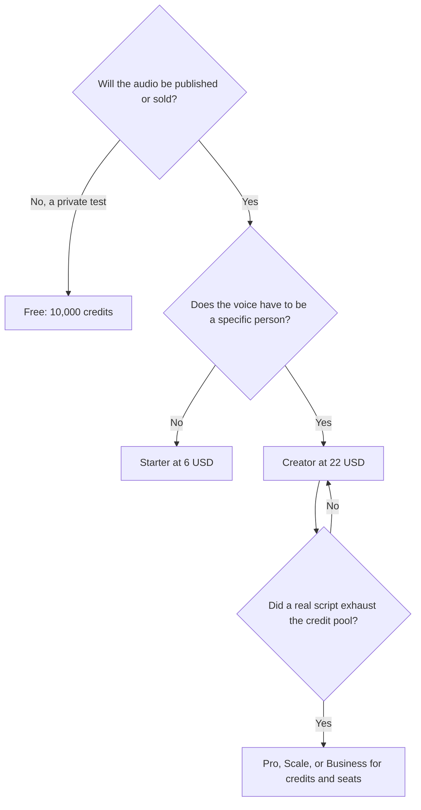

**ElevenLabs pricing is a license cliff, then a credit pool.** Free includes 10,000 credits a month and does not include commercial use. Starter at $6/month is the first plan that does. Creator at $22/month is the first plan with Professional Voice Cloning. Everything above that buys more credits, audio specs, seats, or an agent product. It does not buy a stronger commercial license than Starter.

The plan-by-plan product review is [ElevenLabs review](/blog/elevenlabs-review-2026/). This page is the bill: what the number is, what it is not, and the mistakes that turn a $6 plan into a $99 plan. Monthly list prices in US dollars, excluding tax, from ElevenLabs' pricing page as checked October 16, 2026. First-month promotions were on the page that day. Use the ongoing price in any budget that lasts past month one. We do not convert credits into minutes. The pricing summary we used does not publish a credits-per-minute rate.

## The two products on one price page

**ElevenCreative** is narration, cloning, dubbing, music, sound effects, and Studio for long-form audio. **ElevenAgents** is for configuring and monitoring conversational voice agents. A YouTube voiceover and a phone agent can share a vendor and still be the wrong plan for each other. If you came here to narrate a video, stay on the Creative column. If you came here to answer calls, read the Agents line before you buy Pro "for quality."

Other voice tools are in [best AI voice generators](/blog/best-ai-voice-generators/). If Starter's license is all you needed and the voice still is not the one, use [ElevenLabs alternatives](/blog/elevenlabs-alternatives-2026/).

## What you pay, and what is new at that tier

| Plan | Monthly list | Credits / month | The new thing versus the cheaper plan |
|---|---|---|---|
| Free | $0 | 10,000 | Listening, 3 Studio projects, sound effects. No commercial license |
| Starter | $6 | 30,000 | Commercial license, commercial music use, Dubbing Studio |
| Creator | $22 | 121,000 | Professional Voice Cloning, and extra credits you can buy |
| Pro | $99 | 600,000 | 44.1 kHz PCM via the API, and 192 kbps audio |
| Scale | $299 | 1.8 million | 3 seats and 3 professional clones |
| Business | $990 | 6 million | 10 seats, 10 professional clones, low-latency text to speech from 5¢ per minute |
| Enterprise | Custom | Custom | A sales conversation and volume terms |

Yearly billing exists. The discounted monthly equivalent is a checkout number. This table is the monthly list. A first-month discount is a discount, not the renewal.

## How to read a credit number

Credits drop when you generate audio. The page we checked does not say how many credits one minute of a given model costs. Anyone who tells you "Starter is 30 minutes" is guessing, unless they generated that script and read the meter.

Do this instead:

1. Paste one real script, the length you actually publish.
2. Generate it once on the plan you can already access. Free is enough for this measurement if the clip is not going live.
3. Read the credit drop in the account.
4. Divide the plan's monthly credits by that drop. That is how many of those scripts the plan covers.
5. Add a retake. A second generation spends credits again.

Creator and above can buy additional credits. Free and Starter, on the summary we used, are the pools you live inside. If one script uses a large share of 30,000 credits, Creator is the next pool (121,000), not Pro. Pro is about five times Creator's credits, at $99 instead of $22. Buy it when the measured script says Creator is short, or when you need the API audio spec. Do not buy it because a tier list looks more professional.

Business is the tier that publishes a latency price: low-latency text to speech from 5¢ per minute. That sentence is about an agent-style product, not about a YouTube narration you render overnight. A channel does not need Business to "get the good voice."

## Four buyers, four plans

**A monetized narrator who can use a stock or designed voice.** Starter at $6. The license is the purchase. 30,000 credits is the cap you measure. If the measurement fits, stop.

**Someone cloning a specific person.** Creator at $22, and only with the rights to that voice. Professional Voice Cloning starts here. Scale includes 3 professional clones and Business includes 10. A single clone does not need Scale. The consent and setup steps are in [how to clone a voice with ElevenLabs](/blog/how-to-clone-a-voice-with-elevenlabs/).

**A product calling the API.** Pro at $99 is where 44.1 kHz PCM via the API shows up, with 600,000 credits. Price your own per-request meter in staging. The subscription and the API usage are the same credit story unless Enterprise says otherwise. Confirm on the current pricing page before you put Pro in a unit-economics spreadsheet.

**A team running voice agents.** Scale at $299 for 3 seats, or Business at $990 for 10, on the Creative seat counts above. ElevenAgents is the product surface for deploying those agents. A support team that wanted a help-desk bot may be in the wrong article. Customer-facing chat products are in [AI chatbots for business](/blog/best-ai-chatbots-for-business-2026/).

## The mistakes that inflate the bill

- **Publishing on Free.** The credits work. The commercial license does not. Starter is the $6 fix.
- **Paying the first-month promo as if it renews.** Budget the list price in month two.
- **Jumping to Pro for a weekly video.** Measure one script. Creator is four times the Starter price and about four times the credits (121,000 versus 30,000). Pro is a much larger jump.
- **Buying a clone tier for a stock voice.** Professional Voice Cloning is the Creator feature. If you do not need it, you do not need Creator.
- **Ignoring tax and currency.** These are US list prices excluding tax. A local checkout can differ.
- **Using a chatbot subscription as the voice plan.** [ChatGPT](/tools/chatgpt/) Plus does not include this license. They are separate bills. The subscription map is [which AI subscription is worth paying for](/blog/which-ai-subscription-is-worth-paying-for/).

For a YouTube stack around the voice, see [best AI tools for YouTubers](/blog/best-ai-tools-for-youtubers-2026/). [Murf](/tools/murf-ai/) sells API speech from $0.01 per 1,000 characters, and its Studio subscription prices did not fully load in our check. [Speechify](/tools/speechify/) Premium is $29/month billed monthly and is a listening product, not this credit system. [Descript](/tools/descript/) is where you edit the file after it exists. A presenter on camera is [HeyGen](/tools/heygen/). A song under the voice is [Suno](/tools/suno/).

## FAQ

### How much does ElevenLabs cost?

Monthly list prices are $0, $6, $22, $99, $299, and $990, then Enterprise. Commercial use starts at $6. Professional Voice Cloning starts at $22. Tax is extra. A first-month discount may show at checkout and should not be the number in a yearly budget.

### How many minutes are in 10,000 credits?

We cannot say from the pricing page we checked. It does not publish a credits-per-minute rate. Generate one real script and divide.

### Is the annual plan cheaper?

ElevenLabs offers yearly billing. Confirm the monthly equivalent on the pricing page when you buy. This article uses the monthly list so a promo does not leak into the comparison.

## Last verified

October 16, 2026. Recheck [ElevenLabs pricing](https://elevenlabs.io/pricing) before you move from Starter to Creator, or from Creator to Pro.

**Sources:** [ElevenLabs pricing](https://elevenlabs.io/pricing), [ElevenLabs](https://elevenlabs.io).

The [ElevenLabs](/tools/elevenlabs/) directory page may include an affiliate link. A purchase through it may earn us a commission at no extra cost to you.
