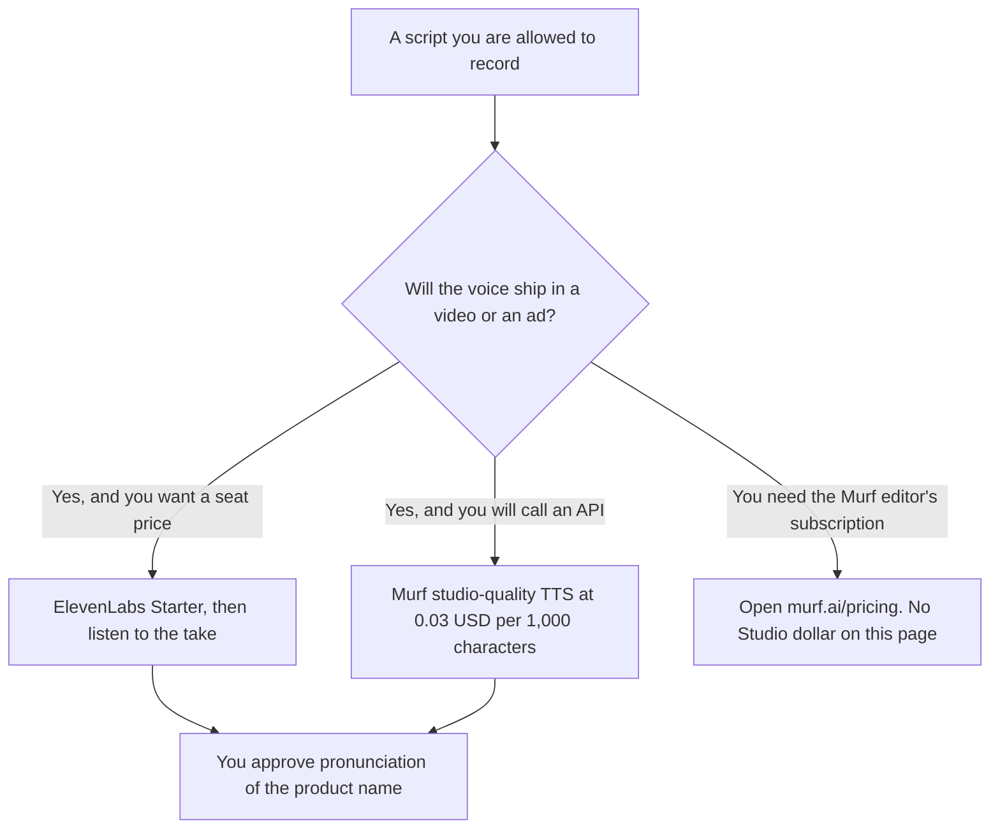

**For an explainer voiceover you will publish, start with ElevenLabs Starter at $6 a month when you need a commercial license on a plan you can read. Use Murf's API when you want a character rate: studio-quality text-to-speech is $0.03 per 1,000 characters on the card.** Murf Studio, the editor, is a real product for this job. This page does not print a Studio subscription price, because that part of the pricing page did not render on the October 16 check.

The three-way that includes listening software is [ElevenLabs vs Murf vs Speechify](/blog/elevenlabs-vs-murf-vs-speechify-2026/). The two-vendor switch guide is [Murf vs ElevenLabs](/blog/murf-vs-elevenlabs-2026/). Speechify is for hearing a document. It is not this page. An avatar that speaks the script is a video product, linked below.

Prices are US list prices excluding tax from directory pages checked October 16, 2026. Published October 24, 2026. We did not score which voice sounds more natural.

## The explainer, side by side

| | [ElevenLabs](/tools/elevenlabs/) | [Murf](/tools/murf-ai/) |
|---|---|---|
| The job on this page | Generate the narration you will put under a product video | Narrate from the API at a published rate, or from Studio once you have read Studio's own price |
| Free | 10,000 credits a month. No commercial license | Studio: 10 minutes of generation, and downloads are not available. API: $10 credit for new users |
| First paid step we can price | Starter at $6 a month, 30,000 credits, commercial license, Dubbing Studio | Falcon API at $0.01 per 1,000 characters. Studio-quality API at $0.03 per 1,000 characters |
| A clone of a voice you have rights to | Creator at $22 a month adds Professional Voice Cloning and 121,000 credits | Voice cloning exists. Professional voice cloning is listed for enterprise API customers. Confirm the plan before you clone anyone |
| What we will not quote | A credit-to-minute conversion this directory does not print | A Studio subscription dollar |

Pronunciation of the product name is your job. Generate a short take of the name, the price, and any acronym before you render the full script. A fluent paragraph that mis-says the brand is a reshoot.

## Arithmetic you can check

**ElevenLabs.** Starter is $6 a month. A year of Starter, if the price stays monthly on that card, is 12 × $6 = $72. Creator is $22 a month, or 12 × $22 = $264 for a year at that monthly rate. Pro is $99 a month for 600,000 credits. Those higher tiers are volume and cloning, not the default for one explainer a week. The credit rules are [ElevenLabs pricing explained](/blog/elevenlabs-pricing-explained-2026/). The product page is [ElevenLabs review](/blog/elevenlabs-review-2026/).

**Murf's API.** Ten thousand characters at the studio-quality rate are 10 × $0.03 = $0.30. The same length on Falcon, which the card positions for real-time agents, is 10 × $0.01 = $0.10. An explainer file is the studio-quality line, not the agent line, unless you have a reason to use Falcon. The $10 new-user API credit is the trial. Purchased API credit does not expire, on the directory card. Count the characters in the script you will actually generate. This page does not convert words to characters for you. The gap on Studio plans is [Murf pricing explained](/blog/murf-pricing-explained-2026/).

A $0.30 API take and a $6 seat are not the same offer. The seat includes a product, a license step, and a credit pool. The API includes a meter. Compare them after one real script, including the retakes. Retakes are characters or credits. The first take is not the invoice.

## When the explainer is not a voice file

**The voice should come out of a person's mouth on camera, and you already recorded them.** Edit that recording in [Descript](/tools/descript/). Hobbyist is $16 a person a month billed annually. Generating a new narrator is a different decision. The episode workflow is [Descript vs CapCut for podcasts](/blog/descript-vs-capcut-for-podcasts-2026/).

**The explainer is an avatar reading the script.** [HeyGen](/tools/heygen/) Creator is $29 a month. [Synthesia](/tools/synthesia/) Starter is $29 a month billed monthly. You may still want a separate voice, or you may use the avatar's voice. Do not buy a voice seat and an avatar seat on the same afternoon without knowing which mouth the viewer will see. The invoices are [HeyGen pricing explained](/blog/heygen-pricing-explained-2026/) and [Synthesia pricing explained](/blog/synthesia-pricing-explained-2026/).

**Someone needs to listen to a PDF.** That is Speechify, not an explainer. Premium is $29 a month billed monthly. Leave it off this choice.

## FAQ

### Is Murf's $0.03 rate the Studio plan?

No. It is the studio-quality text-to-speech endpoint on the API card. Murf Studio subscriptions were not visible on the check this site recorded. Open the pricing page before you budget the editor.

### Do I need Creator to publish one explainer?

You need the commercial-license step, which the directory places on Starter, not on Free. Creator is the Professional Voice Cloning row. If you are using a stock voice, Starter is the first plan that matches publishing. Confirm the license language at checkout.

### Can I clone our founder for the explainer?

Only with rights you actually have, on a plan that includes the clone you need. ElevenLabs lists Professional Voice Cloning on Creator. Murf lists professional voice cloning for enterprise API customers. A test on Free is not a published founder voice.

### Which voice is better?

We did not measure that. Generate the product name on both, on the free credit or the cheapest paid step, and keep the take a person on your team will stand behind. A subscription does not fix a wrong pronunciation.

## Last verified

October 16, 2026 for ElevenLabs, Murf's API rates and free Studio minutes, Descript, HeyGen, and Synthesia. Murf Studio subscription prices were not on that check. Published October 24, 2026.

**Sources:** [ElevenLabs pricing](https://elevenlabs.io/pricing), [Murf pricing](https://murf.ai/pricing), [HeyGen pricing](https://www.heygen.com/pricing).

*Published by Andrew for [AI Tools Optimizer](https://aitoolsoptimizer.com).*

[ElevenLabs](/tools/elevenlabs/) is in the [audio, voice, and music directory](/tools/category/audio-voice-music/). Directory pages may use affiliate links. A purchase through them may earn us a commission at no extra cost to you.
