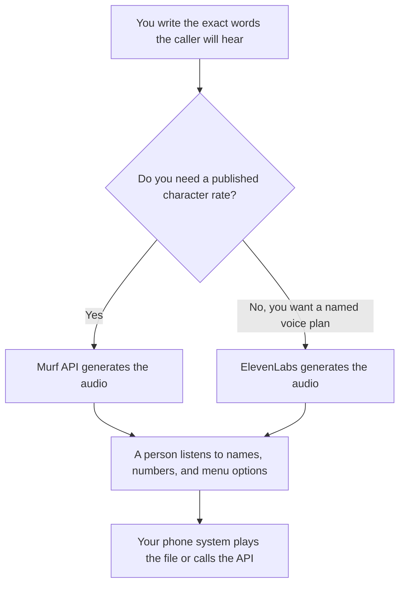

**Use Murf's API when you need a published character rate for short prompts you will generate as audio files or as real-time speech. Use ElevenLabs when you need a named subscription with a commercial license and you will live in a credit plan.** Neither product is your phone system. The IVR still plays the file, or calls the API, under the telephony you already run.

The product-video cousin of this choice is [ElevenLabs vs Murf for explainers](/blog/elevenlabs-vs-murf-for-explainers-2026/). Murf's bill, including the Studio prices we could not print, is [Murf pricing explained](/blog/murf-pricing-explained-2026/). ElevenLabs' bill is [ElevenLabs pricing explained](/blog/elevenlabs-pricing-explained-2026/).

Prices are US list prices excluding tax from directory pages checked October 16, 2026. A direct fetch of Murf's pricing page on October 24, 2026 returned 401, so Studio subscription dollars stay off this page. Published October 24, 2026. We did not score voices, and we did not measure latency.

## Which path matches the prompt

| The line you are producing | Start here | What you still do |
|---|---|---|
| A handful of fixed prompts: hours, menu options, a hold message | [Murf](/tools/murf-ai/) free Studio workspace, 10 minutes, no downloads, or the API | Write the script. Export only on a plan that allows the file you need |
| Real-time speech billed by the character | Murf Falcon TTS at $0.01 per 1,000 characters | Confirm the debit on one call. A vendor claim of time-to-first-audio under 100 ms is theirs. We did not measure it |
| A narration file via the same API at a higher rate | Murf studio-quality TTS at $0.03 per 1,000 characters | Same script rule. Do not invent a minute price from a character rate |
| A commercial voice seat with a published plan | [ElevenLabs](/tools/elevenlabs/) Starter at $6 a month | Free is 10,000 credits a month and does not include a commercial license |
| A cloned voice for a brand you have rights to | ElevenLabs Creator at $22 a month, which adds Professional Voice Cloning | Rights first. The plan does not grant them |
| You are editing a recording a person already made | [Descript](/tools/descript/) | That is an edit. It is not a generated IVR line |

ElevenLabs Pro is $99 a month, Scale is $299, and Business is $990, with credits recorded as 30,000 on Starter, 121,000 on Creator, 600,000 on Pro, 1.8 million on Scale, and 6 million on Business. This page does not convert credits into phone minutes. Read the pricing article before you forecast a call center.

Murf Voice Changer is $0.10 per minute and Translation is $0.02 per 1,000 characters, on the same card. New API users get $10 of credit. Purchased API credit does not expire, on that record. Studio plan prices were not on the page we could read.

## What the caller should hear

An IVR prompt is the sentence you approved: the option, the number, and the fallback when the caller says nothing. It is not a paragraph the model padded. Numbers and product names get a listen from a person. A misread digit is a wrong department.

**Murf** is the right first quote when finance wants a character rate it can multiply. Ten thousand characters on Falcon are $0.10 at the recorded rate. That arithmetic is a sketch. Confirm the debit. The three-way with a listening app is [ElevenLabs vs Murf vs Speechify](/blog/elevenlabs-vs-murf-vs-speechify-2026/). [Speechify](/tools/speechify/) Premium is $29 a month for listening. It is the wrong product for a phone menu.

**ElevenLabs** is the right first quote when the buyer needs a commercial license and a tier with a name. Free audio that is not licensed for commercial use does not belong on a customer line. The review is [ElevenLabs review](/blog/elevenlabs-review-2026/).

A prompt that holds the line:

"Read only the script I pasted. Do not add a sentence. Do not paraphrase the menu. Pronounce the phone numbers as I wrote them. If a word is marked phonetic, use that spelling."

## What not to delegate

Do not let the model invent the menu. Do not ship a prompt you have not heard out loud. Do not paste customer recordings into a voice tool to "match our callers" unless the notice and the contract allow that use. The phone tree is a script your support lead signs.

## FAQ

### Which voice sounds more natural on a phone line?

We did not measure that. Generate the menu on the cheapest licensed path, listen on a handset, and keep the take a person will stand behind. A subscription does not fix a wrong number.

### Can I budget IVR from the credit plan alone?

Not from this page. ElevenLabs publishes credits, not a minutes-per-credit rate we are willing to invent. Murf's API publishes characters. Convert your script into characters, then confirm one invoice line.

### Is real-time TTS required?

Only if the line changes per caller. Fixed hours and a fixed menu can be audio files you generate once and store. Real-time is a second system, with a timeout your phone platform already has. That wait is an engineering budget, not a voice score. The shape of that budget is [what an AI latency budget is](/blog/what-is-ai-latency-budget-2026/).

### What if Studio is where the team already works?

Open murf.ai/pricing and read the current Studio dollar. This article leaves it blank on purpose. Use the API rates when you need a number we recorded.

## Last verified

October 16, 2026 for ElevenLabs plans and Murf API rates. Studio subscription prices were not on that check. A Murf fetch on October 24, 2026 returned 401. Published October 24, 2026.

**Sources:** [ElevenLabs pricing](https://elevenlabs.io/pricing), [Murf pricing](https://murf.ai/pricing).

*Published by Andrew for [AI Tools Optimizer](https://aitoolsoptimizer.com).*

[ElevenLabs](/tools/elevenlabs/) is in the [audio, voice, and music directory](/tools/category/audio-voice-music/). Directory pages may use affiliate links. A purchase through them may earn us a commission at no extra cost to you.
