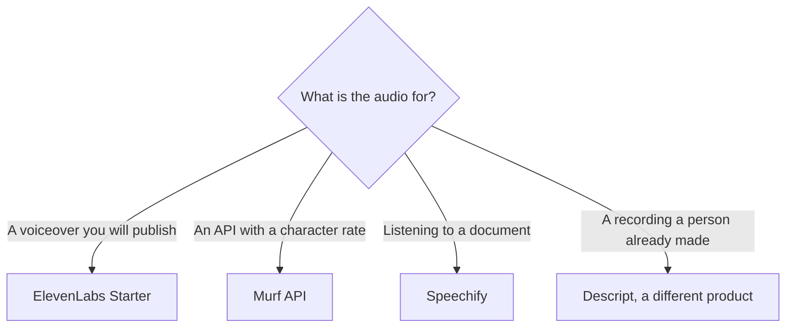

**Pick ElevenLabs to generate a voiceover you will publish, Murf when you need a published per-character API rate, and Speechify when a person needs to hear a document.** They share the word "voice." They do not share a job. This page does not score how natural a voice sounds.

Prices are US list prices excluding tax from directory pages checked October 16, 2026. Murf's Studio subscription prices did not render for us that day. They are omitted on purpose. The wider switch guide is [ElevenLabs alternatives](/blog/elevenlabs-alternatives-2026/).

## The job, side by side

| | [ElevenLabs](/tools/elevenlabs/) | [Murf](/tools/murf-ai/) | [Speechify](/tools/speechify/) |
|---|---|---|---|
| Primary job | Generate speech, dub, clone, and run voice agents | Voiceover in Studio, plus a pay-as-you-go API | Listen to articles, PDFs, and other reading |
| Free | 10,000 credits a month. No commercial license | Studio: 10 minutes of voice generation, no downloads. API: $10 credit | 10 voices, up to 1.5x speed, text to speech only |
| First paid step we could price | Starter $6/month, 30,000 credits, commercial license | API: Falcon $0.01 per 1,000 characters. Studio quality $0.03 per 1,000 characters | Premium $29/month billed monthly |
| Next step | Creator $22/month for Professional Voice Cloning and 121,000 credits | Studio plans: not verified October 16, 2026. Check murf.ai/pricing | Yearly billing is advertised as 60% less. The annual dollar total was not on the page we could record |
| Commercial use | Starts on Starter | Confirm on the Studio plan you buy. The API rates above are published usage prices | Premium is a listening product. Do not assume it licenses a generated ad voiceover |

ElevenLabs Pro is $99 a month for 600,000 credits. Scale is $299. Business is $990. Those are volume plans, not the default after Starter. The credit rules are [ElevenLabs pricing explained](/blog/elevenlabs-pricing-explained-2026/). The product page is [ElevenLabs review](/blog/elevenlabs-review-2026/).

## ElevenLabs, when you are making the audio

Use ElevenLabs when the script is yours and the output is narration, a dub, or a cloned voice you have the right to clone. Free is a test: 10,000 credits and no commercial license. Starter at $6 is the first plan that includes the commercial license and Dubbing Studio. Creator at $22 is the plan for Professional Voice Cloning.

Do not clone a voice you do not have rights to. A paid plan is not permission.

If the "voice" is a face on camera, you wanted an avatar tool. [HeyGen](/tools/heygen/) Creator is $29 a month. The comparison with the other avatar bill is [HeyGen vs Synthesia](/blog/heygen-vs-synthesia-2026/).

## Murf, when the rate card has to be arithmetic

Murf's API, recorded October 16, 2026:

| Endpoint | Price |
|---|---|
| Text to speech, Falcon, real-time | $0.01 per 1,000 characters |
| Text to speech, studio quality | $0.03 per 1,000 characters |
| Voice Changer | $0.10 per minute |
| Translation | $0.02 per 1,000 characters |

Purchased API credit does not expire, and new API plans include $10 of credit. That is the number a developer can put in a spreadsheet. ElevenLabs bills credits on a subscription, which is a different shape.

Studio is the non-API product: a workspace for learning designers and marketers. The free workspace includes 10 minutes of generation without downloads. **We could not verify current Studio subscription prices**, because that tab did not render. Check Murf's pricing page before you compare a Studio seat with ElevenLabs Starter. Do not treat the API rate as the Studio price.

## Speechify, when someone is listening

Speechify reads. Free covers basic text to speech at up to 1.5x, with 10 voices the directory page describes as robotic. Premium at $29 a month billed monthly is the plan for 1,000+ natural voices, 60+ languages, and the rest of the listening features. The page says yearly billing saves 60% versus monthly. It did not give us a yearly dollar figure we are willing to print. Read the checkout.

Upload a PDF in the web app, or use the browser extension on an article. Speechify is the wrong product for an ad read you will publish as a generated performance. That script belongs on ElevenLabs or, once you have confirmed a Studio price, on Murf. The listening review is [Speechify review](/blog/speechify-review-2026/).

A file a human already recorded is a fourth job. Edit it in [Descript](/tools/descript/). Hobbyist is $16 a person a month billed annually. The workflow is [how to edit podcasts with Descript](/blog/how-to-edit-podcasts-with-descript-2026/).

## FAQ

### Which is cheaper, ElevenLabs or Speechify?

They are not the same purchase. ElevenLabs Starter is $6 a month for generated speech with a commercial license. Speechify Premium is $29 a month for listening. Comparing those two numbers as if they were the same product will pick the wrong tool.

### Is Murf cheaper than ElevenLabs?

On the API, Murf publishes a character rate and ElevenLabs publishes credits. Convert your script length on both cards before you decide. Murf Studio subscription prices were not available in our October 16 check.

### Can I use Speechify as a voiceover studio?

The directory describes it as a listening product: articles, PDFs, and proofreading by ear. For a voiceover you will publish, start with ElevenLabs and the license on Starter.

### Does the free ElevenLabs plan allow commercial use?

No. Commercial use starts on Starter at $6 a month. Free is 10,000 credits for evaluation.

## Last verified

October 16, 2026. Murf Studio subscription prices were not verified that day. Speechify's annual dollar total was not recorded. Published October 24, 2026.

**Sources:** [ElevenLabs pricing](https://elevenlabs.io/pricing), [Murf pricing](https://murf.ai/pricing), [Speechify pricing](https://speechify.com/pricing/).

*Published by Andrew for [AI Tools Optimizer](https://aitoolsoptimizer.com).*

[ElevenLabs](/tools/elevenlabs/), [Murf](/tools/murf-ai/), and [Speechify](/tools/speechify/) are in the [audio and voice directory](/tools/category/audio-voice-music/). Directory pages may use affiliate links. A purchase through them may earn us a commission at no extra cost to you.
