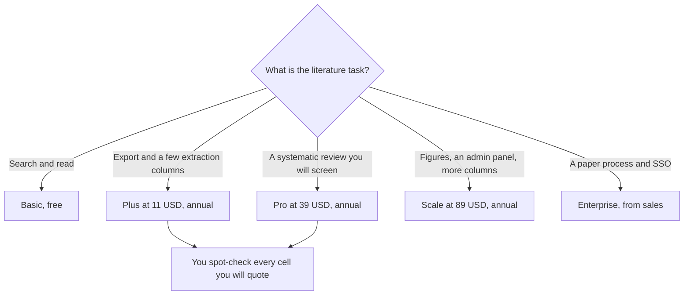

**Elicit Plus is $11 per user per month billed annually ($132 a year). Pro is $39 ($468 a year). Scale is $89 ($1,068 a year).** Basic is free, with unlimited search, summaries, and chat on the card, and limited Research Agent and Research Reports usage. Enterprise is custom. The pricing page also lists higher per-user rates of $49 and $169 a month, billed annually, for some plan options. The directory reads those as likely industry prices. This page will not assign $49 or $169 to a named plan the card did not label in a single sentence. Monthly billing costs more. The directory does not print the monthly dollar, so neither does this article.

The product page is [Elicit review](/blog/elicit-review-2026/). The workflow with a second research tool is [how to research with Elicit and Consensus](/blog/how-to-research-with-elicit-and-consensus-2026/). The "which search" split is [Perplexity vs Elicit for research](/blog/perplexity-vs-elicit-for-research-2026/).

Prices are US list prices excluding tax from Elicit's pricing page as recorded in the directory on October 16, 2026. Published October 24, 2026. We did not score extraction accuracy. You still open the source quote.

## The annual card

| Plan | Per user, billed annually | What the card highlights |
|---|---|---|
| Basic | $0 | Unlimited search across 138 million+ papers, unlimited summaries and chat with papers, Zotero import, limited agent and reports |
| Plus | $11 ($132 a year) | Clinical trials search, exports, 5 extraction columns, standard agent usage |
| Pro | $39 ($468 a year) | Higher usage the card calls 5x, systematic review workflow up to 5,000 papers, 20 columns, Routines, API access |
| Scale | $89 ($1,068 a year) | Higher usage the card calls 9x, figure extraction, collaboration, 30 columns, admin panel, unlimited Search API |
| Enterprise | Custom | Screening up to 40,000 papers, 40 extraction columns, SSO/SAML, no training on your data by default |

The $49 and $169 figures stay in this paragraph so you are not surprised if checkout shows them. Treat them as a second price list until the page in your account names the plan. Do not email a lab a $11 quote if the button in front of you says otherwise. Checkout wins.

## What each row is actually for

**Basic** is a serious free plan for finding and reading. It is the wrong row if you need a table of outcomes across many papers. Search is not extraction.

**Plus at $132 a year** is the academic step: exports to RIS, CSV, BIB, PDF, and DOCX are on the Plus line in the directory, clinical trials search, and five columns. Five columns is a short table. If the question needs sample size, outcome, and comparator only, Plus can hold it. If the protocol has twenty fields, you are describing Pro.

**Pro at $468 a year** is the systematic-review seat on this card: up to 5,000 papers in that workflow, 20 columns, custom extractions on uploaded PDFs, Routines, and API access. A graduate student screening a small set may still be on Plus. A team with inclusion criteria and a PRISMA-shaped process should read the Pro limits before they promise a review date. Five thousand papers is the recorded cap, not a suggestion to upload five thousand unread files.

**Scale at $1,068 a year** adds figure extraction, real-time collaboration, 30 columns, and an admin panel. Buy it when those words are the requirement. "We might collaborate" is not a requirement. Two people emailing a CSV can stay on Pro until the admin panel is the pain.

**Enterprise** is the security and volume conversation: up to 40,000 papers, and no training on your data by default. Pharma and medtech teams should ask that question in the quote even if Scale's feature list looks complete. The default on lower tiers is whatever the current terms say. This page does not restate a training promise the directory reserved for Enterprise.

## Other ways to read the literature

**Consensus Pro** is $12 a month billed annually ($144 a year), or $20 monthly, for evidence-style answers. Free includes unlimited paper searches with tight limits on Pro messages and Deep reviews. Consensus is the faster yes-or-no evidence check. Elicit is the table. The tool page is [Consensus](/tools/consensus/). The review is [Consensus review](/blog/consensus-review-2026/).

**[Perplexity](/tools/perplexity/) Pro** is $17 a month billed annually when the question is the open web with citations, not a screening protocol. The invoice is [Perplexity pricing explained](/blog/perplexity-pricing-explained-2026/).

**[Gemini Notebook](/tools/gemini-notebook/)** is free with a Google account when the PDF is already yours and you need citations from that file. It does not search 138 million papers. The long-file choice is [Gemini vs Claude for long PDFs](/blog/gemini-vs-claude-for-long-pdfs-2026/).

A cell in an extraction table is a claim. Open the quote Elicit links. A wrong sample size that looks tidy will survive into the slide. The failure mode is [what an AI hallucination is](/blog/what-is-ai-hallucination-2026/).

## FAQ

### Is Elicit free?

Yes. Basic includes unlimited search, summaries, and chat with papers, plus Zotero import, on the card. Agent and report usage is limited. Free is for reading. It is not the systematic-review workflow.

### Why do some people see $49 or $169?

The pricing page recorded on October 16, 2026 also shows those higher per-user monthly rates, billed annually, for some plan options. This directory does not map them to Plus or Pro by name. Use the number on your checkout. If you are an industry buyer, ask whether you are on that list before you circulate $11.

### Does Pro include the API?

Yes, on the card. Scale includes unlimited Search API access. Enterprise includes unlimited API access. A script that pulls more than you can review is not a savings. The human check still applies to every cell you publish.

### Can I do a systematic review on Plus?

The dedicated workflow, with screening up to 5,000 papers, is listed on Pro. Plus gives you five extraction columns and exports. A short structured reading is Plus. A review with inclusion criteria is Pro, or Enterprise if you will exceed 5,000 or you need the contract terms.

## Last verified

October 16, 2026, from elicit.com/pricing as recorded in the directory. Monthly billing is described as more expensive, without a monthly dollar on this page. Published October 24, 2026.

**Sources:** [Elicit pricing](https://elicit.com/pricing), [Consensus pricing](https://consensus.app/pricing/), [Perplexity pricing](https://www.perplexity.ai/hub/pricing).

*Published by Andrew for [AI Tools Optimizer](https://aitoolsoptimizer.com).*

[Elicit](/tools/elicit/) is in the [research and search directory](/tools/category/research-search/). Directory pages may use affiliate links. A purchase through them may earn us a commission at no extra cost to you.
