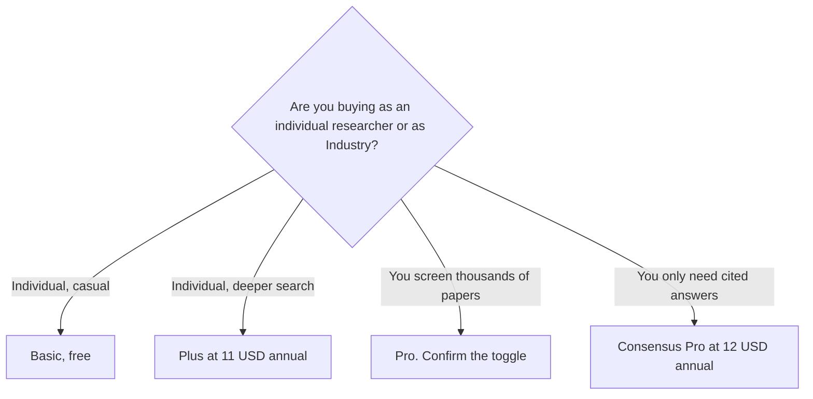

**[Elicit](/tools/elicit/) is a literature-review assistant.** It searches papers, summarizes them, and builds tables that pull a data point out of many papers. The price depends on a toggle. The yearly cards that include Plus are $11, $39, and $89 per user per month, billed annually. The Industry cards on the same page drop Plus and list Pro at $49 and Scale at $229, also billed annually.

Those figures were read from Elicit's pricing page on October 24, 2026. The page has an Industry control and a monthly/yearly control. The yearly cards print a save percentage against monthly billing. The text we extracted did not include a separate monthly dollar amount. We did not audit extraction accuracy. Elicit says its team tests accuracy. That is their claim, not a score from us.

For a cited answer without the table, use [Consensus](/tools/consensus/) and the [Consensus review](/blog/consensus-review-2026/). For the open web, use [Perplexity](/tools/perplexity/). The write-up is the [Perplexity review](/blog/perplexity-review-2026/).

## Two grids

| Plan | Yearly price, non-Industry cards | Yearly price, Industry cards | What the card is for |
|---|---|---|---|
| Basic | Free | Free | Unlimited search across 138 million papers, summaries, chat with papers, Zotero import. Limited agent and reports |
| Plus | $11/user/month, billed as $132/year | Not on the Industry cards we read | Exports, 5 table columns, clinical-trials search, standard agent use |
| Pro | $39/user/month, billed as $468/year | $49/user/month, billed as $588/year | Systematic review screening of 5,000 papers, 20 columns, reports from up to 135 sources, API |
| Scale | $89/user/month, billed as $1,068/year | $229/user/month, billed as $2,748/year | Higher usage, figure extraction, live collaboration, 30 columns, an admin panel |
| Enterprise | Custom | Custom | 40,000-paper screening, SSO, no training on your data by default |

The invoice is [Elicit pricing explained](/blog/elicit-pricing-explained-2026/).

The non-Industry yearly cards print save rates of about 42% (Plus), 43% (Pro), and 40% (Scale). Set the Industry toggle to the audience that will pay before you compare Elicit with a $12 Consensus seat. A company that quotes the $11 price and then checks out on Industry Pro has not been quoted $11.

## What the table is for

Elicit's distinctive published feature is the extraction table: rows are papers, columns are the fields you name, and the cells point back at the source text. Plus adds five columns at a time. Pro adds twenty, a systematic-review workflow that can screen 5,000 papers, and custom extraction from PDFs you upload. Scale adds figure extraction and live collaboration. If you will not build a table, you are paying for a search box. Consensus Free already searches papers.

Basic is not a crippled demo. Unlimited search, summaries, and chat with full text are on the free card. The limit is the agent and the reports. Use Basic until a review needs columns or a screening workflow. Then match the column count to the plan, and match the audience toggle to the invoice.

Enterprise is the plan that says Elicit does not train on your data by default, and that lists SSO. Do not assume Plus has that sentence. A pharma team should read the Enterprise card and the Industry price, not the $11 card.

A PDF you already trust, with no literature search, is a different product. [Gemini Notebook](/tools/gemini-notebook/) stays on your uploads. The workflow is [how to study with Gemini Notebook](/blog/gemini-notebook-study-workflows/).

## Who should pay

**Stay on Basic** for search and chat with papers. **Pay for Plus** at $132 a year if you export and you need clinical trials plus a short table. **Pay for Pro** when the work is a systematic review. **Read the Industry price** before a company card is charged. **Skip Elicit** for a one-off cited paragraph. That is Consensus.

## FAQ

### Is Elicit free?

Yes. Basic includes unlimited paper search, summaries, and chat with papers. Agent and report use is limited.

### How much is Elicit Plus?

$11 per user per month, billed as $132 a year, on the non-Industry yearly card. Plus did not appear on the Industry cards we read.

### Why are there two Pro prices?

The page has an Industry toggle. Pro is $39 per user per month billed annually on one set of cards and $49 on the Industry cards. Scale jumps from $89 to $229 on that same split. Look at the toggle before you compare quotes.

## Last verified

October 24, 2026, from elicit.com/pricing. Monthly rates were not printed as their own dollar amounts in the extract. Recheck the toggle at checkout.

**Sources:** [Elicit pricing](https://elicit.com/pricing), [Elicit](https://elicit.com).

[Elicit](/tools/elicit/) is in the [research directory](/tools/category/research-search/). Directory pages may use affiliate links. A purchase through them may earn us a commission at no extra cost to you.
