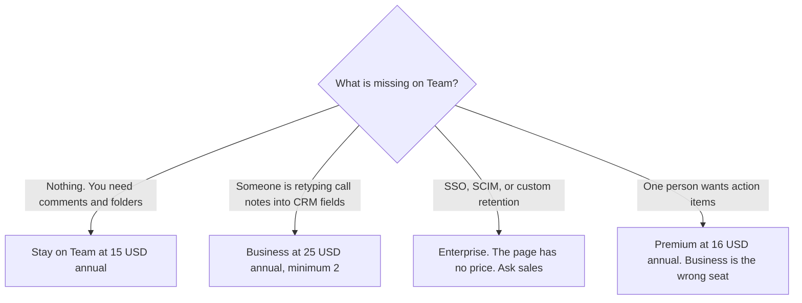

**Fathom Business is $25 per user per month billed annually, or $34 per user per month billed monthly, and it requires at least two users.** The line you are paying for, on the pricing page read October 24, 2026, is CRM field sync, Deal View, and coaching metrics. Team, at $15 per user annually or $19 monthly, is the collaboration tier under that. Premium, at $16 annually or $20 monthly, is one person's action items. The full ladder, including Free, is [Fathom pricing explained](/blog/fathom-pricing-explained-2026/). This page is the Business seat only.

Enterprise is a sales conversation on that page: SSO, SCIM, custom retention, and a success manager. It has no dollar here. Do not multiply $25 by a headcount and call the product Enterprise.

The product page is [Fathom review](/blog/fathom-review-2026/). The no-bot comparison is [Granola vs Fathom](/blog/granola-vs-fathom-2026/). The three-way is [Otter vs Fireflies vs Fathom](/blog/otter-vs-fireflies-vs-fathom-2026/).

Those prices were read from Fathom's pricing page on October 24, 2026, and they match the October 16 directory card. The page leads with annual billing and says it saves 25% or more. Prices are US dollars. Tax can be extra. Published October 24, 2026. We did not score transcription or CRM fill rate.

## What Business buys that Team does not

| Plan | Annual, per user | Monthly, per user | Minimum | The line that is or is not Business |
|---|---|---|---|---|
| Team, for contrast | $15 | $19 | 2 users | Comments, folders, keyword alerts, shared playlists. Not CRM field sync |
| Business | $25 | $34 | 2 users | CRM field sync, Deal View, coaching metrics |
| Enterprise | Talk to sales | Talk to sales | Sales | SSO, SCIM, custom retention, a success manager. No dollar on the page |

Premium can be one person. Business cannot. Two users on Business annual is $50 a month. Ten users on Business annual is $250 a month, which is $3,000 a year. Ten users on Business monthly is $340 a month, which is $4,080 a year. The same ten people on Team annual are $150 a month. The $100 a month gap, at ten seats on annual billing, is the CRM line. It is not a nicer transcript. Free already lists unlimited recordings and transcripts, on that page. Buying Business to "get transcription" pays for a layer Free claims to include.

The base pricing article records a 90-day guarantee on team plans. Confirm on the quote whether Business is covered before you cite that guarantee. This page does not extend it past what that article recorded.

## The invoice people mislabel

**The CRM fields.** [Fathom](/tools/fathom/) Business is the seat when a person is copying budget, timeline, or next step into the CRM by hand, and Deal View is the summary you want across calls. Coaching metrics are on the same card. A team that only comments on clips stays on Team.

**A notetaker with a published analytics seat.** [Fireflies](/tools/fireflies-ai/) Business is $19 per user per month billed annually, or $29 monthly. That is a different product's analytics tier, not a Fathom discount. The invoice is [Fireflies Business pricing explained](/blog/fireflies-business-pricing-explained-2026/).

**A minute pool, if finance wants a cap in writing.** [Otter](/tools/otter-ai/) Business is $19.99 per user per month billed annually, or $30 monthly, with a 4-hour conversation cap. Fathom's Business card, as we read it, does not publish that kind of per-call minute cap. The invoice is [Otter Business pricing explained](/blog/otter-business-pricing-explained-2026/).

**A bot-free notebook.** [Granola](/tools/granola/) Business is $14 per user per month, on the pricing page read October 24, 2026. Basic keeps 30 days of history. That is a different archive. The invoice is [Granola pricing explained](/blog/granola-pricing-explained-2026/).

Fathom's site says Fathom is now part of Superhuman. A Grammarly or Superhuman Mail subscription does not include these seats.

## What not to assume

Do not buy one Business seat. The minimum is two. Do not describe Team's keyword alerts as Deal View. Do not quote Enterprise as "Business, but annual." Annual Business already has a price. Enterprise does not, on this page. Do not convert a non-USD checkout into these dollars. Quote the currency the buyer will be charged.

## FAQ

### How much is Fathom Business for 10 people?

At the October 24 list, ten users on annual billing are 10 times $25, which is $250 a month, or $3,000 a year. Ten users on monthly billing are 10 times $34, which is $340 a month, or $4,080 a year. Both require the two-user minimum, which ten seats already meet. Tax can be extra.

### Does Team include CRM sync?

CRM field sync and Deal View are on Business. Team is comments, folders, keyword alerts, and shared playlists. Premium is the individual upgrade for advanced summaries and AI action items. A solo user who wants action items stays on Premium at $16 annual or $20 monthly.

### What does the two-user minimum change?

A solo user cannot get the Business price by buying one seat. The cheapest Business invoice is two seats: $50 a month at the annual per-user price, or $68 a month at the monthly price. If the second seat is only there to unlock the SKU, say so on the quote.

### Does this page replace the main Fathom pricing article?

No. That article is Free, Premium, Team, Business, and the bot-free beta label. This article is the Business row: what it adds over Team, the ten-seat arithmetic, and what not to invent when someone asks for Enterprise.

## Last verified

October 24, 2026, from Fathom's pricing page, matching the October 16 directory card. The bot-free option is marked beta on the base article. Recheck it before you promise a client there will be no bot.

**Sources:** [Fathom pricing](https://www.fathom.ai/pricing), [Fathom](https://www.fathom.ai).

*Published by Andrew for [AI Tools Optimizer](https://aitoolsoptimizer.com).*

[Fathom](/tools/fathom/) is in the [meetings directory](/tools/category/meetings-transcription/). Directory pages may use affiliate links. A purchase through them may earn us a commission at no extra cost to you.
