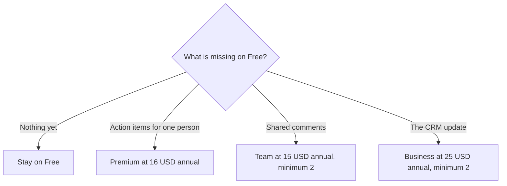

**Fathom's price is a free recorder, then a paid layer for action items, team comments, or CRM fields.** Premium is $16 a month billed annually, or $20 month to month. Team is $15 per user annually or $19 monthly, with a two-user minimum. Business is $25 per user annually or $34 monthly, also with a two-user minimum. Enterprise is a sales conversation.

Those prices were read from Fathom's pricing page on October 24, 2026. The page leads with annual billing and says it saves 25% or more. Prices are US dollars. Tax can be extra. The product page is [Fathom review](/blog/fathom-review-2026/). The no-bot comparison is [Granola vs Fathom](/blog/granola-vs-fathom-2026/).

## What each line item buys

| Plan | Monthly | Annual, per month | Minimum | The line you are paying for |
|---|---|---|---|---|
| Free | $0 | $0 | 1 | Unlimited recordings and transcripts, instant summaries, clips, playlists, search |
| Premium | $20 | $16 | 1 | Advanced summaries, AI action items, a conversational assistant, a custom meeting bot |
| Team | $19 per user | $15 per user | 2 users | Comments, folders, keyword alerts, shared playlists |
| Business | $34 per user | $25 per user | 2 users | CRM field sync, Deal View, coaching metrics |
| Enterprise | Talk to sales | Talk to sales | Sales | SSO, SCIM, custom retention, a success manager |

Team plans include a 90-day guarantee, per the pricing page. Fathom's site says Fathom is now part of Superhuman. A Grammarly subscription does not include these seats. Grammarly's own prices are in the [Grammarly review](/blog/grammarly-review-2026/).

## The free plan is the product, until it is not

Free already lists unlimited recordings and transcripts. A team that buys Premium to "get transcription" is paying for a layer Free claims to include. Premium is the plan for advanced summary templates, including sales frameworks named on the page, and for AI action items. Run one real meeting on Free. Pay when you are rewriting the summary into tasks by hand.

The annual saving is the page's "25% or more," and the card math matches a simple reading: Premium monthly at $20 versus $16 is 20% off the monthly price, and the page's headline says 25% or more across the toggle. Quote the card in your workspace. The headline and a specific row can differ.

Bot-free capture is marked beta, for Mac, beside the usual meeting bot. If you are buying Fathom because a client was promised there would be no bot, the beta label matters. The product built around your own notes, with no bot, is [Granola](/tools/granola/). Business there is $14 per user per month, and Basic keeps 30 days of history. That is a different archive.

## Minimums and a 10-person invoice

Premium can be one person. Team cannot. Two users on Team annual is $30 a month. Ten users on Team annual is $150 a month. Ten on Business annual is $250 a month. Ten on Business monthly is $340 a month.

Business is the CRM line: field sync and Deal View. Buy it when someone is retyping call notes into the CRM. Coaching metrics are on the same card. A transcript-only team should stay on Free or Premium and keep the CRM as its own system.

[Fireflies](/tools/fireflies-ai/) Pro is the lower published paid seat in the notetaker set, at $10 per user per month billed annually, or $18 monthly. Fireflies' pricing article does not publish Fathom's free unlimited-recording claim, and it does not publish Otter's per-call minute cap. The Fireflies invoice is [Fireflies pricing explained](/blog/fireflies-pricing-explained-2026/). [Otter](/tools/otter-ai/) Pro annual is $8.33, with a 1,200-minute pool and a 90-minute conversation cap. The three-way is [Otter vs Fireflies vs Fathom](/blog/otter-vs-fireflies-vs-fathom-2026/).

## FAQ

### Is Fathom actually free?

The pricing page lists a free plan with unlimited recordings and transcripts, instant summaries, clips, playlists, and search. Advanced summaries and AI action items are on Premium. Team features start at two users.

### How much is Fathom Premium if I pay month to month?

$20 a month, against $16 a month billed annually, on the page read October 24, 2026.

### Does Premium include CRM sync?

CRM field sync and Deal View are on Business. Team is the collaboration tier under that. Premium is the individual upgrade.

### What does the two-user minimum change?

A solo user cannot get the Team price by buying one seat. The cheapest shared plan is two Team seats, $30 a month at the annual per-user price. One person who wants action items stays on Premium.

## Last verified

October 24, 2026, from Fathom's pricing page. The bot-free option is marked beta. Recheck it before you promise a client there will be no bot.

**Sources:** [Fathom pricing](https://www.fathom.ai/pricing), [Fathom](https://www.fathom.ai).

*Published by Andrew for [AI Tools Optimizer](https://aitoolsoptimizer.com).*

[Fathom](/tools/fathom/) is in the [meetings directory](/tools/category/meetings-transcription/). Directory pages may use affiliate links. A purchase through them may earn us a commission at no extra cost to you.
