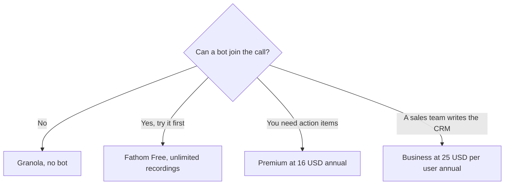

**[Fathom](/tools/fathom/) is an AI notetaker for Zoom, Google Meet, and Microsoft Teams.** The reason to try it before a paid seat is the free plan: unlimited recordings and transcripts. Premium is the individual upgrade, at $16 a month billed annually or $20 month to month. Team and Business are per-user plans with a two-user minimum.

Those prices were read from Fathom's pricing page on October 24, 2026. The page leads with annual billing and says it saves 25% or more. Prices are in US dollars. Tax can be extra. We did not score summary quality against [Otter](/tools/otter-ai/) or Fireflies. The four-way comparison is [best AI meeting notetakers](/blog/best-ai-meeting-notetakers/).

## What each plan lists

| Plan | Monthly | Annual, per month | What the pricing page adds |
|---|---|---|---|
| Free | $0 | $0 | Unlimited recordings and transcripts, instant summaries, clips, playlists, search. Bot or bot-free capture (bot-free is in beta, for Mac) |
| Premium | $20 | $16 | Advanced summaries, AI action items, a conversational assistant, a custom meeting bot |
| Team | $19 per user | $15 per user | Comments, folders, keyword alerts, playlists across the team. Minimum 2 users |
| Business | $34 per user | $25 per user | CRM field sync, Deal View, coaching metrics. Minimum 2 users |
| Enterprise | Talk to sales | Talk to sales | SSO, SCIM, custom retention, a success manager |

The invoice is [Fathom pricing explained](/blog/fathom-pricing-explained-2026/).

Team plans include a 90-day guarantee, per the pricing page. Fathom's site says Fathom is now part of Superhuman. A Grammarly subscription does not include these seats. Grammarly's own prices are in the [Grammarly review](/blog/grammarly-review-2026/).

## What you are actually deciding

Free already records, transcribes, and summarizes. Premium is the plan that adds the action items and the advanced summary templates, including sales frameworks Fathom names on the page. If your notes are "what did we decide," try Free on one real meeting before you pay. If your notes are "what should I do next, in a template," Premium is the published answer.

Team is a collaboration seat, not a discount for one person. The minimum is two users. Ten people on Team at the annual price is $150 a month. Business is the plan that writes insights into CRM fields and adds Deal View. Ten people on Business annual is $250 a month. Buy Business when someone is retyping call notes into the CRM. Do not buy it for a better transcript. Free already claims unlimited transcripts.

Recording has a consent problem that the price does not solve. Laws and company rules differ. Fathom offers a bot and, in beta on Mac, a bot-free option. If the room will not accept a bot, the product in this category that is built around your own notes is [Granola](/tools/granola/). The Granola review is [Granola review](/blog/granola-review-2026/). [Fireflies](/tools/fireflies-ai/) Pro is the lower confirmed paid seat in the comparison, at $10 per user per month billed annually. The Fireflies review is [Fireflies review](/blog/fireflies-ai-review-2026/).

## Who should pay

**Start on Free** unless you already know you need action items or CRM fields. **Pay for Premium** when you are one person and Free's summary is the thing you rewrite by hand. **Pay for Team** when two or more people share calls and comments. **Pay for Business** when the CRM update is the job. **Skip Fathom** for in-person meetings with no laptop audio, and for a notetaker you refuse to put in the room.

## FAQ

### Is Fathom free?

Yes. The free plan lists unlimited recordings and transcriptions, instant summaries, clips, playlists, and search. It does not include the advanced summaries and AI action items that Premium lists.

### How much is Fathom Premium?

$16 a month billed annually, or $20 billed monthly, on the pricing page we read.

### Does Premium include CRM field sync?

No. CRM field sync and Deal View are on Business. Team is the collaboration tier under that.

## Last verified

October 24, 2026, from Fathom's pricing page. The bot-free capture option is marked beta. Recheck it before you promise a client there will be no bot.

**Sources:** [Fathom pricing](https://www.fathom.ai/pricing), [Fathom](https://www.fathom.ai).

[Fathom](/tools/fathom/) is in the [meetings directory](/tools/category/meetings-transcription/). Directory pages may use affiliate links. A purchase through them may earn us a commission at no extra cost to you.
