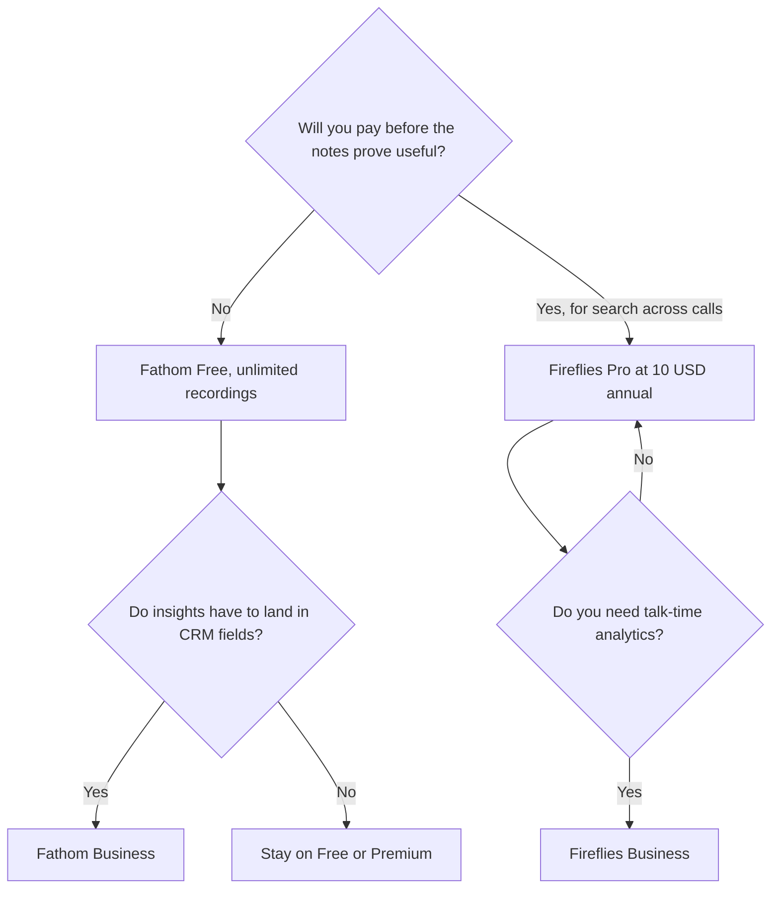

**Use Fathom when you want unlimited recordings and a summary on the free plan, and a bot in the meeting is acceptable. Use Fireflies when you will pay for search across calls and the annual seat is the number finance will sign.** Both put a bot in the room. If the bot is the problem, leave for [Granola](/tools/granola/). The three-way that includes [Otter](/tools/otter-ai/) is [Otter vs Fireflies vs Fathom](/blog/otter-vs-fireflies-vs-fathom-2026/). This page stays on the two-way: a generous free recorder, or a paid searchable archive.

Prices are US list prices excluding tax from directory pages checked October 16, 2026. Published October 24, 2026. We did not score transcription accuracy. The directory does not print a minute cap for Fireflies Free. It does print unlimited recordings for Fathom Free. Those are different sentences. Do not swap them.

## What you are buying

| You need | Choose | The number |
|---|---|---|
| Unlimited recordings before you pay | [Fathom](/tools/fathom/) Free | Unlimited recordings, transcripts, and instant summaries |
| Advanced summaries and AI action items on one seat | Fathom Premium | $16 a month billed annually, or $20 monthly |
| A low confirmed paid seat for a team that will search calls | [Fireflies](/tools/fireflies-ai/) Pro | $10 a user a month billed annually, or $18 monthly |
| Talk-time and participation analytics | Fireflies Business | $19 a user a month annually, or $29 monthly |
| CRM field sync | Fathom Business | $25 a user a month billed annually, or $34 monthly. Team is $15 a user annually with a 2-user minimum |
| No bot | [Granola](/tools/granola/) | Business is $14 a user a month. Basic is free with 30 days of history |

## The plans, without borrowing features

**Fathom Free** is unlimited recordings and transcriptions, instant summaries, and the directory also lists clips, search, and LLM integrations on the free forever line in the product comparison we used for the three-way. Premium is $16 a month billed annually, or $20 monthly, and adds advanced summaries and AI action items. Team is $15 a user a month annually, or $19 monthly, with a two-user minimum. Business is $25 a user annually, or $34 monthly, and syncs meeting insights into CRM fields, plus Deal View. Annual billing saves 25% or more, on the directory card. Fathom is part of Superhuman. The card is [Fathom pricing explained](/blog/fathom-pricing-explained-2026/). The review is [Fathom review](/blog/fathom-review-2026/).

**Fireflies** Free exists. Fireflies Talk, unlimited voice dictation in the desktop app, is included on every plan, including Free. Do not buy Pro to unlock dictation. Pro is $10 a user a month billed annually, or $18 month to month. Business is $19 annually or $29 monthly. Enterprise is $39 a user a month billed annually. The directory's reason to buy Pro is search across calls. The reason to buy Business is analytics. Ask Fred is the assistant over past meetings. Live Assist is the real-time suggestion feature. The card is [Fireflies pricing explained](/blog/fireflies-pricing-explained-2026/). The review is [Fireflies review](/blog/fireflies-ai-review-2026/).

This page will not invent a storage limit, a monthly meeting cap, or a language count for Fireflies Free. If checkout shows a cap the directory did not record, checkout wins.

## How to choose

Start on Fathom Free if you are one person, or a small team, and you want every call recorded before you know whether the notes are good. Move to Premium when you want the advanced summary and action items and Free is no longer enough. Move to Business when a CRM field is the point, not when the word Business sounds more serious.

Start on Fireflies if you already know you will search months of calls, or you record dialers and uploaded files, and a $10 annual seat is an easier approval than "unlimited, then we will see." The monthly prices are much higher. Pro at $18 is close to Fathom Premium's monthly $20, and it is not a bargain against Fathom Free. Annual is the Fireflies discount. Buy it when you will still be searching calls in three months.

If the guest should not see a bot, neither of these is the tool. [Granola vs Fathom](/blog/granola-vs-fathom-2026/) is that decision. A live transcript with a minute cap is [Otter vs Granola](/blog/otter-vs-granola-2026/). The shelf is [best AI meeting notetakers](/blog/best-ai-meeting-notetakers/). [Read AI](/tools/read-ai/) is another meeting-search seat, not a tie-breaker between these two.

Read the summary the same day. A fluent recap can miss the decision. The habit is [how to summarize meetings with AI](/blog/how-to-summarize-meetings-with-ai-2026/).

## FAQ

### Is Fireflies Free unlimited like Fathom Free?

The directory says Fathom Free includes unlimited recordings. It says Fireflies has a free plan and that Talk dictation is on that plan. It does not say Fireflies Free is unlimited. Do not quote them as the same offer.

### Which paid plan is cheaper?

Fireflies Pro annual is $10 a user. Fathom Premium annual is $16. Fathom Free is $0 with unlimited recordings. The cheapest way to record is Fathom Free. The cheapest confirmed paid search seat in this pair is Fireflies Pro annual.

### Does either one sync a CRM on the cheap plan?

Fathom's CRM field sync is on Business, at $25 a user billed annually. Do not expect it on Free or Premium. Fireflies Business is the analytics tier, at $19 annual. Read the integration list at checkout before you promise a field to sales.

### Can a bot-free tool replace both?

[Granola](/tools/granola/) can replace the capture method. It does not replace a bot that records a call you are not at. Business is $14 a user a month. Basic keeps 30 days of history.

## Last verified

October 16, 2026 for Fathom, Fireflies, and Granola prices named above. Published October 24, 2026.

**Sources:** [Fathom pricing](https://www.fathom.ai/pricing), [Fireflies pricing](https://fireflies.ai/pricing), [Granola](https://www.granola.ai/).

*Published by Andrew for [AI Tools Optimizer](https://aitoolsoptimizer.com).*

[Fathom](/tools/fathom/) and [Fireflies](/tools/fireflies-ai/) are in the [meetings and transcription directory](/tools/category/meetings-transcription/). Directory pages may use affiliate links. A purchase through them may earn us a commission at no extra cost to you.
