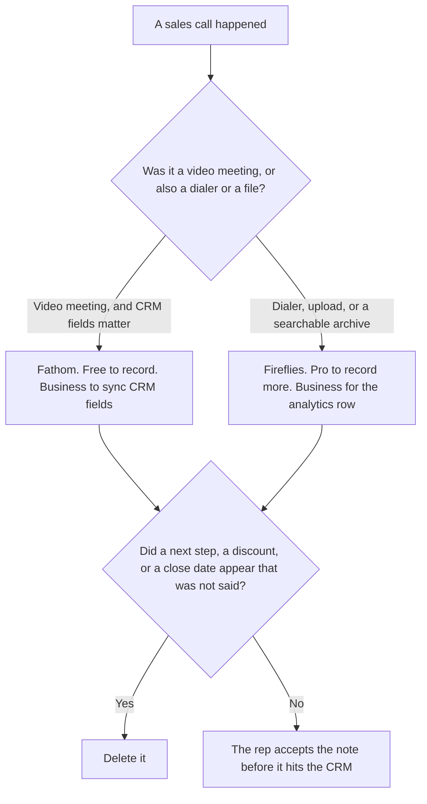

**Use Fathom when the sales call is a Zoom, Meet, or Teams meeting and you want unlimited recordings on the free plan, with CRM field sync on Business. Use Fireflies when the call also comes from a dialer, an upload, or a month of calls you need to search, and the analytics you want are on Business.** The notes may quote what was said. They may not invent a next step, a discount, or a close date.

A bot-or-not cut against Otter is [Otter vs Fathom for sales calls](/blog/otter-vs-fathom-for-sales-calls-2026/). The Fathom invoice is [Fathom pricing explained](/blog/fathom-pricing-explained-2026/). The Fireflies invoice is [Fireflies pricing explained](/blog/fireflies-pricing-explained-2026/).

Prices below are US list prices from those articles, which use the October 16, 2026 directory cards. Published October 24, 2026. We did not score calls. A recording still needs the consent your counsel already requires. This page does not supply that rule.

## Which call you are keeping

| The call | Start here | First paid step | The limit |
|---|---|---|---|
| A video meeting, and CRM fields must update | [Fathom](/tools/fathom/) | Business is $25 a user a month billed annually, or $34 monthly | Free includes unlimited recordings. It does not include CRM field sync |
| A dialer, an upload, or search across many calls | [Fireflies](/tools/fireflies-ai/) | Pro is $10 a user a month billed annually, or $18 monthly | Conversation analytics are on Business, at $19 annually or $29 monthly |
| The follow-up, from words that were actually said | [Claude](/tools/claude/) | Pro is $17 a month billed annually, or $20 monthly | No commitment that was not in the notes |
| The page that holds the accepted next step | [Notion AI](/tools/notion-ai/) | Business is $20 a seat a month | The page does not invent the date |

Fathom's card lists a free plan with unlimited recordings and transcriptions, Premium at $16 a month billed annually or $20 monthly for advanced summaries and AI action items, Team at $15 a user a month annually or $19 monthly with a two-user minimum, and Business at $25 annually or $34 monthly for CRM field sync and Deal View. Buying Business to get a recording pays for a row the free plan already lists. Buying Business because a manager wants Salesforce fields filled is the $25 seat. The detail is [Fathom Business pricing explained](/blog/fathom-business-pricing-explained-2026/).

Fireflies lists Free, Pro at $10 annually or $18 monthly, Business at $19 annually or $29 monthly, and Enterprise at $39 a user a month billed annually. The pricing article's point is the annual toggle. Talk dictation is on every plan, including Free. Dialers such as Aircall and RingCentral, plus uploaded files, are why a sales team picks this card when the conversation never joined Zoom. Analytics are the Business line. Enterprise at $39 is a published seat, not a guess. Read [Fireflies Business pricing explained](/blog/fireflies-business-pricing-explained-2026/) before you call Business the top of the ladder.

Claude writes the follow-up only from the accepted notes. A close date the prospect did not say stays out. Notion holds the next step the rep already agreed to log.

## What the note is allowed to say

Who was on the call, what they asked, and the next step a person heard. A discount the rep "usually" offers stays out. A competitor claim the model supplied stays out. If the next step is unclear, the line says Next step not set.

**Fathom Business** is the CRM field sync. Free is the recording. The review is [Fathom review](/blog/fathom-review-2026/).

**Fireflies Business** is the analytics row. Pro is the cheaper recording seat. The review is [Fireflies review](/blog/fireflies-ai-review-2026/).

**Claude Pro** is the follow-up draft. The review is [Claude review](/blog/claude-review-2026/).

A prompt that holds the line:

"Draft the sales note from the transcript lines I pasted. If a next step was not said, write Next step not set. Do not add a discount. Do not add a close date."

## What not to delegate

Do not let the summary mark the deal as committed. Do not sync a field the rep has not read. Do not pick Enterprise Fireflies because the archive feels important, if Business already has the analytics you meant. The rep owns the note.

## FAQ

### How is this different from Otter vs Fathom for sales calls?

That page includes a bot-free or minute-cap choice against Otter. This page is Fathom's CRM field sync against Fireflies' dialer archive and analytics. Otter is not the third seat here.

### Does Fathom's free plan update the CRM?

No. On the card the pricing article uses, CRM field sync and Deal View are Business, at $25 a user a month billed annually or $34 monthly. Free is unlimited recordings and instant summaries. Premium adds advanced summaries and AI action items. It does not add the CRM row.

### What is the Fireflies seat for analytics?

Business, at $19 a user a month billed annually or $29 monthly, on the October 16 card. Enterprise at $39 billed annually is a higher published seat. Pro at $10 or $18 is the recording seat under that. Quote the cycle. The annual price and the monthly price are different invoices.

### Who may write the CRM field?

The rep, after they read the note. Next step not set stays out of the field. A summary is not a forecast.

## Last verified

October 16, 2026 for Fathom, Fireflies, and Notion, via the posts cited above. October 24, 2026 for Claude. Published October 24, 2026. We did not score calls.

**Sources:** [Fathom pricing](https://www.fathom.ai/pricing), [Fireflies pricing](https://guide.fireflies.ai/articles/3734844560-learn-about-the-fireflies-pricing-plans), [Claude pricing](https://claude.com/pricing), [Notion pricing](https://www.notion.com/pricing).

*Published by Andrew for [AI Tools Optimizer](https://aitoolsoptimizer.com).*

[Fathom](/tools/fathom/) is in the [meetings directory](/tools/category/meetings-transcription/). Directory pages may use affiliate links. A purchase through them may earn us a commission at no extra cost to you.
