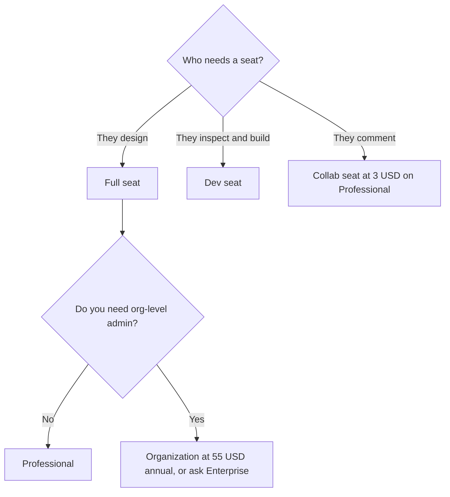

**Figma's AI price is a seat type plus a monthly credit allowance, not a separate AI subscription.** Starter is free, with 150 AI credits a day up to 500 a month. Professional is $16 a month for a Full seat billed annually, with 3,000 credits, $12 for a Dev seat with 500 credits, and $3 for a Collab seat. Extra credits exist. The directory does not print the add-on dollar.

The product page is [Figma review](/blog/figma-review-2026/). The template-editor comparison is [Figma AI vs Canva Magic Studio](/blog/figma-ai-vs-canva-magic-studio-2026/). Canva's own allowance is [Canva Magic Studio pricing explained](/blog/canva-magic-studio-pricing-explained-2026/).

Prices are US list prices from Figma's pricing page as recorded in the directory on October 16, 2026. The Professional starting price is billed annually. Published October 24, 2026. We did not score designs. This page does not invent a higher month-to-month Full-seat price the card did not list.

## The seats

| Plan | Full seat | Dev seat | Collab seat | AI credits on the card |
|---|---|---|---|---|
| Starter | Free | — | — | 150 a day, up to 500 a month |
| Professional | $16 a month | $12 | $3 | Full 3,000 a month. Dev 500 a month |
| Organization, annual | $55 | $25 | $5 | Full 3,500 a month |
| Enterprise, annual | $90 | $35 | The card does not list a Collab dollar here | Full 4,250 a month |

A small product team of 2 designers, 4 developers, and 3 people who comment, all on Professional, is 2 × $16 + 4 × $12 + 3 × $3 = $32 + $48 + $9 = $89 a month before tax, using the annual-billed rates on the card. Putting the four developers on Full seats would be 4 × $16 = $64 instead of $48. The $16 difference is the reason Dev seats exist. Collab seats are for people who view, comment, and whiteboard.

Organization and Enterprise are billed annually on the card. Organization Full at $55 is a large jump from $16. Buy it when you need that plan's admin, not because AI credits went from 3,000 to 3,500. The credit bump is real and small next to the seat price.

## What spends a credit

The directory says AI credits are consumed by Figma's AI features, including the agent on the canvas and Figma Make. It does not publish a menu of "this button costs this many credits" on the summary card. Watch the meter on one real file before you buy a credit add-on. Extra credits can be bought pay-as-you-go or by subscription. No unit price was on the October 16 card. Ask Figma, and write down the quote.

Starter's 150-a-day cap, with a 500-a-month ceiling, is enough to learn. It is a poor place to run a design system for a company. Professional is the usual first paid step, and the Full seat is the one that should sit with the people who draw.

Dev Mode and the MCP server are the handoff story. Advanced inspection is on paid plans, on the directory description. A Dev seat is how you pay for that inspection without buying a Full seat for every engineer.

## What Figma is not

[Canva](/tools/canva/) Pro is $180 a year for one person and is the right tool for social posts and flyers. [Adobe Express](/tools/adobe-express/) Premium is $9.99 a month when Firefly and Stock are the point. Buying a Figma Full seat to make an Instagram post is the expensive way to get a template. The comparison is [Canva vs Adobe Express for AI design](/blog/canva-vs-adobe-express-for-ai-design-2026/).

[v0](/tools/v0/) and [Lovable](/tools/lovable/) are app-building seats. Figma Make turns an idea into a prototype on the canvas. A hosted app builder is a different bill. Do not add one until the Figma file is the thing that is failing.

Designers picking a wider shelf can start from [best AI tools for designers](/blog/best-ai-tools-for-designers-2026/).

## Who should pay

Stay on Starter while you are learning frames and auto layout. Move the designers to Professional Full when the file is shared and the free credit cap is in the way. Give engineers Dev seats. Give reviewers Collab seats. Look at Organization when a security or admin requirement names it. Look at extra AI credits only after a month of real use shows the 3,000 gone, and only after you have the add-on price in writing.

## FAQ

### Is Figma AI included in the free plan?

Yes, within the Starter allowance: 150 credits a day, up to 500 a month. It is not the 3,000-credit Full seat.

### Do Collab seats include the same AI credits as Full seats?

The directory prints credit numbers for Full and Dev on Professional, and for Full on Organization and Enterprise. It does not print a Collab credit number in the table this site recorded. Do not assume Collab includes 3,000. Check the seat at checkout.

### Is $16 the monthly price if I do not pay annually?

The directory's starting price says Professional Full is $16 a month billed annually. This page does not invent a different monthly-billed number. If checkout shows another figure, the checkout wins.

### Can we buy AI credits without a paid seat?

The card says add-ons are available on all plans, including extra credits. Starter already includes a small allowance. Confirm whether an add-on can attach to Starter before you plan on it. The seat is still the main bill.

## Last verified

October 16, 2026 for Figma, Canva, and Adobe Express prices named above. The extra-credit unit price was not on the card. Published October 24, 2026.

**Sources:** [Figma pricing](https://www.figma.com/pricing/), [Figma](https://www.figma.com), [Canva pricing](https://www.canva.com/pricing/).

*Published by Andrew for [AI Tools Optimizer](https://aitoolsoptimizer.com).*

[Figma](/tools/figma/) is in the [design directory](/tools/category/design/). Directory pages may use affiliate links. A purchase through them may earn us a commission at no extra cost to you.
