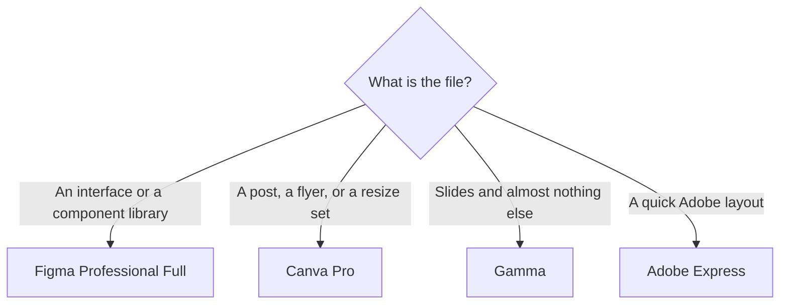

**Choose Figma when the file is an interface, a prototype, or a design system, and the AI features spend a credit pool on top of a seat. Choose Canva when the file is a social post, a flyer, or a deck, and the AI features are an allowance inside that editor.** Canva does not sell Magic Studio as a separate subscription. The tools people mean by that name sit on Free, Pro, or Business.

Figma's seat prices were read from the pricing page on October 24, 2026. Canva's prices are US list prices from the pricing page checked October 16, 2026, as used in [Canva Magic Studio review](/blog/canva-magic-studio-review-2026/). The Figma product page is [Figma review](/blog/figma-review-2026/). Published October 24, 2026. We did not score layouts.

## Seat versus allowance

| | Figma | Canva |
|---|---|---|
| Free | Starter. Unlimited drafts. 150 AI credits a day, up to 500 a month | A real editor. Limited AI. Magic Write and Translate can sit outside the monthly allowance, per Canva's description |
| First paid step | Professional Full seat $16 a month. Dev $12. Collab $3. Confirm the monthly versus annual column | Pro $18 a month or $180 a year for one person. Canva lists a 10× AI allowance versus Free |
| AI on that paid step | Full seat: 3,000 credits a month. Dev and Collab: 500 | The allowance, plus background remover, resize, Brand Kit, 100 GB |
| The team plan | Organization Full $55 a month billed annually. Enterprise Full $90 | Business $25 per person per month or $250 per person per year, listed as 20× Free |
| What you are buying | A shared design file and Dev Mode | Templates, sizes, and a Brand Kit |
| Commenters | Viewers can comment on a paid plan without a seat | Pro is one person. A second person with admin is Business |

## What the AI credit is doing

Figma's FAQ, as read for the October 24 review, says credits are shared across Figma's AI features, including the on-canvas agent and Figma Make. It does not publish one credits-per-action rate for every feature. Watch a real task before you call 3,000 plenty. Extra credits can be purchased. A stakeholder who only comments should stay a viewer. Buying Collab seats for every comment is how the bill grows. Organization is the multi-team library plan. The credit bump to 3,500 or 4,250 is real and small next to the seat price.

Canva Pro at $180 a year is $15 a month across the year, against $18 month to month. Background Remover and Magic Resize are the week-to-week reasons to leave Free. Magic Write drafting a headline is often outside the allowance. Image generation spends it. Canva is a convenient place to crop a background into a template. It is a weaker place to be your only model when the picture must contain a spelled word. Generate that still in [Ideogram](/tools/ideogram/) or [Adobe Firefly](/tools/adobe-firefly/), then place it. The image shelf is [best AI image generators](/blog/best-ai-image-generators-2026/).

[Adobe Express](/tools/adobe-express/) Premium is $9.99 a month. The review is [Adobe Express review](/blog/adobe-express-review-2026/). Express is the quick-layout neighbor. It is not a component library, and it is not Canva's template pile.

[Gamma](/tools/gamma/) Plus is $9 per seat per month when the deliverable is a deck and you will not maintain it as Figma components. The deck tools are [best AI presentation makers](/blog/best-ai-presentation-makers/). Canva can make a deck too. Buy Gamma when the deck is the whole job.

## Who should pay for which

**One product designer.** Figma Starter until drafts and 500 credits run out, then one Full seat at $16. **A developer who only inspects.** A Dev seat at $12, or a free viewer. **One marketer resizing a campaign.** Canva Pro. **A second marketer who must use the Brand Kit under an admin.** Canva Business. Five people at $250 a year is $1,250. Sharing one Pro login is outside the plan.

Designers who cross both files in a week can read [best AI tools for designers](/blog/best-ai-tools-for-designers-2026/). The content team that lives in Canva and a doc is [best AI tools for content teams](/blog/best-ai-tools-for-content-teams-2026/).

## FAQ

### Is Canva Magic Studio a separate subscription?

No. The AI tools are an allowance on Canva Free, Pro, and Business. An AI Pass add-on exists for heavier use. We did not record its price on October 16, so it is not in the table.

### Does Figma replace Canva?

It replaces Canva on an interface file. It does not replace Canva on a Friday social post. Teams keep both when both files exist. They drop one when only one file exists.

### How much AI is on Figma's free plan?

Up to 500 credits a month, with a daily cap of 150, on the pricing page read October 24, 2026. Paid Full seats list 3,000 a month on Professional.

### Can I put a Figma frame into Canva?

You can export an image and place it. You cannot keep it as a component. If the frame will change every sprint, edit it in Figma and export the still you need.

## Last verified

October 24, 2026 for Figma's pricing page. October 16, 2026 for Canva's prices and the allowance language in the Magic Studio review. Published October 24, 2026.

**Sources:** [Figma pricing](https://www.figma.com/pricing/), [Canva pricing](https://www.canva.com/pricing/).

*Published by Andrew for [AI Tools Optimizer](https://aitoolsoptimizer.com).*

[Figma](/tools/figma/) and [Canva](/tools/canva/) are in the [design directory](/tools/category/design/). Directory pages may use affiliate links. A purchase through them may earn us a commission at no extra cost to you.
