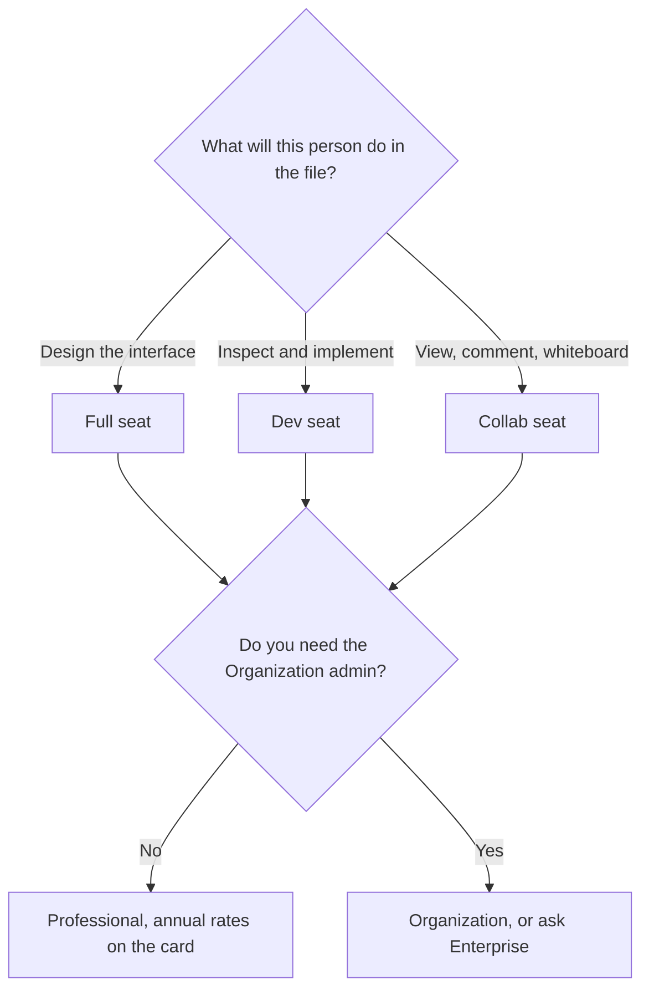

**Figma Professional is $16 a month per Full seat, $12 per Dev seat, and $3 per Collab seat. Starter is free. Organization is $55, $25, and $5 on those same seat types, billed annually. Enterprise lists $90 per Full seat and $35 per Dev seat, billed annually.** The seat is the job: design, inspect, or comment. The monthly AI allowance that comes with the seat is a second article. Buying Full seats for people who only comment is the expensive mistake. Treating Organization as "Professional plus a few credits" is the other one.

That credit article is [Figma AI pricing explained](/blog/figma-ai-pricing-explained-2026/). The product page is [Figma review](/blog/figma-review-2026/). The template editor, when the file is a social graphic and not an interface, is [Canva pricing explained](/blog/canva-pricing-explained-2026/).

Prices are US list prices from Figma's pricing page as recorded in the directory on October 16, 2026. Professional's starting price is billed annually. The directory does not print a higher month-to-month Full-seat dollar, so this page does not invent one. Published October 24, 2026. We did not score design files.

## The seats

| Plan | Full seat | Dev seat | Collab seat | Who the seat is for |
|---|---|---|---|---|
| Starter | Free | — | — | Learning and personal drafts. Unlimited drafts, on the card |
| Professional | $16 a month | $12 | $3 | A small team that needs shared libraries |
| Organization, annual | $55 | $25 | $5 | The admin and security jump. Billed annually |
| Enterprise, annual | $90 | $35 | The card does not list a Collab dollar here | The contract plan. Billed annually |

Starter includes 150 AI credits a day, up to 500 a month. Professional Full includes 3,000 a month and Dev includes 500. Those numbers are why the other article exists. A Collab seat is for someone who views, comments, and whiteboards. It is not a discounted Full seat. If that person starts editing the components, they need a Full seat, and the bill should change on purpose.

Organization Full at $55 is more than three times Professional's $16. The credit allowance moves from 3,000 to 3,500 on the card. Buy Organization when you need that plan's admin, not because of 500 credits. The credit add-on, pay-as-you-go or by subscription, is acknowledged on the card. The directory does not print the add-on dollar. This page does not invent it.

## What you are choosing besides the dollar

**Professional** is the plan for a team that has outgrown Starter's drafts and needs a shared library. Two designers on Full seats and a reviewer on a Collab seat is a different invoice from three Full seats. The reviewer who only comments should not be on $16 to save a conversation.

**Dev seats** exist so implementation does not require a design seat. The handoff tools are the point of the $12. If the developer also designs screens, they are a Full seat. The $4 difference between $12 and $16 is small next to a wrong workflow, and it is real across a large team.

**Organization and Enterprise** are annual on the card. Enterprise does not list a Collab price in the directory table this article uses. Ask before you model a commenter on Enterprise as $5. That $5 is the Organization figure.

A marketing graphic is often the wrong file. [Canva](/tools/canva/) Pro is $18 a month or $180 a year for one person. [Adobe Express](/tools/adobe-express/) Premium is $9.99 a month. A generated interface with no design system is a different product again: [v0](/tools/v0/) Plus is $30 a user a month. Pick the file you are responsible for, then the seat.

## What not to assume

Do not divide a Full seat by the number of people who share a login. The card is per seat. Do not quote Enterprise as a discount you can calculate from Organization. It is a listed $90 and $35, and the rest is the contract. Do not skip the AI article if the reason you are upgrading is credits. The seat decision and the credit decision are related, and they are not the same sentence.

## FAQ

### Is Figma free?

Yes. Starter is free, with unlimited drafts and the daily AI credit cap the other article explains. Shared team libraries are why teams move to Professional.

### Why are there three prices on one plan?

They are three jobs. Full is the design seat, Dev is the implementation seat, and Collab is the comment seat. Professional's $16, $12, and $3 are those jobs on the annual card. Putting everyone on Full is a choice. It is not the only price Figma printed.

### Does Organization include a large AI upgrade?

It includes 3,500 credits on a Full seat, against 3,000 on Professional, on the October 16 card. The seat price moves from $16 to $55. Read the admin features before you buy the jump for the credits. Extra credits are an add-on the directory does not price here.

### Can we pay monthly?

The directory records Professional's starting price as billed annually and records Organization and Enterprise as annual. It does not print a month-to-month Full-seat dollar. Use the figure checkout shows, and do not invent a monthly premium on top of $16.

## Last verified

October 16, 2026, from Figma's pricing page as recorded in the directory. Published October 24, 2026.

**Sources:** [Figma pricing](https://www.figma.com/pricing/), [Figma](https://www.figma.com).

*Published by Andrew for [AI Tools Optimizer](https://aitoolsoptimizer.com).*

[Figma](/tools/figma/) is in the [design directory](/tools/category/design/). Directory pages may use affiliate links. A purchase through them may earn us a commission at no extra cost to you.
