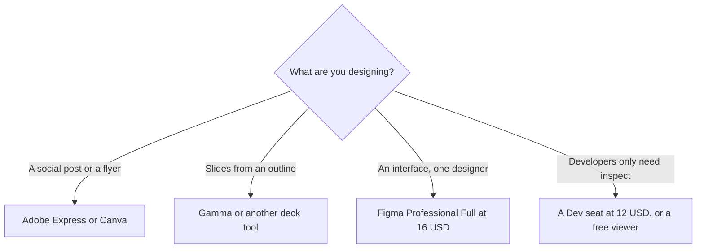

**[Figma](/tools/figma/) is the collaborative design tool for interfaces, prototypes, and design systems, with an AI credit pool on every seat.** A Professional Full seat is listed at $16 a month. Dev is $12. Collab is $3. Organization and Enterprise are billed annually, at $55 and $90 for a Full seat. Viewers can comment on a paid plan without a seat.

Those figures were read from Figma's pricing page on October 24, 2026. The page says prices are in USD. The Professional card has a monthly/annual control, so confirm which column you are reading before you send a budget. We did not score Figma's agent against a designer's file. This review is the seat and the credit.

Slide tools that are not a design system are in [best AI presentation makers](/blog/best-ai-presentation-makers/). The quick-layout app is [Adobe Express](/tools/adobe-express/), in the [Express review](/blog/adobe-express-review-2026/).

## Seats

| Plan | Full | Dev | Collab | AI credits the page lists |
|---|---|---|---|---|
| Starter | Free | — | — | 150 a day, up to 500 a month |
| Professional | $16/month | $12/month | $3/month | Full: 3,000 a month. Dev and Collab: 500 a month |
| Organization | $55/month, annual | $25/month | $5/month | Full: 3,500 a month |
| Enterprise | $90/month, annual | $35/month | — | Full: 4,250 a month |

The seat card is [Figma pricing explained](/blog/figma-pricing-explained-2026/).

Figma's FAQ says a Full seat includes Design, Make, Draw, Motion, Sites, Dev Mode, FigJam, Slides, Buzz, and Specs. A Dev seat is Dev Mode plus the collaborative products, with view and comment on Design files. A Collab seat is the collaborative products and basic inspection. Extra AI credits can be purchased. Credits are shared across Figma's AI features. The FAQ does not publish a credits-per-action rate that covers every feature. Watch one real task before you call 3,000 plenty.

## What the seat is for

Figma is the file a product team shares. The AI features, including the on-canvas agent and Figma Make, spend the credit pool. They do not replace the seat. A stakeholder who only comments should be a viewer, which Figma says is free on a paid plan, with basic inspection. Buying Collab seats for everyone who leaves a comment is how the bill grows.

Organization and Enterprise are admin and design-system plans: shared libraries across teams, and on Enterprise, SCIM and workspace controls. They are not "more AI" in any sense that should lead the purchase. The credit bump from 3,000 to 4,250 is real and small next to the seat price. Buy Organization when the company has more than one team in the library. Buy Enterprise when security asks for SCIM.

Education has a separate page, which Figma links from the pricing FAQ. A class should open that before it buys Professional.

Figma is the wrong tool for a one-off social graphic. [Canva](/tools/canva/) and Adobe Express are built for that. It is also the wrong tool for a deck you will not maintain as components. [Gamma](/tools/gamma/) is in the [Gamma review](/blog/gamma-review-2026/).

Mid-year seats on an annual Professional plan are billed monthly at the monthly rate until you add them to the annual subscription, per Figma's FAQ. That is the sentence that surprises a team in month four.

## Who should pay

**Use Starter** while drafts and 500 credits a month are enough. **Pay for one Full seat** when the file is a real product and you need libraries and Dev Mode. **Add Dev seats** for people who inspect, not for people who design. **Leave commenters as viewers.** **Skip Figma** if the output is a poster or a slide and nobody is maintaining a component.

## FAQ

### Is Figma free?

Yes. Starter includes unlimited drafts and up to 500 AI credits a month, with a daily cap of 150. Paid plans add unlimited files for the team, libraries, and the larger credit pool.

### How much is a Figma Full seat?

Professional lists a Full seat at $16 a month, a Dev seat at $12, and a Collab seat at $3. Organization Full is $55 and Enterprise Full is $90, both billed annually. Confirm the Professional monthly versus annual column.

### Do viewers need a paid seat?

On a paid plan, Figma says other people can view and comment without a seat. That access includes basic inspection only.

## Last verified

October 24, 2026, from Figma's pricing page. AI credit costs per action are not a single published rate. Recheck the seat type before you multiply a team by $16.

**Sources:** [Figma pricing](https://www.figma.com/pricing/), [Figma](https://www.figma.com).

[Figma](/tools/figma/) is in the [design directory](/tools/category/design/). Directory pages may use affiliate links. A purchase through them may earn us a commission at no extra cost to you.
