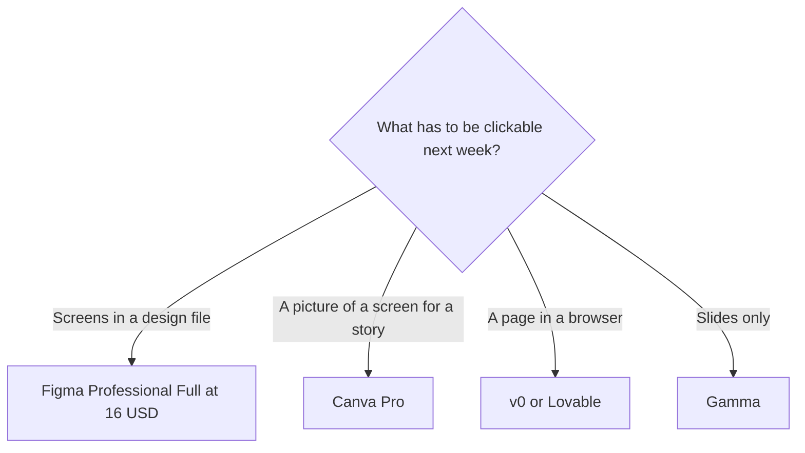

**Use Figma when the prototype is a clickable flow in a design file that engineering will inspect. Use Canva when you need a visual mock of a screen for a story or a deck, and you do not need components, Dev Mode, or a handoff file.** Canva's AI is an allowance inside the editor. Figma's AI spends credits on a seat. A generated picture of a screen is not yet a prototype.

The broader editor choice is [Figma AI vs Canva Magic Studio](/blog/figma-ai-vs-canva-magic-studio-2026/). The invoices are [Figma AI pricing explained](/blog/figma-ai-pricing-explained-2026/) and [Canva Magic Studio pricing explained](/blog/canva-magic-studio-pricing-explained-2026/). If the next step is a coded page, that is [Lovable vs v0 for landing pages](/blog/lovable-vs-v0-for-landing-pages-2026/).

Prices are US list prices from directory pages checked October 16, 2026. Figma's Professional rates on the card are billed annually. Published October 24, 2026. We did not score prototypes.

## Prototype versus mock

| | [Figma](/tools/figma/) | [Canva](/tools/canva/) |
|---|---|---|
| Free | Starter. Unlimited drafts. 150 AI credits a day, up to 500 a month | A real editor with a limited AI allowance |
| First paid step | Professional Full seat, $16 a month. Dev seat $12. Collab seat $3 | Pro, $18 a month or $180 a year, for one person |
| AI on that step | Full seat: 3,000 credits a month. Dev and Collab: 500. The directory names the canvas agent and Figma Make as credit users | Paid plans get a larger allowance: Pro at 10× Free, Business at 20× Free, on the card |
| The team plan | Organization Full, $55 a month billed annually | Business, $25 a person a month or $250 a person a year |
| What you can hand off | A shared file, a prototype flow, and Dev Mode on the seats that include it | A graphic, a deck, or a resize. Not a component library |
| Commenters | Collab is $3 on Professional. Viewers can comment on a paid plan without a Full seat | Pro is one person. A second person who needs the team plan is Business |

Two designers and one person who comments, on Figma Professional at the annual-billed rates, are 2 × $16 + $3 = $35 a month before tax. The same three people cannot share Canva Pro. Pro is one person at $180 a year. Three people on Canva Business annual are 3 × $250 = $750 a year, which is $62.50 a person a month. Buy Business when the second person needs the paid team, not because a mock looked better.

## Where AI helps, and where a person still clicks through

**A flow you will user-test.** Build it in Figma. Use AI credits to draft frames if you want, then walk the prototype yourself. The directory does not publish a per-button credit price. Watch the meter on one file. Extra credits can be bought, and the October 16 card does not print the add-on dollar. The product page is [Figma review](/blog/figma-review-2026/).

**A concept for a campaign review.** Canva Pro is enough when the audience is marking up a picture, not clicking a flow. Magic Studio is not a separate subscription. The product page is [Canva Magic Studio review](/blog/canva-magic-studio-review-2026/).

**The prototype became a landing page.** [v0](/tools/v0/) Plus is $30 per user per month with $30 of included credits. [Lovable](/tools/lovable/) Pro starts at $25 a month for 100 credits, and members share the pool. Do not keep polishing a Figma frame if the decision is the live page.

**A slide that shows three screens.** [Gamma](/tools/gamma/) Plus is $9 a seat a month. Export pictures from the file that is already true. Gamma will not keep your components in sync. The invoice is [Gamma pricing explained](/blog/gamma-pricing-explained-2026/).

A prototype that invents a button the product will not ship is a spec bug. The writing check is [how to fact-check AI writing](/blog/how-to-fact-check-ai-writing-2026/). The designer shelf is [best AI tools for designers](/blog/best-ai-tools-for-designers-2026/).

## FAQ

### Can Canva replace Figma for a prototype?

It can replace Figma for a static mock. A click-through of real components, with a Dev seat inspecting spacing, is the Figma job on this card. If your test only needs a picture, do not buy a Full seat to get one.

### Do AI credits make the prototype?

Credits pay for Figma's AI features, including the agent and Figma Make, on the directory wording. The prototype is still the frames and the links a person checks. A credit balance is not a usability test.

### Is the $16 Figma seat monthly or annual?

The directory lists Professional Full at $16 a month billed annually. This page does not invent a higher month-to-month price. Read the toggle at checkout.

### Should stakeholders get Full seats?

No. Collab at $3 is the comment seat on Professional. Canva viewers are a Business question once Pro's one-person limit is the blocker. Extra Full seats are how prototype bills grow.

## Last verified

October 16, 2026 for Figma, Canva, v0, Lovable, and Gamma. Published October 24, 2026.

**Sources:** [Figma pricing](https://www.figma.com/pricing/), [Canva pricing](https://www.canva.com/pricing/), [Gamma pricing](https://gamma.app/pricing).

*Published by Andrew for [AI Tools Optimizer](https://aitoolsoptimizer.com).*

[Figma](/tools/figma/) is in the [design directory](/tools/category/design/). Directory pages may use affiliate links. A purchase through them may earn us a commission at no extra cost to you.
