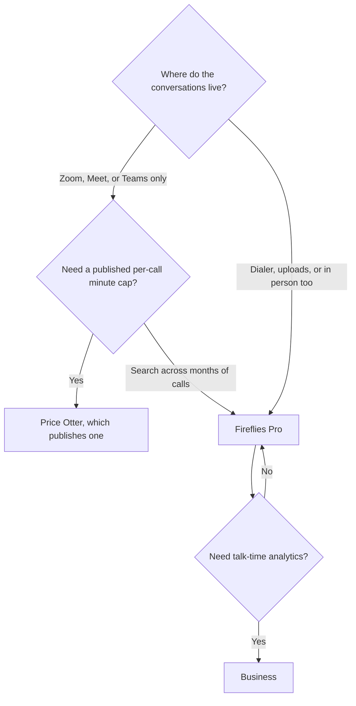

**[Fireflies.ai](/tools/fireflies-ai/) records meetings, dialer calls, uploads, and in-person audio, then lets you search them or ask Fred.** Pro is $10 per user per month billed annually, or $18 month to month. Business is $19 annually or $29 monthly. Enterprise is $39 per user per month billed annually. Free exists, and Fireflies Talk dictation is included on every plan, including Free.

Prices come from Fireflies' pricing article in its knowledge base, recorded October 16, 2026, in US dollars. The live checkout can add tax or show a different currency. We did not measure transcript word-error rates, and we did not score AskFred against a test set of questions.

For the wider field, use [best AI meeting notetakers](/blog/best-ai-meeting-notetakers/). Otter's minute caps are spelled out in the [Otter.ai review](/blog/otter-ai-review-2026/). A bot-free notepad is the [Granola review](/blog/granola-review-2026/).

## What the invoice actually changes

| Plan | Annual | Monthly | Why a team moves here |
|---|---|---|---|
| Free | $0 | $0 | Try the notetaker. Fireflies Talk dictation is included |
| Pro | $10/user | $18/user | The first paid seat. Search and summaries across calls |
| Business | $19/user | $29/user | Conversation analytics, the tier Fireflies aims at teams |
| Enterprise | $39/user | Not listed as a monthly rate in the article we used | Admin and security beyond Business |

Pro on annual billing is $120 a user per year. The same Pro seat on monthly billing is $216 a year. Business annual is $228 a user. Business monthly is $348 a year. That gap is the decision for anyone who already knows they will keep the seat. It is arithmetic on the list price, not a discount code.

Fireflies' public pricing summary is thinner on "minutes per conversation" than Otter's. If a hard per-call cap is the thing you must know before you buy, Otter publishes it and Fireflies' article we used does not. Buy Fireflies when the archive and the channel mix matter more than that cap.

## What Fred is doing

You invite fred@fireflies.ai or let the notetaker follow the calendar. It transcribes with speakers, writes notes and action items, and keeps the recording searchable down to a sentence and a timestamp. AskFred answers questions across meetings and returns the line it used.

Channels Fireflies documents:

- Zoom, Google Meet, and Microsoft Teams.
- Dialers such as Aircall and RingCentral.
- Uploaded MP3, MP4, WAV, and M4A files.
- In-person audio from the mobile app.

Live Assist offers suggestions during the call. Conversation analytics, including talk time and participation, is the Business reason. Fireflies Talk is separate: unlimited dictation in the desktop app, on every plan.

Transcription languages in the product materials include English, Spanish, French, and others, with automatic language switching between meetings. A multilingual team should run one real call in each language before a yearly invoice. This review did not.

## A rollout that stays small

1. Put Fireflies on one recurring internal meeting. Tell attendees a notetaker is present. Consent rules differ by country and by company.
2. Ask Fred one question you already know the answer to. If the citation is the wrong sentence, the archive is still useful and the assistant needs a human check.
3. If sales calls live in a dialer, connect that dialer before you judge the tool on Zoom alone.
4. If the team wants talk-time trends, price Business. If they want search and summaries, price Pro annual against Pro monthly using the $120 versus $216 figures above.
5. If the room will not accept a bot, switch to [Granola](/tools/granola/). If you want video clips as the main artifact, look at [tl;dv](/tools/tl-dv/).

## Fit score

| Need | Free | Pro | Business |
|---|---|---|---|
| See a summary after one meeting | Try it | Strong | Strong |
| Search months of calls | Limited by the free tier's practical use | Strong | Strong |
| Transcribe a dialer call | Confirm on the live plan | Documented for the product | Documented for the product |
| Talk-time analytics | No | Partial | The tier built for it |
| Dictation while you type | Yes, Talk | Yes | Yes |
| No visible bot | No | No | No |

Labels follow Fireflies' published plan story. They are not quality scores.

## FAQ

### Is Fireflies free?

Yes. There is a free plan, and Fireflies Talk dictation is included on it.

### How much does Fireflies Pro cost?

$10 per user per month billed annually, or $18 billed monthly. Business is $19 or $29 on those same billing cycles. Enterprise is $39 per user per month billed annually.

### Which apps can it join?

Zoom, Google Meet, Microsoft Teams, supported dialers, file upload, and the mobile app for in-person conversations.

### What is AskFred?

Fred is the assistant. You can ask what was decided and get an answer tied to a sentence and a timestamp. Check the answer before you paste it into a customer email.

## Last verified

October 16, 2026.

**Sources:** [Fireflies pricing plans](https://guide.fireflies.ai/articles/3734844560-learn-about-the-fireflies-pricing-plans), [Fireflies.ai](https://fireflies.ai).

[Fireflies](/tools/fireflies-ai/) is in the [meetings directory](/tools/category/meetings-transcription/). Directory pages may use affiliate links. A purchase through them can earn us a commission at no extra cost to you.
