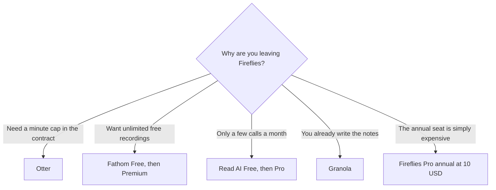

**Leave Fireflies for Otter when you need a published minute cap. Leave it for Fathom when unlimited recordings on a free plan matter more than Fireflies' archive habits. Stay when the seat you already configured is the one the team will actually open.** A second notetaker in the same call is not a backup. It is two bots and a guest list that got worse.

Fireflies' invoice is [Fireflies pricing explained](/blog/fireflies-pricing-explained-2026/). The three-way with the two closest substitutes is [Otter vs Fireflies vs Fathom](/blog/otter-vs-fireflies-vs-fathom-2026/). The wider shelf is [best AI meeting notetakers](/blog/best-ai-meeting-notetakers/). How to use the notes after the call is [how to summarize meetings with AI](/blog/how-to-summarize-meetings-with-ai-2026/).

Prices are US list prices excluding tax. Fireflies figures are from its knowledge-base article recorded October 16, 2026. Otter is from the same date. Fathom's annual prices match the October 24 pricing page cited in the Fireflies explainer. Published October 24, 2026. We did not score transcript accuracy.

## The five seats

| Tool | Free | First paid step | The reason to pick it over Fireflies |
|---|---|---|---|
| [Fireflies](/tools/fireflies-ai/) | $0, Talk dictation included | Pro $10/user/month annual, or $18 monthly | You are not leaving. Search across calls is the Pro job |
| [Otter](/tools/otter-ai/) | 300 minutes/user/month, 30 minutes per conversation | Pro $16.99/user monthly, or $8.33 billed annually, for 1,200 minutes and 90-minute conversations | You want the cap in writing |
| [Fathom](/tools/fathom/) | Unlimited recordings, transcripts, and instant summaries | Premium $16/month annual, or $20 monthly | The free archive is the product |
| [Read AI](/tools/read-ai/) | 5 meeting transcripts a month | Pro $15/user annual, or $19.75 monthly, for unlimited transcripts | A small free taste, then a flat unlimited transcript seat |
| [Granola](/tools/granola/) | Basic, 30 days of note history | Business $14/user/month for unlimited history | You take the notes. The bot is not the point |

## What you give up when you leave

**Fireflies Pro annual is $120 a year per user. Monthly is $216.** That $96 gap is the first thing to fix. People shop alternatives because they are on the monthly toggle. Business is $19 annual or $29 monthly. Enterprise is $39 annual, with no monthly rate in the article we used. Talk dictation is on every plan, including Free. The pricing article does not publish Otter-style minute caps. If a procurement form requires a cap, Otter is the clearer public number. If it requires an archive across Zoom, Meet, Teams, dialers, and uploads, read Fireflies' channel list before you assume the alternative matches it.

**Otter Basic** stops at 300 minutes and 30 minutes per conversation. Pro at $8.33 annual is 1,200 minutes and 90 minutes per conversation. Business at $19.99 annual is unlimited meetings and 4 hours per conversation, with a workspace cap of 25 billed users on the recorded card. Pro workspaces cap at 5 billed users. The invoice is [Otter.ai pricing explained](/blog/otter-ai-pricing-explained-2026/). A promotion was visible on the October 16 check. Checkout can differ.

**Fathom Free** is the unusual one: unlimited recordings and transcripts. Premium at $16 annual adds advanced summaries and AI action items. Team is $15 per user annual with a two-user minimum. Business at $25 per user annual is the CRM field-sync tier. The invoice is [Fathom pricing explained](/blog/fathom-pricing-explained-2026/). If Fireflies was in the call only to store a transcript, Fathom Free may retire the $10 seat. If the team lives in AskFred across months of calls, test that question on Fathom before you cancel. A different bot will not import the habit.

**Read AI Free** is five transcripts. That is a pilot, not a team plan. Pro at $15 annual is the unlimited-transcript step, with 100 file-upload credits. Enterprise at $22.50 annual adds playback and video highlights. Use Read when five calls will tell you whether anyone opens the email. Use Fathom when the pilot would have needed a sixth call.

**Granola** does not try to be a silent archive of every call. Business at $14 is unlimited history and integrations. Basic keeps 30 days. The pair with Fathom is [Granola vs Fathom](/blog/granola-vs-fathom-2026/). The Granola card is [Granola pricing explained](/blog/granola-pricing-explained-2026/). Choose it when a person is in the notes and wants them cleaned up. Do not choose it to satisfy a "record every sales call" policy.

## One bot, and a place the notes go

Tell the room the meeting is recorded. Keep one notetaker. Put the decisions in the tracker the team already opens. A transcript that never becomes an owner and a date is a storage bill. The writing step after a product conversation is [how to use AI for user interview notes](/blog/how-to-use-ai-for-user-interview-notes-2026/). A support team that wants the call and the ticket is [best AI tools for support teams](/blog/best-ai-tools-for-support-teams-2026/).

This page stays in USD. One meeting tool in the directory displayed prices in another currency on the day it was checked. Those figures are not converted here, and they are not a reason to pick a tool.

## FAQ

### What is the cheapest Fireflies alternative that still records every meeting?

Fathom Free, on the plan recorded here: unlimited recordings and transcripts. Premium at $16 annual is the step for advanced summaries. Otter Free will stop you at 300 minutes. Read AI Free will stop you at five transcripts.

### Is Otter cheaper than Fireflies?

Otter Pro annual is $8.33 against Fireflies Pro annual at $10. Otter's cap is the point of the switch, not the $1.67. Fireflies monthly at $18 is the expensive version of Fireflies. Fix the toggle before you migrate a workspace.

### Can I replace Fireflies with ChatGPT?

You can paste a transcript you already have into [ChatGPT](/tools/chatgpt/) Plus at $20. Plus does not join the call. The notetaker and the chat are different products. Pasting is [how to summarize meetings with AI](/blog/how-to-summarize-meetings-with-ai-2026/).

### Does Granola join Zoom?

The recorded Granola card is notes, history, and integrations, not a claim that it is a drop-in Fireflies bot. Read the current join behavior before you uninstall the bot the team relies on. If you need a bot in the lobby, Fathom, Otter, or Fireflies is the category.

## Last verified

October 16, 2026 for Fireflies, Otter, and Read AI list prices. October 24, 2026 for Fathom's annual figures as cited from Fathom's pricing page in the Fireflies pricing article, and for Granola Business at $14 as used across the Granola articles. Published October 24, 2026.

**Sources:** [Fireflies pricing](https://guide.fireflies.ai/articles/3734844560-learn-about-the-fireflies-pricing-plans), [Otter pricing](https://otter.ai/pricing), [Fathom pricing](https://www.fathom.ai/pricing).

*Published by Andrew for [AI Tools Optimizer](https://aitoolsoptimizer.com).*

[Fireflies](/tools/fireflies-ai/), [Otter](/tools/otter-ai/), and [Fathom](/tools/fathom/) are in the [meetings directory](/tools/category/meetings-transcription/). Directory pages may use affiliate links. A purchase through them may earn us a commission at no extra cost to you.
