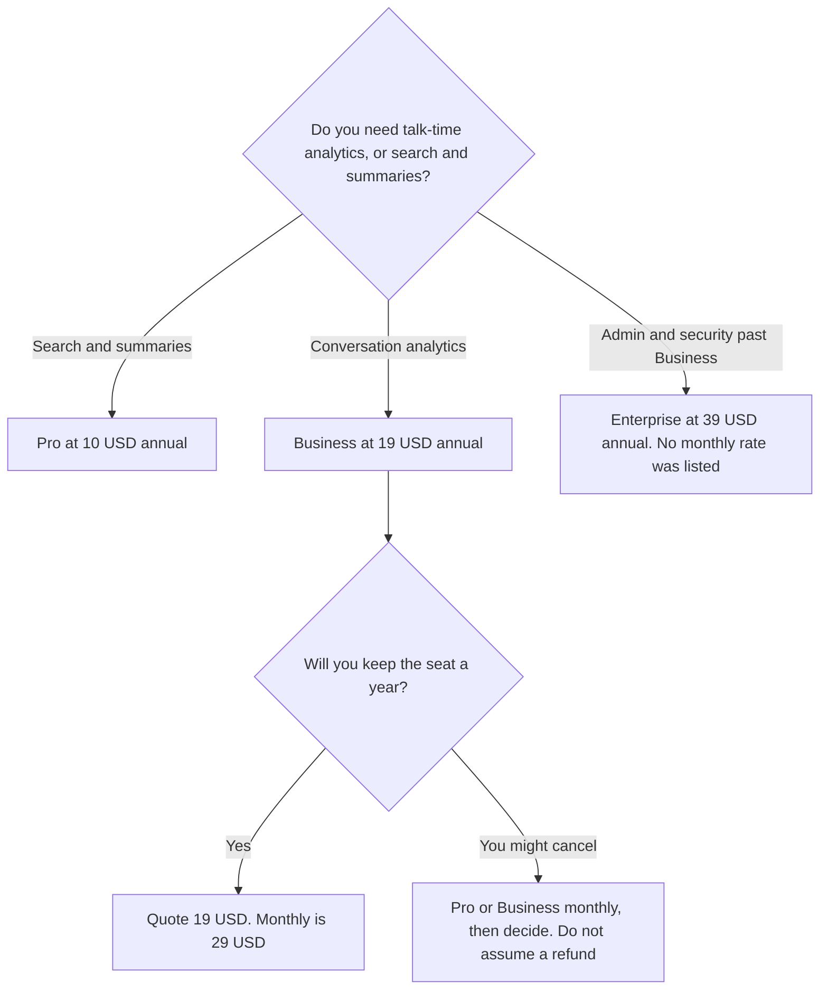

**Fireflies Business is $19 per user per month billed annually, or $29 per user per month billed monthly.** The step up from Pro, on the knowledge-base article recorded October 16, 2026, is conversation analytics for a team. Pro is $10 annually or $18 monthly, for search and summaries. Enterprise is $39 per user per month billed annually. That article does not list an Enterprise monthly rate, so this page does not invent one. The full ladder, including Free and Fireflies Talk, is [Fireflies pricing explained](/blog/fireflies-pricing-explained-2026/). This page is the Business seat.

The product story is [Fireflies.ai review](/blog/fireflies-ai-review-2026/). A CRM-field seat on a different notetaker is [Fathom Business pricing explained](/blog/fathom-business-pricing-explained-2026/). The three-way is [Otter vs Fireflies vs Fathom](/blog/otter-vs-fireflies-vs-fathom-2026/).

Figures are US dollars from Fireflies' pricing article in its knowledge base, recorded October 16, 2026, excluding the tax your checkout may add. Published October 24, 2026. We did not score talk time or search. The directory card says analytics track speaker talk time and participation, and that the best analytics require Business. This page does not add a metric the card does not name.

## What you cross Pro to get

| Plan | Annual | Monthly | A year of one seat, at the list | Why it is or is not Business |
|---|---|---|---|---|
| Pro, for contrast | $10 a user | $18 a user | $120 annual, or $216 if you stay monthly | Search and summaries. Not the analytics tier |
| Business | $19 a user | $29 a user | $228 annual, or $348 monthly | Conversation analytics, the tier aimed at teams |
| Enterprise | $39 a user | Not listed as a monthly rate in the article we used | $468 at the annual list | Admin and security beyond Business. No monthly dollar here |

One Business seat on annual billing is 12 times $19, which is $228 a year. The same seat on monthly billing is 12 times $29, which is $348 a year. The gap is $120 a year for one person. Ten users on Business annual are 10 times $228, which is $2,280 a year. Ten users on Business monthly are 10 times $348, which is $3,480 a year. The gap at ten seats is $1,200 a year. That is the annual toggle. It is not a feature difference.

Pro monthly against Pro annual is the base article's comparison: $216 versus $120. Stay on Pro if you do not need the analytics tier. Buying Business to "get transcription" pays for a layer the free plan and Pro already sit under. Fireflies Talk dictation is included on every plan, including Free, on the October 16 card.

## Seats people confuse with this one

**The analytics seat.** [Fireflies](/tools/fireflies-ai/) Business is the row this page prices. AskFred and the archive are not exclusive to Business on the card we used. The reason to move is conversation analytics. If your admin console shows a different split, the console wins, and you should not quote this table as the feature gate.

**CRM fields, on Fathom.** [Fathom](/tools/fathom/) Business is $25 per user annually or $34 monthly, with a two-user minimum, for CRM field sync and Deal View. Fireflies Business does not publish that two-user minimum in the article we used. Do not copy Fathom's minimum onto this invoice.

**A minute cap, on Otter.** [Otter](/tools/otter-ai/) Business is $19.99 annually or $30 monthly. The Fireflies article we used does not publish Otter's 4-hour conversation cap or a 25-user workspace cap. If finance needs a hard per-call cap in writing, Otter still has the clearer public number. The invoice is [Otter Business pricing explained](/blog/otter-business-pricing-explained-2026/).

**A no-bot notebook.** [Granola](/tools/granola/) Business is $14 per user per month, on the page read October 24, 2026. That is not a Fireflies discount. The invoice is [Granola pricing explained](/blog/granola-pricing-explained-2026/).

## What not to assume

Do not quote Enterprise as $29 times a larger team. Enterprise has its own annual list, $39, and no monthly rate in the article we used. Do not describe Pro's search as Business analytics. Do not convert a non-USD checkout into these dollars. The annual price is the discount. A monthly seat is the same Business product at a higher list.

## FAQ

### How much is Fireflies Business if we pay month to month?

$29 per user per month, against $19 per user per month billed annually, on the October 16 article. One seat is $348 a year monthly, or $228 a year annual. The article does not list a monthly Enterprise price. Do not invent one by scaling $29.

### What does Business add over Pro?

Conversation analytics, described on the directory card as speaker talk time and participation, on the tier aimed at teams. Pro is the search-and-summaries seat at $10 annual or $18 monthly. If a feature you need is not named on your quote, ask Fireflies which SKU includes it. This page does not add features the card does not list.

### Is there a two-user minimum?

Not in the Fireflies pricing article we used. Fathom Team and Fathom Business require two users. Fireflies Business, as recorded, is a per-user price without that minimum. A one-person analytics seat is still a Business question if analytics are the reason. It is not automatically a Pro seat.

### Does this page replace the main Fireflies pricing article?

No. That article is Free, Pro, Business, Enterprise, and the annual gap. This article is the Business row: the ten-seat arithmetic, what Pro already covers, and what not to copy from Fathom's minimum or from Enterprise's $39.

## Last verified

October 16, 2026, from Fireflies' pricing article in its knowledge base, as recorded on the directory card and in the base pricing article. Published October 24, 2026.

**Sources:** [Fireflies pricing plans](https://guide.fireflies.ai/articles/3734844560-learn-about-the-fireflies-pricing-plans), [Fireflies.ai](https://fireflies.ai).

*Published by Andrew for [AI Tools Optimizer](https://aitoolsoptimizer.com).*

[Fireflies](/tools/fireflies-ai/) is in the [meetings directory](/tools/category/meetings-transcription/). Directory pages may use affiliate links. A purchase through them may earn us a commission at no extra cost to you.
