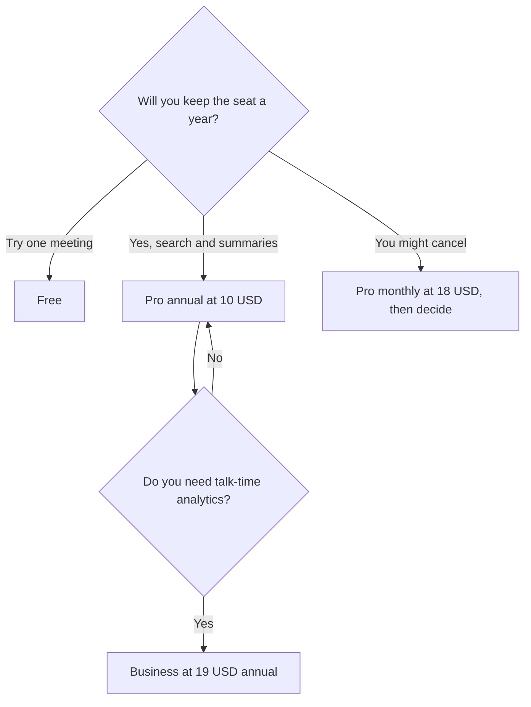

**Fireflies pricing is a per-user seat, and the annual toggle is the whole discount.** Pro is $10 per user per month billed annually, or $18 month to month. Business is $19 annually or $29 monthly. Enterprise is $39 per user per month billed annually. Free exists, and Fireflies Talk dictation is included on every plan, including Free.

Those figures come from Fireflies' pricing article in its knowledge base, recorded October 16, 2026, in US dollars excluding the tax your checkout may add. This explainer is published October 24, 2026. The product story is [Fireflies.ai review](/blog/fireflies-ai-review-2026/). Otter's minute caps, which this price list does not mirror, are [Otter.ai pricing explained](/blog/otter-ai-pricing-explained-2026/).

## The four lines

| Plan | Annual | Monthly | A year of one seat, at the list | What you crossed a paywall to get |
|---|---|---|---|---|
| Free | $0 | $0 | $0 | The notetaker, plus Fireflies Talk dictation |
| Pro | $10/user | $18/user | $120 annual, or $216 if you stay monthly | Search and summaries across calls |
| Business | $19/user | $29/user | $228 annual, or $348 monthly | Conversation analytics, the tier aimed at teams |
| Enterprise | $39/user | Not listed as a monthly rate in the article we used | $468 at the annual list | Admin and security beyond Business |

Pro monthly is $96 more per user per year than Pro annual, because $18 times 12 is $216 and $10 times 12 is $120. Business monthly is $120 more per user per year than Business annual ($348 versus $228). That gap is the decision once you know the team will keep the bot. It is arithmetic on the list price.

## What the article we used does not price

**A per-conversation minute cap.** [Otter](/tools/otter-ai/) publishes 30, 90, and 240 minutes. The Fireflies pricing article recorded on October 16 does not. If finance needs a hard per-call cap in writing, Otter still has the clearer public number. Buy Fireflies when the archive and the channel mix matter more than that cap. The field comparison is [Otter vs Fireflies vs Fathom](/blog/otter-vs-fireflies-vs-fathom-2026/).

**A separate AskFred SKU.** Fred is the assistant on the product: questions across meetings, answered with a sentence and a timestamp. The plans above are the seats. There is no second "Fred add-on" in the article we used. Check a citation before you paste it into a customer email. A confident sentence can still point at the wrong line. That failure mode is [what an AI hallucination is](/blog/what-is-ai-hallucination-2026/).

**Storage beyond the channels.** Documented channels are Zoom, Google Meet, Microsoft Teams, dialers such as Aircall and RingCentral, uploads (MP3, MP4, WAV, M4A), and in-person audio from the mobile app. A CRM writeback is a different product decision. [Fathom](/tools/fathom/) Business, at $25 per user per month billed annually on the October 24 pricing page, is the plan in this set that lists CRM field sync. The Fathom invoice is [Fathom pricing explained](/blog/fathom-pricing-explained-2026/).

## A 10-person bill

Ten people on Pro annual is $100 a month, or $1,200 a year. The same ten on Pro monthly is $180 a month, or $2,160 a year. Ten on Business annual is $190 a month. Ten on Enterprise annual is $390 a month.

Invite the people whose calls should be searchable. A contractor who attends one meeting does not automatically need a paid seat for the year. Check Fireflies' guest and viewer rules in your workspace before you treat that as a license shortcut. It is a prompt to look.

Fireflies Talk, the desktop dictation feature, is included on Free. Do not buy Pro to unlock dictation. Buy Pro when search across calls is the job. Buy Business when talk time and participation trends are the job. Buy Enterprise when admin and security reviews require the $39 tier. If the room will not accept a bot, the no-bot notepad is [Granola](/tools/granola/) at $14 per user per month for Business. The review is [Granola review](/blog/granola-review-2026/).

## FAQ

### How much does Fireflies cost per user?

Pro is $10 a month billed annually or $18 month to month. Business is $19 or $29 on those cycles. Enterprise is $39 a month billed annually. Free is $0, and Talk dictation is on it.

### Is annual billing required?

No. Monthly Pro and Business exist at the higher list prices above. Enterprise, in the article we used, is quoted as an annual per-user price. Annual is the discount, once you intend to keep the seat.

### Does Pro include conversation analytics?

The Business tier is the one Fireflies aims at teams that want talk-time and participation analytics. Pro is the search-and-summary seat. Read the live plan card if a feature you need is named on a screenshot from a different year.

### Are there hidden minute overages?

The pricing article we used prices seats, not a published per-minute overage. That is different from Otter, which prices a minute pool. Confirm any fair-use line in the current terms before you record an all-day workshop.

## Last verified

October 16, 2026, from Fireflies' pricing article. Published October 24, 2026. Fathom's CRM price in the comparison was read October 24, 2026.

**Sources:** [Fireflies pricing plans](https://guide.fireflies.ai/articles/3734844560-learn-about-the-fireflies-pricing-plans), [Fireflies.ai](https://fireflies.ai).

*Published by Andrew for [AI Tools Optimizer](https://aitoolsoptimizer.com).*

[Fireflies](/tools/fireflies-ai/) is in the [meetings directory](/tools/category/meetings-transcription/). Directory pages may use affiliate links. A purchase through them may earn us a commission at no extra cost to you.
