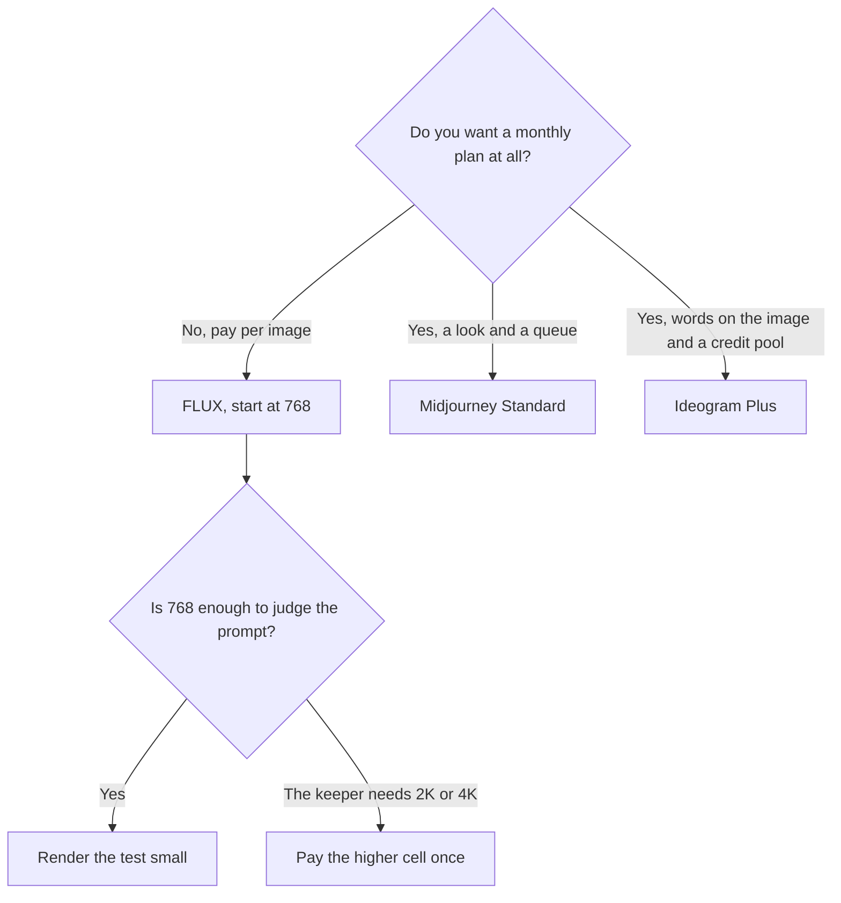

**FLUX pricing is pay as you go. There is no seat.** One credit is $0.01. FLUX 3 Klein images on the directory card cost $0.008 at 768×768, $0.009 at 1K, $0.011 at 1.5K, $0.014 at 2K, and $0.036 at 4K. The API and the playground use the same prices. You pay for the image you rendered, including the ones you throw away.

The product page is [FLUX review](/blog/flux-review-2026/). The subscription neighbors are [Midjourney vs Leonardo vs FLUX](/blog/midjourney-vs-leonardo-vs-flux-2026/). The credit-pool neighbors are [FLUX vs Ideogram vs Firefly](/blog/flux-vs-ideogram-vs-firefly-2026/).

Prices are US list prices from Black Forest Labs' pricing page and docs, checked October 16, 2026. Published October 24, 2026. We did not score images. Other models have their own rates. The default model in the public calculator showed $0.048 an image at that check. Use the button, not this paragraph, for a model this table does not name.

## The meter

| What you generate | Price on the October 16 card | What it is not |
|---|---|---|
| FLUX 3 Klein at 768×768 | $0.008 | A monthly minimum |
| FLUX 3 Klein at 1K | $0.009 | A seat |
| FLUX 3 Klein at 1.5K | $0.011 | A Firefly credit |
| FLUX 3 Klein at 2K | $0.014 | A Midjourney Fast hour |
| FLUX 3 Klein at 4K | $0.036 | The price of every FLUX model |
| Anything else, including video | The card for that endpoint | A number this page should invent |

Video is billed per second, and a FLUX Video Upscale endpoint is priced per output megapixel-second. The directory does not print those dollar rates in the table this article is willing to stretch. FLUX 3 can generate video with synchronized audio, up to 20-second clips. Read the per-second price in the docs before you multiply a clip. Do not multiply $0.008 by frames.

Enterprise is custom pricing, volume discounts, and SLAs. Open-weight models can be downloaded and run on hardware you operate. The license is part of the price. A weight file you are not allowed to ship is not a savings. The definition of running your own file, as opposed to calling the API, sits next to [what open-source AI is](/blog/what-is-open-source-ai-2026/).

## How the arithmetic works

One credit is $0.01, so a $0.008 image is a fraction of a credit. Do not round it up to a cent in a budget and also do not pretend the thrown-away images were free. Two hundred 768×768 keepers are $1.60. Two hundred 4K keepers are $7.20. The failures you discarded cost the same cell. The product-photo workflow that uses this math is [how to generate product photos with AI](/blog/how-to-generate-product-photos-with-ai-2026/).

A pile of images that can wait is still this price list, unless a batch mode on the current card says otherwise. This directory page does not record a FLUX batch discount. The general idea, so you do not borrow someone else's half-off line, is [what batch inference is](/blog/what-is-ai-batch-inference-2026/).

Prototype at the small size. Re-render the keeper. A prompt that is wrong at 768 is wrong at 4K, and the 4K cell is 4.5 times the 768 cell ($0.036 / $0.008).

## FLUX next to a subscription

[Krea](/tools/krea/) is a compute-unit switchboard that can run several models, including ones in this family. Free is 100 units a day. Basic is $9 a month, or $5 billed yearly. Paid plans include a commercial license. If you wanted a canvas and a daily free allowance, start there and read [Krea pricing explained](/blog/krea-pricing-explained-2026/).

[Leonardo](/tools/leonardo-ai/) Essential is $12 a month for 8,500 fast tokens. Premium is $30. You buy Leonardo when you want a token pool, a relaxed mode, or personal models. The card is [Leonardo pricing explained](/blog/leonardo-ai-pricing-explained-2026/).

[Ideogram](/tools/ideogram/) Plus is $15 a month billed yearly for 2,400 credits, and Free exists. Text on the image is the reason to pay that seat instead of a fraction of a cent. The card is [Ideogram pricing explained](/blog/ideogram-pricing-explained-2026/).

[Midjourney](/tools/midjourney/) Basic is $10 a month and there is no free plan. You are buying a look and Fast hours, not an API credit. The clock is [Midjourney pricing explained](/blog/midjourney-pricing-explained-2026/).

[Adobe Firefly](/tools/adobe-firefly/) Standard is $9.99 for unlimited standard images and a credit pool for premium work. Buy Firefly when the commercial story and the Adobe apps are the point. The card is [Adobe Firefly pricing explained](/blog/adobe-firefly-pricing-explained-2026/).

None of those credits equals a FLUX credit. FLUX's credit is $0.01. Theirs are plan currencies.

## FAQ

### Is FLUX free?

There is no subscription. Generations are paid per use. Some models are released as open weights you can run yourself, subject to the license. The playground still charges the same prices as the API.

### Why is 768×768 not one cent?

The card says $0.008. One credit is $0.01. The image is cheaper than one credit. Your account still has to have credits to spend. Buy a small amount, run the prompt, then scale.

### Does the $0.048 figure replace the Klein table?

No. The directory says the default model in the public calculator showed $0.048 an image, and that other models have their own rates. Klein's table is the Klein table. Name the model in the budget.

### Is self-hosting cheaper?

It can be, after hardware, power, and the license. It is not a $0.008 image. It is a machine you operate. Check the open-weight terms before you ship a product on them.

## Last verified

October 16, 2026 for the Klein table, the $0.01 credit, the $0.048 calculator note, and the Krea, Leonardo, Ideogram, Midjourney, and Firefly prices named above. Published October 24, 2026.

**Sources:** [Black Forest Labs pricing](https://bfl.ai/pricing), [FLUX API pricing](https://docs.bfl.ai/quick_start/pricing), [Ideogram plans](https://docs.ideogram.ai/plans-and-billing/available-plans).

*Published by Andrew for [AI Tools Optimizer](https://aitoolsoptimizer.com).*

[FLUX](/tools/flux/) is in the [image generation directory](/tools/category/image-generation/). Directory pages may use affiliate links. A purchase through them may earn us a commission at no extra cost to you.
