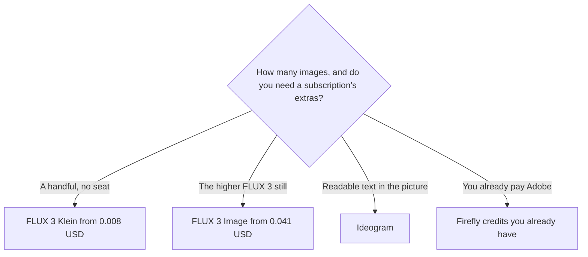

**[FLUX](/tools/flux/) is Black Forest Labs' image and video model family, sold as pay-as-you-go.** There is no seat fee on the API. One credit is $0.01, and the docs say the API and the playground use the same price. FLUX 3 Image Klein starts at $0.008 for a 768×768 image. FLUX 3 Image, the higher tier on the same page, starts at $0.041.

Those image rates are the structured prices on [bfl.ai/pricing](https://bfl.ai/pricing), read October 24, 2026. The credit unit is from Black Forest Labs' pricing docs, read the same day. The on-page calculator showed $0.048 for one image at its default, which matches the FLUX 3 Image 1K rate, not the Klein rate. We did not score image quality. The shelf is [best AI image generators](/blog/best-ai-image-generators-2026/).

## Image rates, per picture

| Output | FLUX 3 Image Klein | FLUX 3 Image |
|---|---|---|
| 768×768 | $0.008 | $0.041 |
| 1K | $0.009 | $0.048 |
| 1.5K | $0.011 | $0.070 |
| 2K | $0.014 | $0.100 |
| 4K | $0.036 | $0.607 |

Sixty Klein images at 768×768 are 60 × $0.008 = $0.48. Sixty FLUX 3 Image files at 4K are 60 × $0.607 = $36.42. The model name is the whole bill. "FLUX" on a screenshot is not a price.

Video is a different meter. The same pricing data lists FLUX 3 text-to-video or image-to-video at standard effort from $0.15 a second at HD, $0.24 at FHD, $0.28 at QHD, and $0.41 at UHD. Draft HD text-to-video is listed at $0.06 a second. Upscale has a per-megapixel-second rate. Use the calculator for a clip. Do not multiply the still rate by frames.

## What pay-as-you-go leaves out

There is no monthly bundle of editing tools, private folders, or a brand kit in the API price. You pay for the generation. Open-weights licensing is a separate section on the pricing page, with Builder, Platform, Professional, and Enterprise cards. Those cards list image caps and user counts. They do not list a public dollar price. If you need to ship Klein on your own infrastructure, that is a sales conversation, not the $0.008 rate.

[Ideogram](/tools/ideogram/) is the subscription when the words in the image have to be spelled correctly. Plus is $15 a month on the yearly plan, in the [Ideogram review](/blog/ideogram-review-2026/). [Adobe Firefly](/tools/adobe-firefly/) is the path when the file has to stay inside Adobe and the training-data claim matters. The Firefly review is [Adobe Firefly review](/blog/adobe-firefly-review-2026/). [Midjourney](/tools/midjourney/) is the paid artistic default in the image guide. FLUX is the path when you want a receipt per image and you will not use a subscription's extra tools.

Commercial terms depend on the model and the license you buy. Open weights are not the same as the hosted API. Read the license for the weights before you put a self-hosted model in a product. The $0.008 price does not answer that question.

## Who should pay

**Use Klein** for volume where a fraction of a cent per still is the point. **Use FLUX 3 Image** when you have looked at the 4K rate and still want that tier. **Use the calculator** before a video job. **Skip FLUX** if you wanted a monthly design app. That is Ideogram, Firefly, or [Canva](/tools/canva/).

## FAQ

### Does FLUX have a subscription?

Not for the hosted API. Black Forest Labs sells pay-as-you-go credits. One credit is $0.01. Licensing open weights is a separate, custom-priced section.

### How much is one image?

FLUX 3 Image Klein is $0.008 at 768×768 and $0.036 at 4K. FLUX 3 Image is $0.041 at 768×768 and $0.607 at 4K. The calculator's default $0.048 matches the FLUX 3 Image 1K rate.

### Is video the same price?

No. Video is billed per second, and the rate depends on resolution and effort. HD standard text-to-video is listed at $0.15 a second.

## Last verified

October 24, 2026, from bfl.ai/pricing and the Black Forest Labs pricing docs. Rates are per delivered output. Recheck the calculator when you change model or resolution.

**Sources:** [FLUX pricing](https://bfl.ai/pricing), [Black Forest Labs pricing docs](https://docs.bfl.ai/quick_start/pricing).

[FLUX](/tools/flux/) is in the [image generation directory](/tools/category/image-generation/). Directory pages may use affiliate links. A purchase through them may earn us a commission at no extra cost to you.
