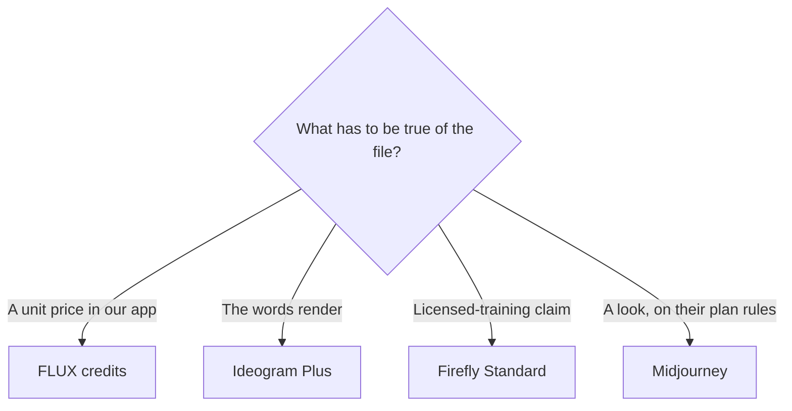

**Choose FLUX when you want a receipt per image and no seat. Choose Ideogram when the words in the picture are the job. Choose Adobe Firefly when the brief includes a licensed-training claim and the file should live near Adobe's other apps.** These three are not a style contest. Midjourney is the look subscription, and it already has a comparison against Leonardo and FLUX: [Midjourney vs Leonardo vs FLUX](/blog/midjourney-vs-leonardo-vs-flux-2026/). This page is the commercial path among the API, the text tool, and Firefly.

Prices are US list prices excluding tax. FLUX and Firefly figures were recorded October 16, 2026. Ideogram's prices were re-read October 24, 2026 for the Ideogram review. We did not score spelling accuracy or photorealism. Open each vendor's current terms before you ship a client file. A directory summary is not the license.

## The commercial job

| Job | Lean toward | What you can point at | First price |
|---|---|---|---|
| Images inside your product, priced per call | [FLUX](/tools/flux/) | Pay as you go. One credit is $0.01. API and playground share a price | FLUX 3 Klein from $0.008 at 768×768 to $0.036 at 4K |
| A poster, ad, or thumbnail where the words must be legible | [Ideogram](/tools/ideogram/) | The product is built around text in images. Plus adds private generation | Plus is $20/month, or $15/month on a $180 year, with 2,400 credits |
| A still you may need to describe as generated on a model trained on licensed and public-domain content | [Adobe Firefly](/tools/adobe-firefly/) | Adobe states that training stance for Firefly models. Paid plans include unlimited standard images | Standard $9.99/month, 2,000 credits for premium features |
| Client work in a multi-model app, with a license line on the paid plan | [Krea](/tools/krea/) | Paid plans include a commercial license | Basic $9/month or $5 yearly. Pro is $35 or $21 yearly |
| A stylized look, and you accept Midjourney's plan rules | [Midjourney](/tools/midjourney/) | Subscribers may use outputs under Midjourney's terms. Companies over $1,000,000 gross annual revenue need Pro or Mega | Standard $30/month, or $24 annual |

The wider shelf is [best AI image generators](/blog/best-ai-image-generators-2026/). If the thing you want to leave is Midjourney's subscription shape, the tour is [Midjourney alternatives](/blog/midjourney-alternatives-2026/). Reviews: [FLUX review](/blog/flux-review-2026/), [Ideogram review](/blog/ideogram-review-2026/), [Adobe Firefly review](/blog/adobe-firefly-review-2026/).

## What each bill buys

| | FLUX | Ideogram | Firefly |
|---|---|---|---|
| How you pay | Credits. No seat | Subscription by credits, plus a free weekly allowance | Subscription. Standard images on paid plans do not spend credits |
| Entry | $0.008 and up per FLUX 3 Klein image | Free: 30 credits a week with a Google, Apple, or Microsoft sign-in. Email-and-password accounts do not get that allowance | Free: limited daily generations |
| The plan people actually use | Keep paying per image | Plus, $15/month yearly, private generations, 2,400 credits | Standard, $9.99, 2,000 premium credits |
| Next step | A higher resolution or a different model. FLUX 3 Image, the higher tier, starts at $0.041 on the review | Pro, $60/month or $42 yearly, 7,500 credits | Pro, $19.99, 4,000 credits, plus Photoshop on web and mobile and Express Premium |
| Privacy | You are calling an API or a playground. Open weights are a separate license | Free generations are public. Plus and above keep new images private until you publish them | Your Adobe account. Read the plan's sharing defaults |
| Commercial wording we recorded | API use is the product. Check open-weight licenses before you self-host for commercial work | We do not have a separate commercial-license sentence in the recorded pages. Read the current terms | Commercially usable for features without a beta label. Beta outputs are not indemnified for eligible business customers |
| Video | Priced per second. The page we used does not turn that into one flat clip price | Not the reason to buy it | 20 credits a second at 540p, 50 at 720p, 100 at 1080p |

Ideogram Plus, Pro, and Team can keep generating with Ideogram models in a slower queue after monthly credits run out. Custom models, partner models, reference images, edits, and upscales still spend credits. Unused monthly credits do not roll over.

Firefly credits also do not roll over. A 1080p video second at 100 credits spends Standard's 2,000-credit pool in 20 seconds. Unlimited standard images are the reason to buy Standard. Video is a different budget. Pro Plus is $49.99 with 10,000 credits. Premium is $199.99 with 50,000.

FLUX video and the default calculator rate of $0.048 on some models are easy to underbudget if you only remember the $0.008 Klein still. Price the model and the resolution you will actually call.

## Three commercial months

These are list-price sketches, not a quality test.

- **Two hundred packshots through an API, 1K Klein stills.** FLUX at $0.009 is $1.80. At the $0.036 4K rate it is $7.20. A Firefly seat is $9.99 whether you make 20 or 200 standard images, and the licensed-training sentence is what the seat is for. Ideogram Plus is $15 on the yearly price and is the wrong meter if the words do not matter.
- **A campaign of posters with the product name spelled out.** Ideogram Plus. Generate on a paid plan so the images are private. Firefly if brand counsel wants Adobe's training stance more than Ideogram's text reputation. FLUX if engineering owns the pipeline and a person will check every word.
- **A designer who already lives in Photoshop and needs stills, not a developer.** Firefly Pro at $19.99, because the seat includes Photoshop on the web and mobile and Express Premium. The image review and the credit math are the Firefly review linked above.

Krea is the app if you want several of these models behind one commercial license on a paid plan, at $5 a month on Basic yearly. It is not a replacement for reading Firefly's indemnity note or FLUX's open-weight license. [Canva](/tools/canva/) Pro at $18 a month or $180 a year is where the still becomes a post. The layout is not the generator.

Product shots have an extra check: the label must match the real product. The sequence is [how to generate product photos with AI](/blog/how-to-generate-product-photos-with-ai-2026/). None of these tools grant a trademark or a person's likeness.

## What to read before the client file

- Firefly: the plan, whether the feature is labeled beta, and the credits FAQ if the deliverable is video.
- Ideogram: the current terms on commercial use, because our recorded pages document privacy and credits and do not give us a license clause to reprint.
- FLUX: the API terms for hosted calls, and the specific open-weight license if you download a model. Those are different permissions.
- Midjourney, if it returns to the shortlist: the revenue threshold and Stealth. Basic and Standard do not include Stealth.

## FAQ

### Which is cheapest for commercial stills?

For a handful of API images, FLUX, because there is no seat. For a month of standard stills inside Adobe's terms, Firefly Standard at $9.99 is a flat fee and includes unlimited standard images. Ideogram Plus at $15 yearly is the cheap seat when privacy and text are the requirements. Cheapest is the meter that matches the job, after the license fits.

### Can I use Ideogram images commercially?

Read the current terms on the plan you buy. This directory records that Free images are public and Plus images are private. It does not record a commercial-license sentence we should pretend to quote. Krea's paid plans and Firefly's help pages do have commercial wording we could cite. Ideogram's absence from that sentence is a reason to open the terms, not a reason to assume the answer is no.

### Is Firefly's model trained on customer prompts?

The claim we are using is the one Adobe publishes about training on licensed content such as Adobe Stock and on public-domain content. Training on your prompts is a different question. Read the current privacy and training settings in the account. Do not treat this article as that policy.

### Does FLUX include a subscription with unlimited images?

No. You buy credits. One credit is $0.01. Some teams self-host open weights. That path is a license plus infrastructure, not a free copy of the API.

## Last verified

October 16, 2026 for FLUX and Firefly prices, Firefly's training stance as recorded on the tool page, and the video credit rates. October 24, 2026 for Ideogram's plan prices in the linked review. Published October 24, 2026.

**Sources:** [Black Forest Labs pricing](https://bfl.ai/pricing), [FLUX API pricing](https://docs.bfl.ai/quick_start/pricing), [Ideogram plans](https://ideogram.ai/pricing), [Adobe Firefly plans](https://www.adobe.com/products/firefly/plans.html), [Generative credits FAQ](https://helpx.adobe.com/creative-cloud/apps/generative-ai/generative-credits-faq.html).

[FLUX](/tools/flux/), [Ideogram](/tools/ideogram/), and [Adobe Firefly](/tools/adobe-firefly/) are in the [image generation directory](/tools/category/image-generation/). Directory pages may use affiliate links. A purchase through them may earn us a commission at no extra cost to you.
