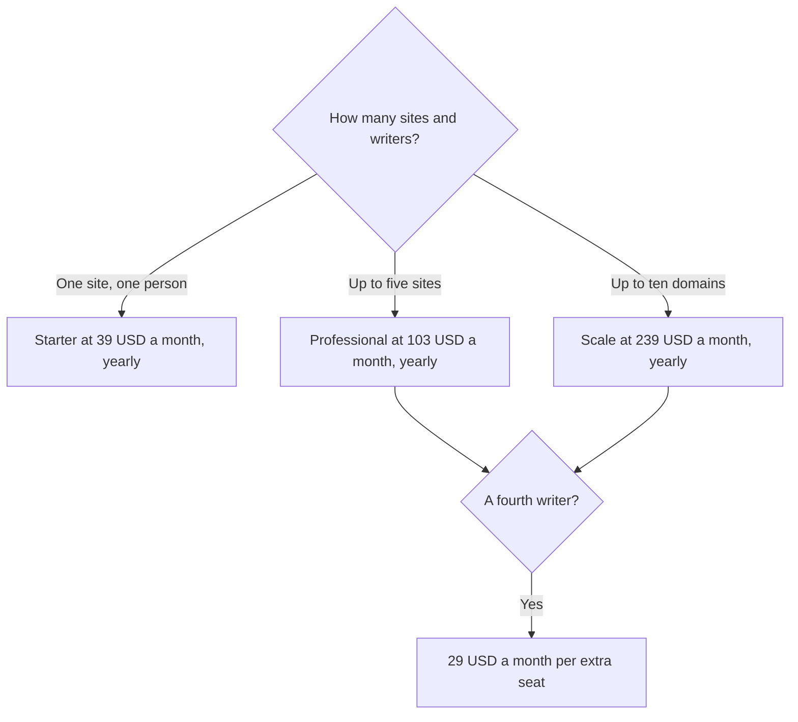

**Frase Starter is $39 a month billed yearly, or $49 month to month, for one seat, one site, 10 articles, and 50 audit pages a month.** Professional is $103 a month yearly, or $129 monthly, for three seats and five sites. Scale is $239 yearly, or $299 monthly. There is no permanent free plan. A 7-day trial needs no credit card, on the card.

The product page is [Frase review](/blog/frase-review-2026/). The editor comparison is [Surfer SEO vs Frase](/blog/surfer-seo-vs-frase-2026/). Surfer's own ladder is [Surfer SEO pricing explained](/blog/surfer-seo-pricing-explained-2026/).

Prices are US dollars before tax, from Frase's pricing page as recorded in the directory on October 16, 2026. Published October 24, 2026. We did not score articles or rankings.

## The tiers

| Plan | Yearly, per month | Monthly | Seats / sites | Monthly limits on the card |
|---|---|---|---|---|
| Starter | $39 | $49 | 1 / 1 | 10 articles, 50 audit pages |
| Professional | $103 | $129 | 3 / 5 | 40 articles, 250 audit pages |
| Scale | $239 | $299 | 5 / 10 | 100 articles, 1,000 audit pages |
| Enterprise | Custom | Custom | Custom | White-label reports and a client portal |

A year of Starter on the yearly rate is 12 × $39 = $468. Month-to-month for a year is 12 × $49 = $588. The $120 gap is the toggle. Professional yearly is 12 × $103 = $1,236. Scale yearly is 12 × $239 = $2,868.

Extra seats are $29 a month on Professional and Scale. A fourth seat on Professional is $29, not a new Professional plan. Three seats are already inside Professional. Do not buy a second subscription to add a person.

## What the limits mean

**Articles and audit pages** are the meter, next to seats and sites. Starter's 10 articles a month is a small blog or a careful agency test. Professional's 40 articles is a team that publishes most weeks. Scale's 100 is a production line. If you do not know the count, stay on the trial week and tally a real month before you pick Scale.

**AI visibility** tracks mentions in ChatGPT and Google AI on every plan. Perplexity is added on Professional. Claude and Gemini are added on Scale. Professional also adds AI crawler monitoring. Content Guard watches pages for ranking decay: 10 pages on Starter, 75 on Professional, and 300 on Scale. Buy the tier whose monitoring list matches the engines you report on. Do not buy Scale only because the name sounds larger.

**Enterprise** is the custom tier for white-label reports and a client portal. The card does not print a dollar. An agency that needs its own brand on the report should ask for that quote instead of assuming Scale includes it.

## The neighbors

[Surfer SEO](/tools/surfer-seo/) Standard is $99 a month billed yearly for 360 documents. That is a higher entry than Frase Starter and a different meter. If the team lives in an optimizer with a content score, read Surfer's card. If the team wants articles, audits, and a visibility list at $39, start with Frase.

[Semrush](/tools/semrush/) SEO is $139 a month, or $117.33 billed annually. It is the keyword and competitor suite. Frase does not include that dataset. The explainer is [Semrush pricing explained](/blog/semrush-pricing-explained-2026/).

A draft can still happen in [ChatGPT](/tools/chatgpt/) Plus at $20, then get filed in Frase or in the CMS. The brief workflow is [how to build a content brief with AI](/blog/how-to-build-a-content-brief-with-ai-2026/). The page the team keeps is [Notion AI](/tools/notion-ai/) Business at $20 a seat, if the calendar lives there. The shelf is [best AI SEO tools](/blog/best-ai-seo-tools-2026/).

## Who should pay

Pay for Starter when one person runs one site and 10 articles a month is honest. Pay for Professional when a second or third person needs a seat, or you report on Perplexity as well as ChatGPT and Google AI. Pay for Scale when the article count or the Claude and Gemini tracking is the requirement. Use the 7-day trial to count articles. Do not start on Scale because the trial felt busy.

## FAQ

### Is $39 the price if I pay monthly?

No. $39 is the yearly rate, billed as that monthly equivalent. Month-to-month Starter is $49. Say which one is on the purchase order.

### Does Starter include three seats?

No. Three seats are Professional. Starter is one seat and one site. Extra seats at $29 are listed for Professional and Scale.

### Is the trial a free plan?

It is seven days, with no credit card, on the card. It ends. There is no ongoing free tier in the table this site recorded.

### Will Frase make the page rank?

The card describes a workflow: topics, drafts, publishing, and monitoring. A subscription is not a ranking. The page still needs a source you trust and a person who ships it. The fact check is [how to fact-check AI writing](/blog/how-to-fact-check-ai-writing-2026/).

## Last verified

October 16, 2026 for Frase, Surfer, Semrush, ChatGPT, and Notion prices named above. Enterprise has no public dollar on the card. Published October 24, 2026.

**Sources:** [Frase pricing](https://www.frase.io/pricing), [Surfer pricing](https://get.surferseo.com/surfer-pricing), [Semrush pricing](https://www.semrush.com/pricing/).

*Published by Andrew for [AI Tools Optimizer](https://aitoolsoptimizer.com).*

[Frase](/tools/frase/) is in the [marketing and SEO directory](/tools/category/marketing-seo/). Directory pages may use affiliate links. A purchase through them may earn us a commission at no extra cost to you.
