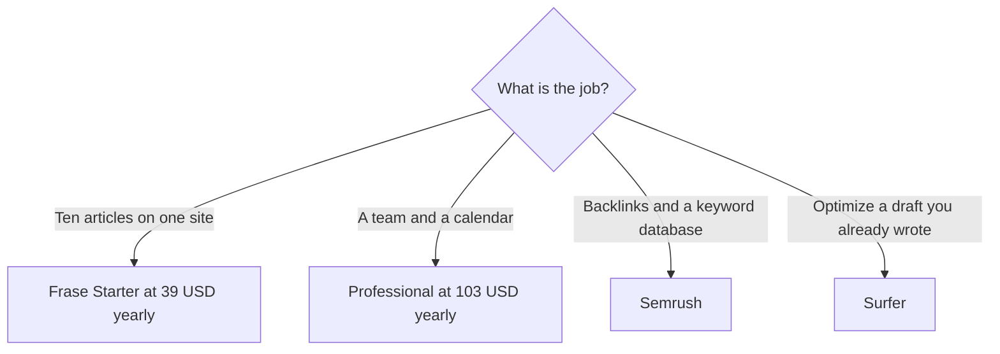

**[Frase](/tools/frase/) is a content system: find topics, draft, publish, and watch pages and AI answers.** Starter is $49 a month, or $39 a month billed yearly, for one seat, one site, and 10 articles a month. It does not promise a ranking. Frase's own pricing page says rankings and AI citations are the slow part, and that a trial will not make you rank.

Those prices were read from frase.io/pricing on October 24, 2026. The page says prices are in USD. There is a 7-day trial and no permanent free content plan. FraseCMS hosting has a separate free tier. We did not measure rankings. The category comparison is [best AI SEO tools](/blog/best-ai-seo-tools-2026/).

## The content plans

| Plan | Monthly | Yearly, per month | Seats / sites | Monthly caps |
|---|---|---|---|---|
| Starter | $49 | $39 | 1 / 1 | 10 articles, 50 audit pages, 25 AI generations. Content Guard watches 10 pages |
| Professional | $129 | $103 | 3 / 5 | 40 articles, 250 audit pages. Extra seats $29. Perplexity added to AI Visibility |
| Scale | $299 | $239 | 5 / 10 | 100 articles, 1,000 audit pages. Claude and Gemini added. Exportable client reports |
| Enterprise | Custom | Custom | Custom | White-label reports, a client portal, SSO |

Yearly billing is the price Frase leads with. The page says it is about 20% off the monthly rate. Starter holds at its cap, so there is no overage bill. Professional and Scale can turn on pay-as-you-go, off by default. If you turn it on, Professional lists $5 per extra article, $0.50 per extra audit page, and $0.25 per extra AI prompt. Scale lists $4, $0.40, and $0.20. Leave it off unless you mean to pay.

AI Visibility tracks ChatGPT and Google AI on every plan, adds Perplexity on Professional, and adds Claude and Gemini on Scale. It monitors. It does not edit the page. Content Guard proposes a fix and republishes when you approve.

## What you are not buying

Frase publishes to WordPress, Webflow, Sanity, Wix, or FraseCMS. FraseCMS is included at 100,000 page views a month. Basic hosting is $19 a month on top, for 250,000 page views and no badge. Pro hosting is $99 a month for a million page views. That add-on is not inside the $39. A page view, in Frase's FAQ, counts when a page is served to a reader or pulled through the API.

[Semrush](/tools/semrush/) is the buy when you need a competitive dataset. The [Semrush review](/blog/semrush-review-2026/) is the price for that. [Surfer SEO](/tools/surfer-seo/) is the buy when the article already exists and you want it optimized. The [Surfer review](/blog/surfer-seo-review-2026/) covers that seat. [Writesonic](/tools/writesonic/) has moved toward AI-answer tracking across more engines. Overlapping visibility tools are how a content budget doubles. Pick one tracker.

The 7-day trial, per the FAQ, uses Professional's features with tight caps: 5 articles, 50 audit pages, 25 AI prompts, up to 3 seats, and no credit card. Use it on a page you already have. Do not use it as evidence that you will rank.

## Who should pay

**Pay for Starter yearly** if you will publish inside 10 articles a month on one site and you want the loop in one tool. **Pay for Professional** when you need a calendar, more than one site, or the Perplexity row. **Pay for Scale** when client reports and 10 domains are the job. **Skip Frase** if you need backlink research. **Skip the pay-as-you-go switch** until a month actually hits the cap.

## FAQ

### How much does Frase cost?

Starter is $49 a month or $39 a month billed yearly. Professional is $129 or $103. Scale is $299 or $239. Enterprise is custom. Extra seats on Professional and Scale are $29 a month.

### Is there a free plan?

There is a 7-day trial of the content product, with no credit card. FraseCMS hosting includes a free allowance of 100,000 page views a month. That is not a free article plan.

### Will Frase rank my site in a week?

Frase's pricing page says no tool ranks you inside a trial, and that Frase will not pretend otherwise. The trial shows drafts and gaps. Rankings and citations come later, if they come.

## Last verified

October 24, 2026, from Frase's pricing page. Overage rates apply only if you enable pay-as-you-go. Recheck them before you flip that switch.

**Sources:** [Frase pricing](https://www.frase.io/pricing), [Frase](https://www.frase.io).

[Frase](/tools/frase/) is in the [marketing and SEO directory](/tools/category/marketing-seo/). Directory pages may use affiliate links. A purchase through them may earn us a commission at no extra cost to you.
