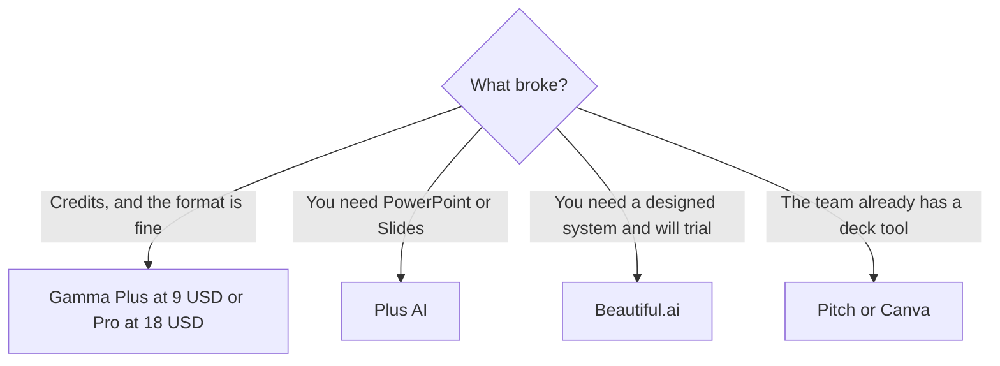

**Leave Gamma for Beautiful.ai when a designed deck is the product and you can live without a free plan. Leave it for Plus AI when the slides should be generated inside PowerPoint or Google Slides. Leave it for Pitch or Canva when the team already builds there and AI is the extra, not the file format.** Gamma's own next step is usually a higher credit tier, not a new vendor.

Gamma's credits are [Gamma pricing explained](/blog/gamma-pricing-explained-2026/). The three-way with the two closest generators is [Gamma vs Beautiful.ai vs Plus AI](/blog/gamma-vs-beautiful-ai-vs-plus-ai-2026/). Canva's format is [Gamma vs Canva presentations](/blog/gamma-vs-canva-presentations/). The shelf is [best AI presentation makers](/blog/best-ai-presentation-makers/). How to get the story right before any of them is [how to create a pitch deck with AI](/blog/how-to-create-a-pitch-deck-with-ai-2026/).

Prices are US list prices excluding tax from directory pages checked October 16, 2026. Published October 24, 2026. We did not score slide design.

## Where to go

| You need | Start here | Price to know | Gamma still wins if |
|---|---|---|---|
| Another generator, no free plan, a tight visual system | [Beautiful.ai](/tools/beautiful-ai/) | Pro $14.50/month billed annually, or $45 monthly. 14-day trial | You still want a $0 test and a link share |
| Generation inside the slide file you already send | [Plus AI](/tools/plus-ai/) | Basic $10/user/month billed annually, or $15 monthly, for 1,500 credits. 7-day trial | You want Gamma's card format, not a PPT add-in |
| A real presentation tool with a free team | [Pitch](/tools/pitch/) | Free for up to 5 members. Plus is $10/seat/month billed yearly for 500 AI credits | The outline-to-cards flow is the whole job |
| Templates, resize, and a brand kit you have | [Canva](/tools/canva/) | Pro $18/month or $180/year for one person | You do not want to rebuild the deck in a design suite |
| A diagram from a paragraph, not a deck | [Napkin AI](/tools/napkin-ai/) | Plus $9/person/month for 10,000 credits | You needed slides, not a visual |

## The prices next to Gamma's ladder

Gamma Free holds a non-refreshing balance, up to 2,000 credits. Plus is $9 a seat a month, or $108 a year, with 1,000 credits a month. Pro is $18 a seat, or $216 a year, with 4,000 credits and API access. Ultra is $90 a seat, monthly only, with 20,000 credits and the full image-model list. Connectors are on every plan. The API starts at Pro. Do not buy Ultra to unlock an API key.

Recorded credit sketch, not a meter reading: about 1–3 credits to generate a card, and about 2–125 for an image depending on the model. Edit the outline before you regenerate cards. That is the cheapest fix, and it is still Gamma.

**Beautiful.ai** has no free plan. Pro annual at $14.50 is the individual seat. Monthly at $45 is the "cancel after the project" seat, and it is a harsh one. Team is $40 per user billed annually, or $50 monthly, for 2–20 people. Students with a .edu address were offered a free year on the recorded page. The invoice is [Beautiful.ai pricing explained](/blog/beautiful-ai-pricing-explained-2026/). Choose it when Gamma's cards look like a doc and the room expects a designed deck. Budget the trial. Fourteen days is the evaluation, not a library of client work.

**Plus AI** Basic is $10 annual for 1,500 credits. Pro is $20 annual for 3,000. Team is $30 annual for 6,000. Max is $200 annual for unlimited credits. The 7-day trial includes 1,000 credits. This is the alternative when the deliverable is a PowerPoint or a Google Slides file and Gamma's export is the complaint. It is a poor trade if you wanted a hosted link and a card stack.

**Pitch** Free is a real team tool: up to five members, unlimited presentations, 100 one-time AI credits. Plus at $10 a seat yearly adds 500 AI credits a month and PPTX export. You are buying a presentation product that has AI credits, not an AI product that happens to export. If the team will still design by hand, Pitch Free is enough and Gamma was the wrong category.

**Canva** Free is the template library with limited AI. Pro at $18, or $180 a year, is one person, premium assets, and a higher AI allowance. Business is $25 a person monthly or $250 a year. Magic Studio's place next to a design tool is [Figma AI vs Canva Magic Studio](/blog/figma-ai-vs-canva-magic-studio-2026/). Use Canva when the deck is one artifact in a kit of posts and one-pagers. Use Gamma when the artifact is the generated narrative.

**Napkin** is the sideways alternative. Plus at $9 exports visuals. It does not replace a ten-card pitch. Use it when a paragraph should become a diagram you drop into whichever deck tool you kept.

## Write the story before you switch vendors

A new slide tool will not invent the round size, the retention number, or the ask. Draft those in [Claude](/tools/claude/) or [ChatGPT](/tools/chatgpt/) from a memo you wrote, then generate. Claude Pro is $20, or $17 billed annually. ChatGPT Plus is $20. The sequence is [how to create a pitch deck with AI](/blog/how-to-create-a-pitch-deck-with-ai-2026/). Regenerating cards to discover the story is how Gamma credits disappear, and the same mistake will follow you to Plus AI.

## FAQ

### What is the closest Gamma alternative?

Plus AI, if the file has to be PowerPoint or Google Slides. Beautiful.ai, if you want another designed generator and you will use the trial because there is no free plan. Pitch, if you wanted a presentation tool more than a generator.

### Is Canva cheaper than Gamma?

Canva Pro is $18 a month, or $180 a year, for one person. Gamma Plus is $9 a seat, or $108 a year. Canva is the broader design suite. Gamma is the cheaper seat if cards are the only job. They are not substitutes line by line.

### Should I buy Gamma Ultra instead of switching?

Ultra at $90 is the image-model and credit pool. Switch vendors if the format is wrong. Buy Ultra only if premium images are the line item eating Pro's 4,000 credits. Pro at $18 already includes the API.

### Is there a free alternative?

Gamma Free, while the balance lasts. Pitch Free for a team of up to five, with 100 one-time AI credits. Canva Free for templates. Beautiful.ai and Plus AI are trials, not free plans.

## Last verified

October 16, 2026 for Gamma, Beautiful.ai, Plus AI, Pitch, Canva, Napkin, Claude, and ChatGPT list prices. Published October 24, 2026.

**Sources:** [Gamma pricing](https://gamma.app/pricing), [Beautiful.ai pricing](https://www.beautiful.ai/pricing), [Plus AI pricing](https://plusai.com/pricing/), [Pitch pricing](https://pitch.com/pricing).

*Published by Andrew for [AI Tools Optimizer](https://aitoolsoptimizer.com).*

[Gamma](/tools/gamma/) and [Beautiful.ai](/tools/beautiful-ai/) are in the [presentations directory](/tools/category/presentations/). Directory pages may use affiliate links. A purchase through them may earn us a commission at no extra cost to you.
