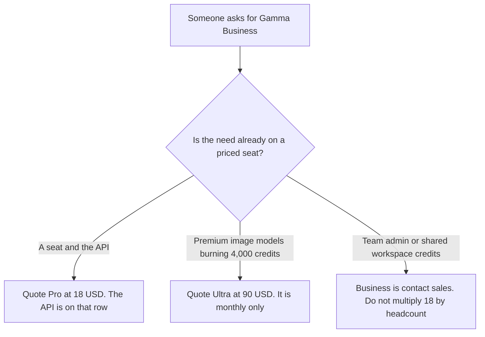

**Gamma Business and Enterprise are "Contact Gamma" on the directory card checked October 16, 2026.** That row lists shared workspace credits and team admin. It does not list a seat price, a credit total, or a minimum. Plus is $9 a seat a month, or $108 a year, with 1,000 credits. Pro is $18 a seat a month, or $216 a year, with 4,000 credits and API access. Ultra is $90 a seat a month, monthly only, with 20,000 credits. The full ladder is [Gamma pricing explained](/blog/gamma-pricing-explained-2026/). This page is the Business name.

A native-slide contract with no printed dollar is [Plus AI Enterprise pricing explained](/blog/plus-ai-enterprise-pricing-explained-2026/). The product page is [Gamma review](/blog/gamma-review-2026/). A sales-deck choice against Plus AI is [Gamma vs Plus AI for sales decks](/blog/gamma-vs-plus-ai-for-sales-decks-2026/).

The Plus, Pro, and Ultra dollars below are US list prices from that October 16 card. A live fetch of gamma.app/pricing timed out on October 24, 2026, so this page adds no new price and does not treat the timeout as a change in the card. Published October 24, 2026. We did not score decks. We did not receive a Business quote.

## What the October 16 card separates

| Plan | Price on the October 16 card | What you may quote as Business |
|---|---|---|
| Plus, for contrast | $9 a seat a month, or $108 a year. 1,000 credits | Removes the free-plan limits. Not team admin |
| Pro, for contrast | $18 a seat a month, or $216 a year. 4,000 credits | Advanced AI and API access. The API is not a Business-only key |
| Ultra, for contrast | $90 a seat a month, monthly only. 20,000 credits | All image models, on that card. An individual pool, not a company contract |
| Teams | Not printed | The card names Teams as an API-key plan, next to Pro, Ultra, and Business. No Teams dollar |
| Business / Enterprise | Contact Gamma | Shared workspace credits and team admin. The card does not split a Business price from an Enterprise price |

The same card says API keys are available on Pro, Ultra, Teams, and Business, and that connectors work on every plan. Buying Business to get an API key pays for a row Pro already lists, unless you also need the team admin or the shared workspace credits the Business row names. The card does not say how large that shared pool is. This page does not invent a number.

Teams is a name in the API sentence. It is not a row with a price. Do not average Pro and Ultra and call the result Teams. Do not treat Teams and Business as one invoice because they appear in the same sentence.

Ultra at $90 is the image-model plan after Pro's 4,000 credits are actually gone. The base article's point stands: do not buy Ultra to get an API key. This page adds the other direction. Do not buy Business to get Ultra's image models. The Business row we read does not say "all image models." It says shared workspace credits and team admin.

Free credits do not refresh. You can hold up to 2,000, and referrals can add more. That balance is not a Business trial.

## What a neighboring invoice does, and does not, tell you

**A slide file with a printed Team price.** [Plus AI](/tools/plus-ai/) Team is $30 a user a month billed annually, or $40 monthly, with custom branding, on the October 24 pricing page read for the enterprise article. Plus AI Enterprise, for custom templates from your slide masters, has no dollar there. That is a different file. Gamma's cards are not a PowerPoint master. The base Plus AI ladder is [Plus AI pricing explained](/blog/plus-ai-pricing-explained-2026/).

**A published Pro seat in another deck tool.** [Beautiful.ai](/tools/beautiful-ai/) Pro is $14.50 a month billed annually on the October 16 record used in the Gamma pricing article. That dollar is not a Gamma Business price. The invoice is [Beautiful.ai pricing explained](/blog/beautiful-ai-pricing-explained-2026/).

**A collaborative slide seat.** [Pitch](/tools/pitch/) Plus is $10 a seat a month billed yearly on that same Gamma article. It does not include Gamma's shared workspace credits. The invoice is [Pitch pricing explained](/blog/pitch-pricing-explained-2026/).

## What not to assume

Do not print a Gamma Business or Enterprise price. Do not print a Teams price. Do not treat Ultra at $90 as the company plan. Do not multiply Pro at $18 by headcount and call it Business. Do not convert a non-USD checkout into $18. The quotes above are the US list on the October 16 card.

## FAQ

### How much is Gamma Business?

The October 16 card says contact Gamma. There is no seat price and no credit total on the Business / Enterprise row we have. Plus at $9, Pro at $18, and Ultra at $90 are the published dollars. A quote you receive is the price. This page will not round it.

### Does Business include the API?

The card says API keys are on Pro, Ultra, Teams, and Business. Pro at $18 already lists API access. Business is the row for shared workspace credits and team admin. If those are not the need, Pro is the API seat the card already prices.

### What is Gamma Teams?

A name on the API-key sentence of the October 16 card. The priced table does not give Teams a dollar. Until Gamma prints one, or a quote arrives, this page leaves Teams unpriced.

### Does this page replace the main Gamma pricing article?

No. That article is Free through Ultra, and what a credit spends. This article is the company question: the admin row the card does not price, and the API you can already buy on Pro.

## Last verified

October 16, 2026, from the directory record of Gamma's pricing page, help center, and API docs. A fetch of gamma.app/pricing timed out on October 24, 2026. Published October 24, 2026. No Business quote was received.

**Sources:** [Gamma pricing](https://gamma.app/pricing), [Gamma API access](https://developers.gamma.app/get-started/access-and-pricing).

*Published by Andrew for [AI Tools Optimizer](https://aitoolsoptimizer.com).*

[Gamma](/tools/gamma/) is in the [presentations directory](/tools/category/presentations/). Directory pages may use affiliate links. A purchase through them may earn us a commission at no extra cost to you.
