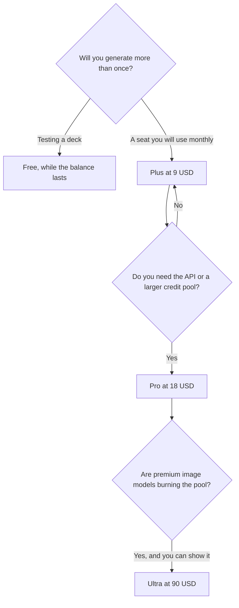

**Gamma pricing is a per-seat plan plus a monthly credit allowance, except on Free, where the credits do not refresh.** Plus is $9 a seat a month, or $108 a year, with 1,000 credits. Pro is $18 a seat a month, or $216 a year, with 4,000 credits and API access. Ultra is $90 a seat a month, monthly only, with 20,000 credits.

Prices are US list prices excluding tax, from Gamma's pricing page, help center, and API docs as recorded in this directory on October 16, 2026. This explainer is published October 24, 2026. The product review is [Gamma review](/blog/gamma-review-2026/). The format choice against the other two deck tools is [Gamma vs Beautiful.ai vs Plus AI](/blog/gamma-vs-beautiful-ai-vs-plus-ai-2026/).

## The ladder

| Plan | Price | Monthly credits | What changes |
|---|---|---|---|
| Free | $0 | Non-refreshing. You can hold up to 2,000, and referrals can add more | A real generation test, not a weekly allowance |
| Plus | $9/seat/month, or $108/year | 1,000 | Removes the free-plan limits |
| Pro | $18/seat/month, or $216/year | 4,000 | Advanced AI and API access |
| Ultra | $90/seat/month, monthly only | 20,000 | All image models |
| Business / Enterprise | Contact Gamma | Shared workspace credits | Team admin |

Connectors work on every plan. API keys are on Pro, Ultra, Teams, and Business. Do not buy Ultra to get an API key. Pro already has it.

## How the credits spend

Gamma's help material, as recorded on the directory page, prices creating with AI at about 1–3 credits a card. Images cost about 2–125 credits depending on the model. The page says Gamma uses plan credits first, then purchased credits, then workspace credits, and that AI errors are not charged.

A sketch, using those ranges, not a meter reading from an account:

| Deck | Rough credit spend | Fits in Plus (1,000)? | Fits in Pro (4,000)? |
|---|---|---|---|
| 10 cards, no generated images | about 10–30 | Yes | Yes |
| 10 cards plus 10 inexpensive images at 2 credits | about 30–50 | Yes | Yes |
| 10 cards plus 10 images at the top of the 125-credit range | about 1,260–1,280 | No | Yes, one deck, with room unless you repeat it |

The 125-credit image is the line that surprises people. A text-only deck on Plus is inexpensive. A deck that calls the most expensive image model on every card is a Pro or Ultra problem. The run button is the receipt. These rows are arithmetic on the published range.

## Who should buy which seat

**Someone making one deck to see the format.** Free. Stop when the balance is gone, or refer if you want more credits. Do not expect the balance to refill next Monday.

**A founder or consultant shipping a few decks a month, mostly text and light images.** Plus at $9. Annual at $108 is the discount once the second month happens. The consultant stack around this seat is [best AI tools for consultants](/blog/best-ai-tools-for-consultants-2026/).

**A team automating decks, or anyone hitting 1,000 credits.** Pro at $18. The API is the other reason. Ultra at $90 is the image-model plan after Pro's 4,000 credits are actually gone.

**A buyer who needs native PowerPoint or Google Slides as the working file.** Price [Plus AI](/tools/plus-ai/) Basic at $10 a user a month billed annually before you force Gamma's cards into a slide master. [Beautiful.ai](/tools/beautiful-ai/) Pro is $14.50 a month billed annually and includes unlimited AI generation and PowerPoint export. Those bills are explained in [Beautiful.ai pricing explained](/blog/beautiful-ai-pricing-explained-2026/).

[Canva](/tools/canva/) Pro at $18 a month is the design suite if the job is templates and brand kits, not a generated card deck. [Pitch](/tools/pitch/) Plus at $10 a seat a month billed yearly is the collaborative slide tool with a smaller AI allowance: 500 credits a seat a month.

## FAQ

### How much is Gamma Plus?

$9 per seat per month, or $108 per seat per year, with 1,000 credits a month. Free is $0, and its credits do not refresh.

### How much is Gamma Pro?

$18 per seat per month, or $216 per seat per year, with 4,000 credits. API keys start here. Ultra is $90 per seat per month, billed monthly, with 20,000 credits.

### Do Gamma credits roll over?

Paid plans list a monthly allowance. The directory page does not promise rollover. Free credits are a balance you hold, up to 2,000, not a monthly grant. Confirm rollover in the help center if a purchase depends on it.

### Is Gamma cheaper than Beautiful.ai?

Gamma Plus at $9 is less than Beautiful.ai Pro at $14.50 on annual billing. Beautiful.ai's month-to-month Pro price is $45. Gamma meters credits. Beautiful.ai's page says generation is unlimited on paid seats. Compare the meter you will actually hit, and the file format.

## Last verified

October 16, 2026 for prices and the per-card and per-image credit ranges. Published October 24, 2026.

**Sources:** [Gamma pricing](https://gamma.app/pricing), [Gamma help center](https://help.gamma.app/en/articles/8077107-how-can-i-upgrade-my-gamma-subscription), [Gamma API access](https://developers.gamma.app/get-started/access-and-pricing).

*Published by Andrew for [AI Tools Optimizer](https://aitoolsoptimizer.com).*

[Gamma](/tools/gamma/) is in the [presentations directory](/tools/category/presentations/). Directory pages may use affiliate links. A purchase through them may earn us a commission at no extra cost to you.
