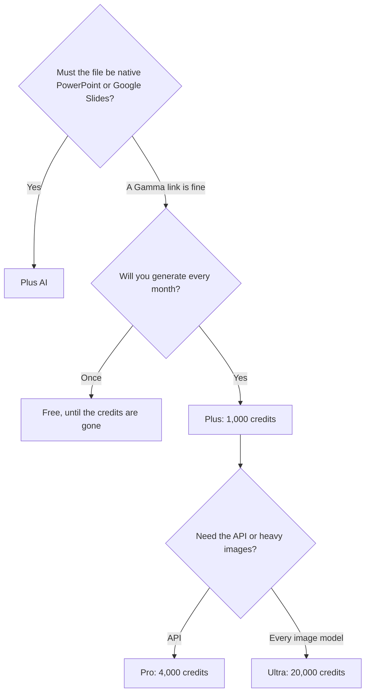

**[Gamma](/tools/gamma/) generates a presentation, a document, a web page, or a social post from a prompt, notes, or a file.** Free credits do not refresh. A free account can hold up to 2,000 credits and can earn more by referring people. Plus is $9 per seat per month, or $108 per seat per year, with 1,000 credits a month. Pro is $18 per seat per month, or $216 per seat per year, with 4,000 credits and API keys. Ultra is $90 per seat per month, monthly billing only, with 20,000 credits.

Prices are US dollars from Gamma's pricing page, help center, and API docs, recorded October 16, 2026. Local tax can change the charge. We did not score visual taste, and a Gamma "card" is not the same object as a PowerPoint slide.

The format comparison lives in [best AI presentation makers](/blog/best-ai-presentation-makers/) and [Gamma vs Canva](/blog/gamma-vs-canva-presentations/). This page is the credit budget. The layout-locked alternative is the [Beautiful.ai review](/blog/beautiful-ai-review-2026/).

## Where the credits go

Gamma's help materials put AI generation at about 1 to 3 credits per card. Images depend on the model: about 2 to 15 for standard, 20 to 33 for advanced, 34 to 75 for premium, and 30 to 125 for ultra. Rates can change. Gamma spends plan credits first, then purchased credits, then workspace credits. It says it does not charge for AI errors.

| Plan | Price | Monthly credits | The gate |
|---|---|---|---|
| Free | $0 | Do not refresh. Up to 2,000 held | A trial, plus referral credits |
| Plus | $9/seat/month, or $108/year | 1,000 | The everyday seat. Removes free-plan limits |
| Pro | $18/seat/month, or $216/year | 4,000 | Advanced AI and API keys |
| Ultra | $90/seat/month, monthly only | 20,000 | All image models |
| Business / Enterprise | Contact Gamma | Shared workspace credits | Team admin |

The credit math is [Gamma pricing explained](/blog/gamma-pricing-explained-2026/).

Plus at $9 × 12 is $108, which matches the annual figure Gamma lists. Pro at $18 × 12 is $216. On those two tiers the annual price is 12 times the monthly seat price we recorded. Ultra does not offer that annual line.

## A deck, priced from the rate card

A 12-card deck at 3 credits per card is 36 credits before images. That is a small slice of Plus's 1,000. Ten premium images at 75 credits each are 750 credits. The images, not the outline, are the bill.

Use one real deck to see your own rate:

1. Paste an outline you already believe, so you can tell if Gamma dropped a point.
2. Generate on a cheaper image setting first. Read the credit receipt.
3. Regenerate only the cards that are wrong. A full rerun spends the card cost again.
4. If you need the deck inside a client's PowerPoint template, export is a courtesy and [Plus AI](/tools/plus-ai/) is the tool that writes the native file. Plus AI Basic is $10 per user per month billed annually.
5. If you will generate decks from another system, API keys start on Pro. Connectors exist on every plan, including Free.

Gamma's cards reflow for a browser. That is a strength for a link you present from, and a mismatch for a board that expects a 16:9 file with a locked master. [Pitch](/tools/pitch/) is the closer fit when the deck is a live room. [Canva](/tools/canva/) is the closer fit when the same brand also needs posts and one-pagers. Canva Pro is $18 a month or $180 a year for one person.

## Fit score

| Job | Free | Plus $9 | Pro $18 | Ultra $90 |
|---|---|---|---|---|
| One deck while credits last | Strong | Strong | Strong | Strong |
| A deck every week | Credits run out | 1,000 credits | 4,000 credits | 20,000 credits |
| Premium or ultra images as the default | Expensive per image | Possible, watch the meter | More room | The plan that lists every image model |
| API keys | No | No | Yes | Yes |
| A native .pptx as the system of record | Poor fit on every Gamma plan | Poor fit | Poor fit | Poor fit |

Fit follows Gamma's published limits. It is not a design score.

## FAQ

### Is Gamma free?

Yes, with credits that do not refresh. Free accounts can hold up to 2,000 credits. Referring people can add more. A monthly allowance starts at Plus.

### How much does Gamma cost?

Plus is $9 per seat per month or $108 per year. Pro is $18 or $216. Ultra is $90 per seat per month with no annual price in the docs we used.

### How many credits does a slide use?

Gamma talks about cards, not slides. Generation is about 1 to 3 credits per card. Images run from a few credits to more than 100, depending on the model.

### Does Gamma have an API?

API keys are on Pro, Ultra, Teams, and Business. Connectors are on all plans.

## Last verified

October 16, 2026.

**Sources:** [Gamma pricing](https://gamma.app/pricing), [Upgrade a Gamma subscription](https://help.gamma.app/en/articles/8077107-how-can-i-upgrade-my-gamma-subscription), [Gamma API access and pricing](https://developers.gamma.app/get-started/access-and-pricing).

[Gamma](/tools/gamma/) is in the [presentations directory](/tools/category/presentations/). Directory pages may use affiliate links. A purchase through them can earn us a commission at no extra cost to you.
