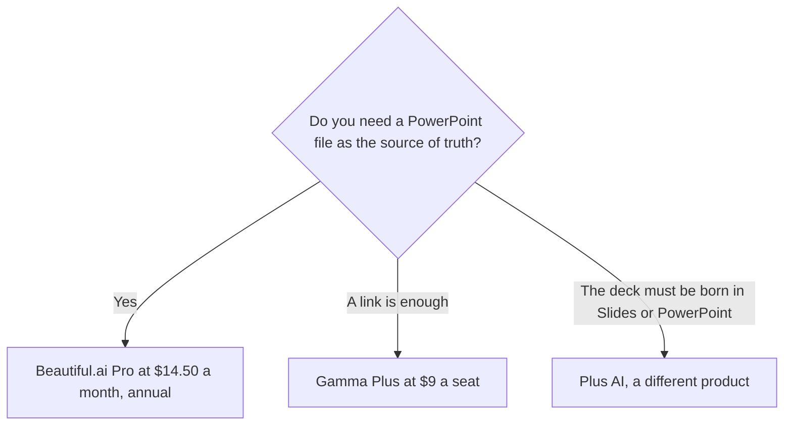

**Use Gamma when a prompt should become cards you can share as slides, a doc, or a simple site. Use Beautiful.ai when you want Smart Slide layouts, unlimited AI generation on a paid seat, and a PowerPoint file.** The three-way that includes Plus AI is [Gamma vs Beautiful.ai vs Plus AI](/blog/gamma-vs-beautiful-ai-vs-plus-ai-2026/). The other pair, Plus AI against Gamma, is [Plus AI vs Gamma](/blog/plus-ai-vs-gamma-2026/). This page stays on these two. We did not score which slides look better.

Prices are US list prices excluding tax from directory pages checked October 16, 2026. Published October 24, 2026.

## Format first, then the seat

| | [Gamma](/tools/gamma/) | [Beautiful.ai](/tools/beautiful-ai/) |
|---|---|---|
| What you get | Cards that can be slides, a doc, or a simple site | A slide deck of Smart Slide layouts |
| Free | Credits that do not refresh. You can hold up to 2,000 | No free plan. A 14-day trial. A free year for students with a valid .edu email |
| First paid seat | Plus $9 a seat a month, or $108 a year, with 1,000 credits | Pro $14.50 a month billed annually, or $45 month to month |
| The step teams mean | Pro $18 a seat a month, or $216 a year, 4,000 credits, API access | Team $40 a user a month billed annually, or $50 monthly, for 2 to 20 people |
| Above that | Ultra $90 a seat a month, 20,000 credits | Enterprise is not given a dollar on this card |
| AI meter | About 1 to 3 credits a card. Images 2 to 125, by model | Unlimited AI content generation on every paid seat |
| File out | Share and export from Gamma's format | PowerPoint import and export, PDF, viewer analytics |

Gamma Plus for a year is $108 a seat. Pro is $216 a seat. Ultra at $90 a month is 12 × $90 = $1,080 a year if you stay on the monthly card. Five Plus seats billed annually are 5 × $108 = $540 a year. That is the credit pool, not unlimited generation. The card math is [Gamma pricing explained](/blog/gamma-pricing-explained-2026/). The product page is [Gamma review](/blog/gamma-review-2026/).

Beautiful.ai Pro on the annual rate is 12 × $14.50 = $174 a year for one person. The same seat month to month is 12 × $45 = $540 a year. The monthly card is for a one-off, and it is the expensive way to stay. Two Team seats on the annual rate are 2 × $40 × 12 = $960 a year. Team is for 2 to 20 people. The ladder is [Beautiful.ai pricing explained](/blog/beautiful-ai-pricing-explained-2026/). The product page is [Beautiful.ai review](/blog/beautiful-ai-review-2026/).

## Which job fits which file

**A leave-behind you will send as a link tonight.** Gamma Plus, after the words are true. Free credits do not refresh, so do not design the only copy of a board deck on the free balance and assume it comes back. The words, before the theme, are [how to write a sales one-pager with AI](/blog/how-to-write-a-sales-one-pager-with-ai-2026/).

**A file the buyer will open in PowerPoint.** Beautiful.ai Pro. You are paying for Smart Slides and the export, and for unlimited AI generation rather than a credit meter. If you only needed one deck and you will cancel, the $45 monthly card exists. Read the renewal before you leave it on.

**You must stay inside Google Slides or PowerPoint the whole time.** That is [Plus AI](/tools/plus-ai/), not this pair. Basic is $10 a user a month billed annually. The 7-day trial includes 1,000 credits.

**A team editor with pitch rooms.** [Pitch](/tools/pitch/) is a different product: a collaborative editor, Free for up to five members, Plus at $10 a seat a month billed yearly for one member. The invoice is [Pitch pricing explained](/blog/pitch-pricing-explained-2026/). [Canva](/tools/canva/) Pro at $18 a month or $180 a year is the design-suite path when the deck is one artifact among many. The Canva pair is [Figma AI vs Canva Magic Studio](/blog/figma-ai-vs-canva-magic-studio-2026/).

A student with a valid .edu email can get a free year of Beautiful.ai, on the directory card. That is a recorded offer. It is not a Gamma credit grant. Confirm the email rule before a class depends on it.

## FAQ

### Is Gamma's $9 plan unlimited AI?

No. Plus includes 1,000 credits a month. Cards cost about 1 to 3 credits. Images cost more, by model. Beautiful.ai's paid seats include unlimited AI content generation. The unlimited line is the reason some teams pay $174 a year instead of $108.

### Which one is better for a startup demo?

The one whose file your buyer can use. If they asked for a link, Gamma. If they asked for PowerPoint, Beautiful.ai. The script of what you will click is [how to create a demo script with AI](/blog/how-to-create-a-demo-script-with-ai-2026/). Looks are not a score on this page.

### Can I import an old deck?

Beautiful.ai imports and exports PowerPoint. Gamma's directory card describes export from Gamma's own format. If the old deck is the source of truth, start on the tool that can import it.

### What about a 20-person team?

Beautiful.ai Team covers 2 to 20 at $40 a user a month billed annually. Twenty seats are 20 × $40 × 12 = $9,600 a year. Gamma Pro at $216 a seat a year for 20 seats is 20 × $216 = $4,320, with a credit cap. Compare the file format and the meter before you treat the lower total as the winner.

## Last verified

October 16, 2026 for Gamma, Beautiful.ai, Plus AI, Pitch, and Canva prices named above. Published October 24, 2026.

**Sources:** [Gamma pricing](https://gamma.app/pricing), [Beautiful.ai](https://www.beautiful.ai), [Pitch pricing](https://pitch.com/pricing).

*Published by Andrew for [AI Tools Optimizer](https://aitoolsoptimizer.com).*

[Gamma](/tools/gamma/) is in the [presentations directory](/tools/category/presentations/). Directory pages may use affiliate links. A purchase through them may earn us a commission at no extra cost to you.
