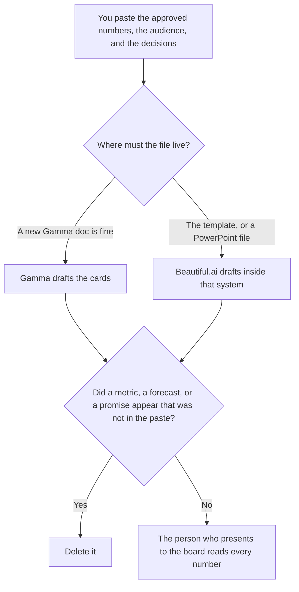

**Use Gamma when the board deck can be a new document generated from a memo the board packet already contains. Use Beautiful.ai when the deck has to stay in a template with Smart Slides, and you may need a PowerPoint file afterward.** Either tool may format numbers you pasted. Neither may invent a metric, a forecast, or a commitment the memo did not contain. A webinar deck is [Gamma vs Beautiful.ai for webinar decks](/blog/gamma-vs-beautiful-ai-for-webinar-decks-2026/). A quarterly business review, which is a customer meeting, is [Gamma vs Plus AI for QBR decks](/blog/gamma-vs-plus-ai-for-qbr-decks-2026/).

Gamma, Beautiful.ai, and Notion prices are from directory pages checked October 16, 2026. Claude's prices are from claude.com/pricing on October 24, 2026. Published October 24, 2026. We did not score slide design.

## Which board deck you are building

| The deck in front of you | Start here | First paid step | The limit |
|---|---|---|---|
| A memo that can become a new deck | [Gamma](/tools/gamma/) | Plus is $9 a seat a month, $108 a year | No number that was not in the memo |
| A template, with PowerPoint export | [Beautiful.ai](/tools/beautiful-ai/) | Pro is $14.50 a month billed annually, or $45 monthly | The layout system stays. The model fills from the paste |
| The narrative before either tool | [Claude](/tools/claude/) | Pro is $17 a month billed annually, or $20 monthly | The narrative is not the deck |
| The page where the numbers were approved | [Notion AI](/tools/notion-ai/) | Business is $20 a seat a month | Plus at $10 is not the full AI tier |

A board deck that rounds a miss into a win has edited the company. If the paste says the hire is open, the slide says the hire is open. The appendix is not a place to hide a number the memo marked draft.

Gamma Pro is $18 a seat a month, $216 a year, on the October 16 card, and that card lists API access on Pro. Ultra is $90 a seat a month, monthly only. Business is contact sales. Do not budget a Business dollar we did not record. The invoice is [Gamma pricing explained](/blog/gamma-pricing-explained-2026/).

Beautiful.ai Team is $40 a user a month billed annually, or $50 monthly, for 2 to 20 people, with shared libraries and brand controls, on the October 16 card. Enterprise is custom. Every seat on that card includes unlimited AI content generation and PowerPoint import and export. There is a 14-day trial of Pro or Team. A board deck the finance partner must edit in the company template is the Team conversation, not a solo Pro file nobody else can govern. The invoice is [Beautiful.ai pricing explained](/blog/beautiful-ai-pricing-explained-2026/).

## What each seat keeps

**Gamma Plus** is the seat when a new deck is acceptable. Keep the memo's words. A theme does not get to invent a chart series.

**Beautiful.ai Pro** is the individual template seat. The annual price and the monthly price are far apart on the card, $14.50 against $45. Quote the one you will be billed. Team is the seat when more than one person must share the brand controls.

**Claude Pro** turns the approved notes into a narrative the slides then follow. Do not ask for the cash number if it is not in the paste. The review is [Claude review](/blog/claude-review-2026/).

**Notion Business** holds the source page if that is where the numbers were signed. The deck links to that page.

A prompt that holds the line:

"Build a board deck from the metrics, the decisions, and the audience I pasted. If a metric is missing, write Missing. Do not estimate. Do not add a forecast. Do not promise a date I did not write."

## What not to delegate

Do not paste unpublished board numbers into a personal free account your policy forbids. Do not let a theme pick a color and call it the board style. Do not send the deck because the cards look finished. The person who sits in the meeting sends it, after they have checked every figure.

## FAQ

### Which one looks more like a board deck?

We did not measure that. Gamma fits a new deck from a memo. Beautiful.ai fits a template and a PowerPoint export. The deck is usable when every number traces to the paste.

### Do I need both?

You need the one that matches where the file has to live. Two versions of a board deck are how a figure changes between the pre-read and the room. Pick the home of the file first.

### What about charts?

A chart may use numbers you pasted. If a cell is blank, the chart omits it or the slide says Missing. A chart that fills the blank has briefed the board on a number nobody approved.

### Who may share the deck?

The owner of the board meeting, under the policy you already have. A share link is a distribution decision. Generating the cards does not make that decision.

## Last verified

October 16, 2026 for Gamma, Beautiful.ai, and Notion. October 24, 2026 for Claude. Published October 24, 2026.

**Sources:** [Gamma pricing](https://gamma.app/pricing), [Beautiful.ai pricing](https://www.beautiful.ai/pricing), [Claude pricing](https://claude.com/pricing), [Notion pricing](https://www.notion.com/pricing).

*Published by Andrew for [AI Tools Optimizer](https://aitoolsoptimizer.com).*

[Beautiful.ai](/tools/beautiful-ai/) is in the [presentations directory](/tools/category/presentations/). Directory pages may use affiliate links. A purchase through them may earn us a commission at no extra cost to you.
