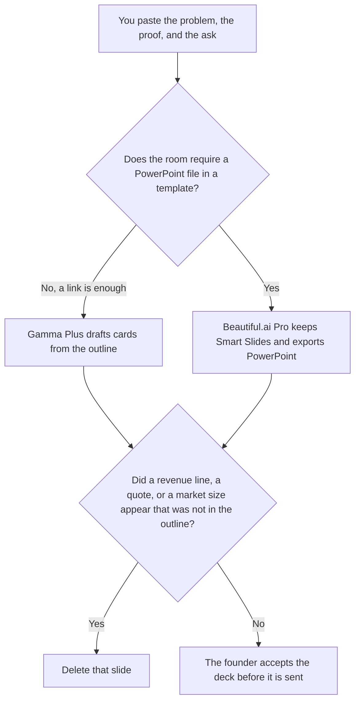

**Use Gamma when the pitch can be a new card deck from an outline you already wrote. Use Beautiful.ai when the room needs Smart Slides and a PowerPoint file, and the template has to stay aligned.** Either tool may place numbers you pasted. Neither may invent revenue, a customer quote, a market size, or an ask. The outline workflow is [how to create a pitch deck with AI](/blog/how-to-create-a-pitch-deck-with-ai-2026/). The Google Slides or PowerPoint path, with Plus AI, is [Gamma vs Plus AI for pitch decks](/blog/gamma-vs-plus-ai-for-pitch-decks-2026/).

A board packet, which is not a fundraise, is [Gamma vs Beautiful.ai for board decks](/blog/gamma-vs-beautiful-ai-for-board-decks-2026/).

Gamma, Beautiful.ai, and Notion prices are from directory pages checked October 16, 2026. Claude's prices are the October 24, 2026 read of claude.com/pricing recorded in [Claude pricing explained](/blog/claude-pricing-explained-2026/). Published October 24, 2026. We did not score slide design. We did not raise money with either tool.

## Which leave-behind you need

| The room | Start here | First paid step | The limit |
|---|---|---|---|
| A link is an acceptable leave-behind | [Gamma](/tools/gamma/) | Plus is $9 a seat a month, $108 a year, 1,000 credits | No number that was not in the outline |
| The file must be PowerPoint, in a template | [Beautiful.ai](/tools/beautiful-ai/) | Pro is $14.50 a month billed annually, or $45 monthly | The Smart Slide does not invent a chart |
| The outline the deck must match | [Notion AI](/tools/notion-ai/) | Business is $20 a seat a month | Plus at $10 is not the full AI tier |
| A second read of the ask, in prose | [Claude](/tools/claude/) | Pro is $17 a month billed annually, or $20 monthly | The ask sentence does not change between files |

Gamma Pro is $18 a seat a month, $216 a year, with 4,000 credits, on the October 16 card. Ultra is $90 a seat a month, monthly only, with 20,000 credits. Plus is the seat for a first narrative. Pro is a larger credit pool and the card's API line. It is not a sharper story. Free holds non-refreshing credits, up to 2,000 at once.

Beautiful.ai Team is $40 a user a month billed annually, or $50 monthly, for 2 to 20 people, with shared libraries. Enterprise is custom. Every seat on that card includes unlimited AI content generation and PowerPoint import and export. There is a 14-day trial of Pro or Team. The invoice is [Beautiful.ai pricing explained](/blog/beautiful-ai-pricing-explained-2026/).

Annual Pro at $14.50 is $174 a year. Monthly at $45 is the ad-hoc row. Do not quote $14.50 if you are paying month to month.

## What the deck is allowed to claim

The problem, the proof, and the ask you pasted. A logo you do not have stays out. A customer name you did not supply stays out. If the ask is missing, the slide says Ask not set. The board-deck page is for a packet the board already has. This page is a pitch. Do not reuse a board chart as if it were a fundraise slide.

**Gamma Plus** is the new narrative. Generate from the outline, then delete any card that adds a fact. The directory is [Gamma](/tools/gamma/).

**Beautiful.ai Pro** is the template path. Swap layouts. Do not let a Smart Slide chart a series you did not paste. The review is [Beautiful.ai review](/blog/beautiful-ai-review-2026/).

**Notion Business** stores the outline and the date the founder accepted it. The invoice is [Notion AI pricing explained](/blog/notion-ai-pricing-explained-2026/).

**Claude Pro** checks that the ask sentence in the deck matches the outline. It does not improve the ask. The review is [Claude review](/blog/claude-review-2026/).

A prompt that holds the line:

"Draft the pitch from the problem, the proof, and the ask I pasted. If the ask is missing, write Ask not set. Do not add revenue. Do not add a customer quote. Do not add a market size."

## What not to delegate

Do not ask which story will "raise." Do not paste a competitor's deck so yours "matches the market." Do not send a link because the theme looks finished. The founder accepts the ask. A Smart Slide is not a data room.

## FAQ

### How is this different from Gamma vs Plus AI for pitch decks?

That page chooses Gamma when a link is enough, and Plus AI when the room will open Google Slides or PowerPoint through Plus AI. This page chooses Beautiful.ai when the requirement is Smart Slides in Beautiful.ai's template, with that product's PowerPoint export. Plus AI is not the tool on this invoice.

### How is this different from the board-deck page?

A board deck repeats numbers from a packet the board already received. A pitch deck asks for something, and the ask is a number you already wrote. The same two products appear on both pages. The source of the numbers is different. Do not put a fundraise ask on a board slide because the template was handy.

### Which one looks more like a designer made it?

We did not measure that. Gamma Plus is $9 a seat. Beautiful.ai Pro is $14.50 a month on annual billing, or $45 month to month. The deck is fit to send when every number matches the outline, and a missing ask says so.

### Who may send the deck?

The founder, or the person the founder names. A generated card is not a send. If the link and the PowerPoint disagree on the ask, stop. Fix the outline first.

## Last verified

October 16, 2026 for Gamma, Beautiful.ai, and Notion. October 24, 2026 for Claude, via the pricing article. Published October 24, 2026. This page did not refetch the Gamma or Beautiful.ai pricing URLs on October 24.

**Sources:** [Gamma pricing](https://gamma.app/pricing), [Beautiful.ai pricing](https://www.beautiful.ai/pricing), [Notion pricing](https://www.notion.com/pricing), [Claude pricing](https://claude.com/pricing).

*Published by Andrew for [AI Tools Optimizer](https://aitoolsoptimizer.com).*

[Beautiful.ai](/tools/beautiful-ai/) is in the [presentations directory](/tools/category/presentations/). Directory pages may use affiliate links. A purchase through them may earn us a commission at no extra cost to you.
