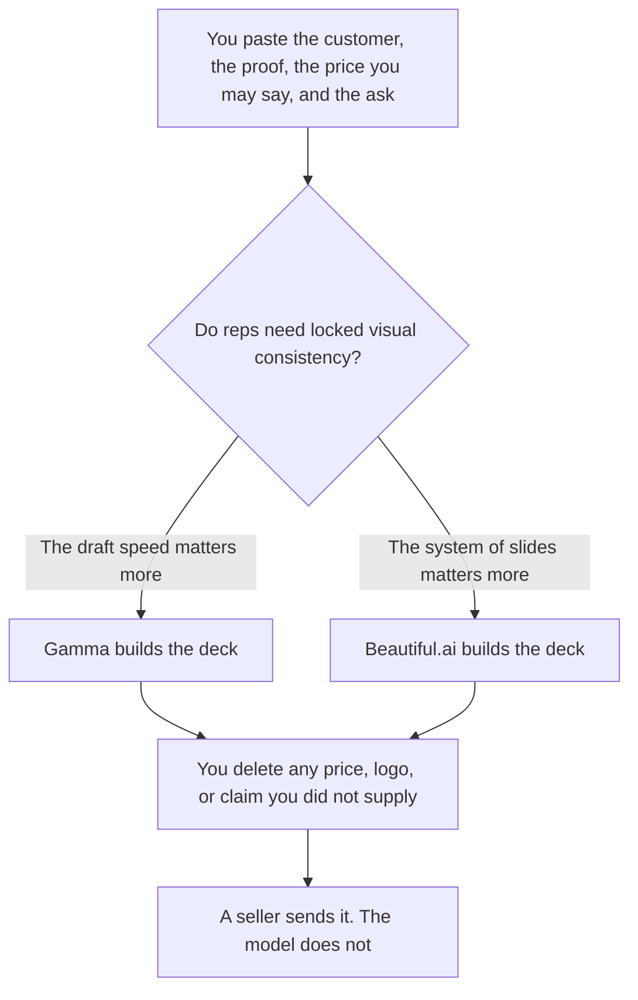

**Use Gamma when you need a sales deck drafted fast from notes you paste, on a low seat price. Use Beautiful.ai when the deck has to stay visually consistent across reps and you will pay the annual Pro price for Smart Slides.** Both can layout slides. Neither knows your discount, your customer, or your next step. A price the model invented is a quote you did not approve.

The general design comparison is [Gamma vs Beautiful.ai](/blog/gamma-vs-beautiful-ai-2026/). The invoices are [Gamma pricing explained](/blog/gamma-pricing-explained-2026/) and [Beautiful.ai pricing explained](/blog/beautiful-ai-pricing-explained-2026/). A one-page leave-behind is [how to write a sales one-pager with AI](/blog/how-to-write-a-sales-one-pager-with-ai-2026/).

Prices are US list prices excluding tax from directory pages checked October 16, 2026. Published October 24, 2026. We did not score close rates or design awards.

## Which seat matches the call

| The deck you actually give | Start here | What you still do |
|---|---|---|
| A first draft from a call's notes | [Gamma](/tools/gamma/) Free, while the one-time credits last | Free credits do not refresh. You replace every number |
| A rep who builds decks every week | Gamma Plus at $9 a seat a month, 1,000 credits. Annual is $108 a seat | Pro is $18 a seat, 4,000 credits, $216 a year |
| The slides must stay on-brand without a designer | [Beautiful.ai](/tools/beautiful-ai/) Pro at $14.50 a month billed annually, or $45 month-to-month | 14-day trial. No permanent free plan on the card |
| A team of 2 to 20 sharing one system | Beautiful.ai Team at $40 per user a month billed annually, or $50 monthly | Unlimited AI generation and 300+ Smart Slide layouts, on that card |
| The file has to be Google Slides or PowerPoint native | [Plus AI](/tools/plus-ai/) Basic at $10 per user a month billed annually | A different product. The pitch-deck article covers it |
| You want a shared room more than a file | [Pitch](/tools/pitch/) Plus at $10 a seat a month billed yearly | Free covers up to 5 members and 100 one-time AI credits |

Gamma Ultra is $90 a seat a month with 20,000 credits. A single sales deck does not need it. Generating with AI costs about 1 to 3 credits per card on the directory card. Images cost more, from 2 to 125 credits depending on the model. Budget cards first.

Beautiful.ai includes a free year for students with a valid .edu email. That path is for students. A sales team uses Pro or Team. Viewer analytics are listed on the card. Analytics are not a win rate.

## What the sales deck has to say

The slides a buyer can use are the problem they recognized, the proof you have permission to show, the price or package you are allowed to say, and the next step with a date. A "why us" slide with invented logos is a liability. If a metric is not in your notes, the slide says Missing.

**Gamma Plus** is the right paid seat when the rep starts from notes and needs something presentable the same day. The review path for the product is the pricing article plus the general comparison. API keys start on Pro, which a sales deck does not require.

**Beautiful.ai Pro** is the right paid seat when several reps must not break the layout, and $45 monthly is too high for a tool you will keep. The annual $14.50 figure is the one to budget if you know you will stay. Month-to-month at $45 is the one-off. Smart Slides keep spacing consistent. They do not check your discount authority.

A prompt that holds the line:

"Build a sales deck from the customer, proof, price, and next step I pasted. Do not add a customer logo. Do not invent a metric or a discount. If proof is missing, write Missing. End on the next step I named."

The narrative version of a competitive slide, if you need one, is [how to write a competitive battle narrative with AI](/blog/how-to-write-a-competitive-battle-narrative-with-ai-2026/). [Claude](/tools/claude/) Pro at $20 a month, or $17 billed annually, can draft that narrative from notes. The slides still come from the deck tool.

## What not to delegate

Do not let the model price the deal. Do not paste a prospect's confidential numbers into a personal Gamma account if your policy forbids it. Do not export and send without reading every number. The enablement version for a team library is [how to write a sales enablement deck with AI](/blog/how-to-write-a-sales-enablement-deck-with-ai-2026/). That library is internal. This page is the deck for one buyer.

## FAQ

### Which one wins more deals?

We did not measure deals. Gamma is the faster draft at $9. Beautiful.ai is the consistency system at $14.50 a month on the annual Pro plan. The deck that wins is the one whose facts you checked.

### Can AI write the talk track too?

It can format a talk track from the same notes. The seller still says the words. A script that adds a promise is the same failure as a slide that adds a price.

### Is Plus AI the same choice?

Plus AI's job is a native Slides or PowerPoint file. Pick it when the buyer or the team requires that file format. Pick Gamma or Beautiful.ai when their own player is acceptable. The pitch-deck comparison is [Gamma vs Plus AI for pitch decks](/blog/gamma-vs-plus-ai-for-pitch-decks-2026/).

### What if we only need one deck?

Gamma Free, until credits run out, or Beautiful.ai month-to-month at $45, or the 14-day trial. Do not buy Team for a single leave-behind. Cancel the monthly plan if you will not build another.

## Last verified

October 16, 2026 for Gamma, Beautiful.ai, Plus AI, Pitch, and Claude. Published October 24, 2026.

**Sources:** [Gamma pricing](https://gamma.app/pricing), [Beautiful.ai pricing](https://www.beautiful.ai/pricing), [Plus AI pricing](https://plusai.com/pricing).

*Published by Andrew for [AI Tools Optimizer](https://aitoolsoptimizer.com).*

[Gamma](/tools/gamma/) is in the [presentations directory](/tools/category/presentations/). Directory pages may use affiliate links. A purchase through them may earn us a commission at no extra cost to you.
