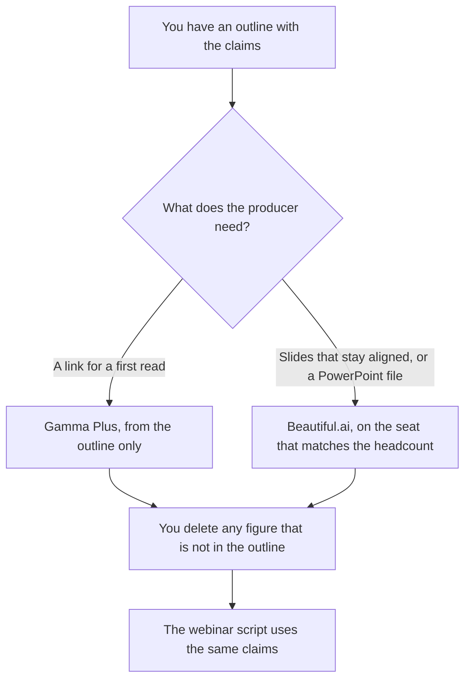

**Use Gamma when you need a first webinar deck from an outline you already wrote, and a link is an acceptable leave-behind. Use Beautiful.ai when the slides have to stay aligned and on a brand theme, including a PowerPoint file you can hand a producer.** The model may order slides. It may not invent a statistic, a customer quote, or a promise about the product. The words you say aloud are [how to create a webinar script with AI](/blog/how-to-create-a-webinar-script-with-ai-2026/). Gamma versus Pitch, for a different leave-behind, is [Gamma vs Pitch for investor decks](/blog/gamma-vs-pitch-for-investor-decks-2026/).

Gamma's prices are from the directory page checked October 16, 2026, because gamma.app/pricing returned HTTP 403 on October 24. Beautiful.ai's prices are from beautiful.ai/pricing on October 24, 2026. Claude's Pro price is from claude.com/pricing that day. Notion's price is from the October 16 directory card. Published October 24, 2026. We did not score slide design or attendance.

## Which deck you are actually making

| The deck | Start here | First paid step | The number rule |
|---|---|---|---|
| A first pass from an outline, shared as a link | [Gamma](/tools/gamma/) | Plus is $9 a seat a month. Annual is $108 a seat a year on the directory card | Every figure comes from the outline |
| One presenter, Smart Slides, a PowerPoint export | [Beautiful.ai](/tools/beautiful-ai/) | Pro is $14.50 a month billed annually, or $45 billed monthly | The same rule |
| A team of 2 to 20 sharing a theme | Beautiful.ai | Team is $40 a user a month billed annually, or $50 billed monthly | Comment history is not a source of new facts |
| The outline in sentences, before slides | [Claude](/tools/claude/) | Pro is $17 a month billed annually, or $20 monthly | The outline is the source |

Gamma Free credits do not refresh, and the directory says a free account can hold up to 2,000 credits. Plus at $9 includes 1,000 credits a seat a month. Pro at $18, or $216 a seat a year, is the API tier on that card. A webinar deck does not need the API. The invoice is [Gamma pricing explained](/blog/gamma-pricing-explained-2026/).

Beautiful.ai has no permanent free plan on the October 24 page. There is a 14-day trial of Pro or Team, and the page says a credit card is required. Students with a valid .edu email can get a free year, on the October 16 directory card. The invoice is [Beautiful.ai pricing explained](/blog/beautiful-ai-pricing-explained-2026/).

## What a slide is allowed to say

The claim in the outline, the source you named, and the date of the webinar. A chart needs numbers you pasted. A quote needs the words and the permission. If the outline says "story, not a number," the slide does not grow a number.

**Gamma Plus** is the first-pass path. Paste the outline. Ask for one slide per section you named. A deck that adds a competitive table you did not write is the deck you discard.

**Beautiful.ai Pro** is the path when alignment and a PowerPoint export matter more than a blank canvas. Team is the path when more than one person must edit inside a shared theme. The October 24 page says every seat includes unlimited AI content generation and PowerPoint import and export. Unlimited generation does not mean unlimited facts.

**Claude Pro** writes the outline if you do not have one yet. It does not design the slides. [Notion AI](/tools/notion-ai/) Business is $20 a seat a month if the outline lives in the wiki. Plus at $10 is not the full AI tier, on the October 16 card.

A prompt that holds the line:

"Build slides only from the outline I pasted. One slide per section I numbered. Do not add a statistic, a quote, or a logo. If a section has no number, do not invent one."

## What not to delegate

Do not ask the model to "make the webinar more convincing." Do not paste an unpublished customer story into a slide tool and then treat the slide as approved. Do not let the deck and the script diverge. If a claim comes out of the outline, it comes out of both. The script article is the spoken version. This page is the slides.

## FAQ

### Which one looks better?

We did not score that. Gamma fits a first narrative you share as a link. Beautiful.ai fits slides that reflow inside Smart Slide layouts, and a PowerPoint file. Look at one section of your real outline in the trial before you buy a team seat.

### Do I need Beautiful.ai Team?

The October 24 page prices Team for collaborators, at $40 a user a month billed annually or $50 monthly, for the 2-to-20 range the page describes. One presenter can stay on Pro. Pro monthly at $45 is the one-off card. A recurring webinar is the annual Pro price if you will still be presenting next quarter.

### Where does Pitch fit?

Pitch is the other room-to-edit comparison, on the investor-deck article. This page is Gamma versus Beautiful.ai. Pick the file format the producer asked for, then the seat.

### Can the model write the talk track too?

Only from the same outline, and the script article is the better checklist. A slide and a script that cite different numbers will be read aloud wrong. One outline, then both.

## Last verified

October 16, 2026 for Gamma and Notion. October 24, 2026 for Beautiful.ai and Claude. gamma.app/pricing returned HTTP 403 on October 24. Published October 24, 2026.

**Sources:** [Gamma pricing](https://gamma.app/pricing), [Beautiful.ai pricing](https://www.beautiful.ai/pricing), [Claude pricing](https://claude.com/pricing), [Notion pricing](https://www.notion.com/pricing).

*Published by Andrew for [AI Tools Optimizer](https://aitoolsoptimizer.com).*

[Beautiful.ai](/tools/beautiful-ai/) is in the [presentations directory](/tools/category/presentations/). Directory pages may use affiliate links. A purchase through them may earn us a commission at no extra cost to you.
