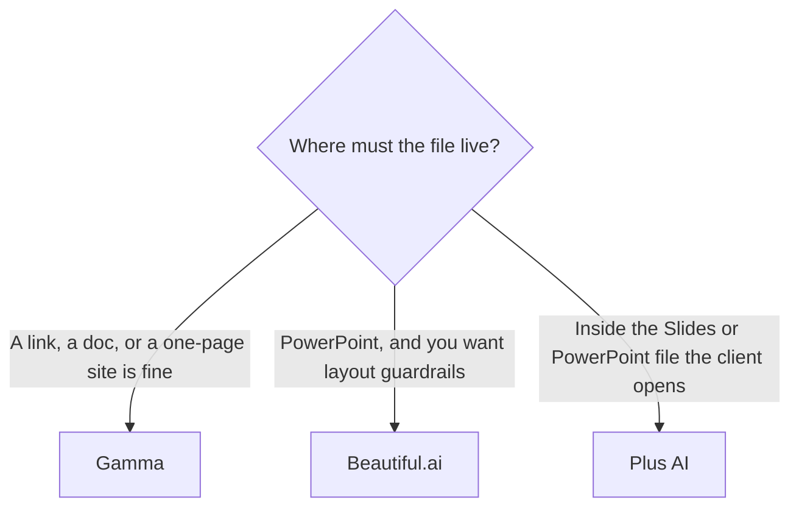

**Use Gamma when you want a designed deck, doc, or one-page site from a prompt. Use Beautiful.ai when you want Smart Slides and a PowerPoint file. Use Plus AI when the deck has to be born inside Google Slides or PowerPoint.** The prices are close enough that the file format decides it. This page does not score which slides look better.

Prices are US list prices excluding tax from directory pages checked October 16, 2026. Plan-by-plan credit math for Gamma is [Gamma pricing explained](/blog/gamma-pricing-explained-2026/). Beautiful.ai's ladder is [Beautiful.ai pricing explained](/blog/beautiful-ai-pricing-explained-2026/).

## The format decides the tool

| | [Gamma](/tools/gamma/) | [Beautiful.ai](/tools/beautiful-ai/) | [Plus AI](/tools/plus-ai/) |
|---|---|---|---|
| What you get | Cards that work as slides, docs, or a simple site | A slide deck of Smart Slide layouts | Slides in Google Slides or PowerPoint |
| Free | Credits that do not refresh. You can hold up to 2,000 | No free plan. A 14-day trial. A free year for students with a .edu email | No free plan. A 7-day trial with 1,000 AI credits |
| First paid seat | Plus $9/seat/month, or $108/year, with 1,000 credits | Pro $14.50/month billed annually, or $45 month-to-month | Basic $10/user/month billed annually, or $15 monthly, with 1,500 credits |
| The step most teams mean | Pro $18/seat/month, or $216/year, 4,000 credits, API access | Team $40/user/month billed annually, or $50 monthly, for 2–20 people | Pro $20/user/month annually, or $25 monthly, 3,000 credits |
| AI meter | Credits. About 1–3 per card. Images 2–125, by model | Unlimited AI content generation on every paid seat | Credits. Max is $200/month annually or $240 monthly for unlimited credits |
| Export | Sharing and export from Gamma's format | PowerPoint import and export | You are already in Slides or PowerPoint |

The shelf around these three is [best AI presentation makers](/blog/best-ai-presentation-makers/). Gamma against a design suite, which is a different comparison, is [Gamma vs Canva](/blog/gamma-vs-canva-presentations/).

## Gamma, when speed and a link matter

Gamma generates cards from a prompt, notes, or a file. Cards are not a one-to-one PowerPoint master. They are the point: a deck you can also publish as a page. Plus at $9 removes the non-refreshing free-credit limit and includes 1,000 credits a month. Pro at $18 adds advanced AI and API access. Ultra at $90 a month is monthly only, with 20,000 credits and all image models.

Free is a trial with a balance, not a monthly allowance. Referrals can add credits. Do not plan a weekly client rhythm on Free.

The reviews are [Gamma review](/blog/gamma-review-2026/) and, for the credit arithmetic, the pricing explainer linked above. A diagram you need before the deck exists can come from [Napkin AI](/tools/napkin-ai/). Plus there is $9 a person a month. The review is [Napkin AI review](/blog/napkin-ai-review-2026/).

## Beautiful.ai, when the slide has to behave

Beautiful.ai has no permanent free plan. Pro is $14.50 a month on annual billing, or $45 if you pay month to month. That gap is the decision: annual once the format sticks, monthly for a single project. Every paid seat includes unlimited AI generation, 300+ Smart Slide layouts, and PowerPoint import and export. Team is $40 a user a month billed annually, or $50 monthly, for shared libraries and brand controls, sized for 2–20 people. Enterprise is custom.

There is a 14-day trial of Pro or Team, and a free year for students with a valid .edu email. The product page is [Beautiful.ai review](/blog/beautiful-ai-review-2026/).

Unlimited generation is the contrast with Gamma and Plus, which meter credits. You still write the outline. Smart Slides will not rescue a deck that tries to say four things on one slide.

## Plus AI, when the client opens a real slide file

Plus AI is an add-on for Google Slides and a PowerPoint add-in. Basic is $10 a user a month billed annually, or $15 monthly, with 1,500 credits. Pro is $20 annually or $25 monthly, with 3,000 credits, and it is the plan that adds image generation and longer document prompts. Team is $30 annually or $40 monthly, with 6,000 credits and shared brand instructions. Max is $200 annually or $240 monthly for unlimited credits.

All paid plans start with a 7-day trial and 1,000 credits. The directory page says Pro and above include unlimited team members. Confirm that line at checkout. It is a strange sentence next to a per-user price, and you should see it on the live card before you budget seats.

The review is [Plus AI review](/blog/plus-ai-review-2026/). If the team builds decks together and AI credits are secondary, [Pitch](/tools/pitch/) Plus is $10 a seat a month billed yearly, with 500 AI credits a seat. [Canva](/tools/canva/) Pro is $18 a month or $180 a year for one person, and it is a design suite, not a slide-native generator.

## FAQ

### Which is cheapest?

Gamma Plus at $9 a seat a month is the lowest first paid price of the three. Beautiful.ai Pro is $14.50 on an annual plan and $45 month to month. Plus AI Basic is $10 on annual billing. Cheapest only matters after the file format fits.

### Can I export Gamma to PowerPoint?

Gamma's directory page lists export and sharing. If the client requires a native PowerPoint or Google Slides file as the working copy, start in Plus AI or export from Beautiful.ai and confirm the file. Do not assume a card deck is a master template.

### Does Beautiful.ai use credits?

The October 16, 2026 pricing page says every seat includes unlimited AI content generation. Gamma and Plus AI meter credits. That is the meter difference.

### Is Canva one of these?

Canva is the design suite people already know. The comparison with Gamma is [Gamma vs Canva](/blog/gamma-vs-canva-presentations/). Use Canva when the job is a brand system. Use one of these three when the job is a deck from an outline.

## Last verified

October 16, 2026. Published October 24, 2026.

**Sources:** [Gamma pricing](https://gamma.app/pricing), [Beautiful.ai pricing](https://www.beautiful.ai/pricing), [Plus AI pricing](https://plusai.com/pricing).

*Published by Andrew for [AI Tools Optimizer](https://aitoolsoptimizer.com).*

[Gamma](/tools/gamma/), [Beautiful.ai](/tools/beautiful-ai/), and [Plus AI](/tools/plus-ai/) are in the [presentations directory](/tools/category/presentations/). Directory pages may use affiliate links. A purchase through them may earn us a commission at no extra cost to you.
