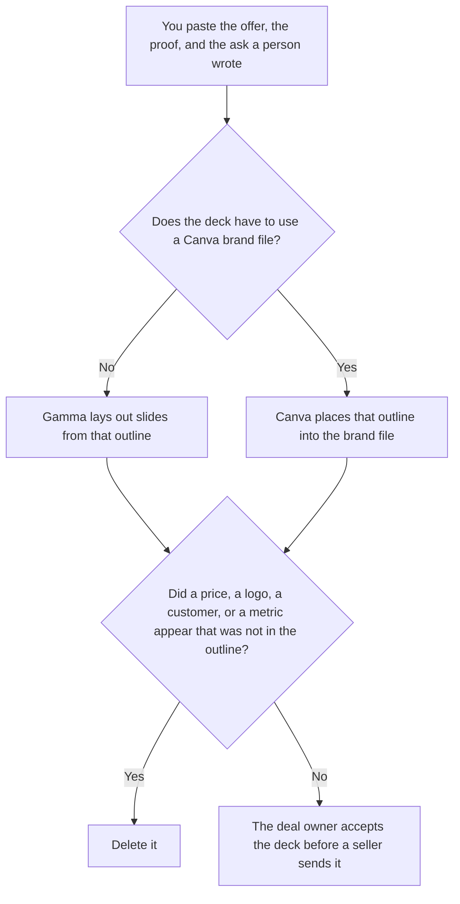

**Use Gamma when you are generating a sales deck from an outline a person already wrote. Use Canva when the deck must use the templates and brand files the team already keeps in Canva.** The model may lay out slides. It may not add a price, a customer name, a metric, or a promise that was not in the outline. A webinar deck, which is a different audience, is [Gamma vs Canva for webinars](/blog/gamma-vs-canva-for-webinars-2026/). The other sales-deck pairing on this site is [Gamma vs Beautiful.ai for sales decks](/blog/gamma-vs-beautiful-ai-for-sales-decks-2026/).

The seat math is [Gamma pricing explained](/blog/gamma-pricing-explained-2026/) and [Canva pricing explained](/blog/canva-pricing-explained-2026/).

Prices are US list prices from directory pages checked October 16, 2026. Claude's Pro price is from claude.com/pricing on October 24, 2026. Published October 24, 2026. We did not score decks.

## Which deck is in front of you

| The page | Start here | First paid step | The limit |
|---|---|---|---|
| A deck from an outline | [Gamma](/tools/gamma/) | Plus is $9 a seat a month, or $108 a year, with 1,000 credits | No price that was not in the outline |
| A deck that must use the brand file | [Canva](/tools/canva/) | Pro is $18 a month or $180 a year for one person | Pro is one person. It is not a team plan |
| The outline before either tool | [Claude](/tools/claude/) | Pro is $17 a month billed annually, or $20 monthly | The outline is the source. A slide is not a new offer |
| The offer the next seller will copy | [Notion AI](/tools/notion-ai/) | Business is $20 a seat a month | Plus at $10 is not the full AI tier |

A slide that "strengthens" the ask has changed the offer. If a proof point was not in the outline, the slide says Proof not in the source. It does not borrow a number from a different deal.

Gamma Pro is $18 a seat a month, or $216 a year, with 4,000 credits and API access, on the October 16 card. Plus is enough for a deck from an outline unless the credit line is the constraint you can show. Ultra at $90 a seat a month is a different purchase. The review is [Gamma review](/blog/gamma-review-2026/).

Canva Business is $25 per person per month or $250 per person per year on that card. Buy Business when more than one person must use the brand file. The card says only one person can use a Pro account. The review is [Canva Magic Studio review](/blog/canva-magic-studio-review-2026/).

## What the deck is allowed to contain

The audience, the offer, the proof, and the ask you pasted. A logo you do not have rights to use does not get "generated closer." A customer quote stays out unless you pasted the approved line. The credit meter is not a reason to regenerate until a metric appears.

**Gamma Plus** is the outline path. Paste the slide list in your words. A version that adds a competitive slide you did not ask for is the version you delete.

**Canva Pro** is one person working in the brand file. If the file is shared by a team, read the Business row before you assume Pro covers them.

**Claude Pro** holds the outline so the deck and the leave-behind use the same offer sentence.

**Notion Business** stores the accepted outline and the date the deal owner signed off. The invoice is [Notion AI pricing explained](/blog/notion-ai-pricing-explained-2026/).

A prompt that holds the line:

"Build the sales deck from the outline I pasted. If a price, a customer, or a metric is missing, write Not in the outline. Do not add a promise. Do not invent a logo."

## What not to delegate

Do not ask which price will close the deal. Do not paste a private forecast so the deck "has urgency." Do not send the file because the theme looks finished. The deal owner accepts it. A deck is not an offer.

## FAQ

### How is this different from the webinar page?

The webinar page is a session with a time and a registration ask. This page is a sales conversation: an offer, proof, and an ask a seller will say out loud. The same outline can feed both. The headings should not be copied across without a person checking the audience.

### How is this different from Gamma vs Beautiful.ai?

That page compares two generators. This page is the choice between a generated deck and a deck that has to live in the Canva file the brand team already uses. If the brand file is the constraint, Canva is the start. If it is not, Gamma is the start.

### Which one makes a better-looking deck?

We did not measure that. Gamma fits an outline. Canva fits a brand file. The deck is fit to send when every number traces to the outline, and a missing proof says so.

### Who may send the deck?

The deal owner, after the offer matches what they are willing to say. A shared link is not acceptance. A generated customer logo is not permission.

## Last verified

October 16, 2026 for Gamma, Canva, and Notion. October 24, 2026 for Claude. Published October 24, 2026.

**Sources:** [Gamma pricing](https://gamma.app/pricing), [Canva pricing](https://www.canva.com/pricing/), [Claude pricing](https://claude.com/pricing), [Notion pricing](https://www.notion.com/pricing).

*Published by Andrew for [AI Tools Optimizer](https://aitoolsoptimizer.com).*

[Canva](/tools/canva/) is in the [design directory](/tools/category/design/). Directory pages may use affiliate links. A purchase through them may earn us a commission at no extra cost to you.
