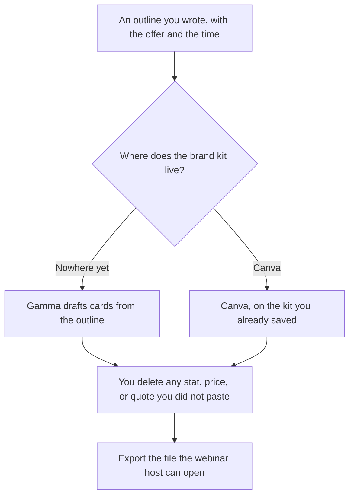

**Build the webinar deck in Gamma when you are starting from an outline you wrote. Build it in Canva when the brand kit, the registration graphic, and the slides already live in Canva.** The script is a different file. The recording is a different file. This page is the deck the audience sees. We did not score which slides convert better.

The talk track is [how to create a webinar script with AI](/blog/how-to-create-a-webinar-script-with-ai-2026/). The clips after the session are [how to repurpose a webinar with AI](/blog/how-to-repurpose-a-webinar-with-ai-2026/). A pitch deck, which is a different room, is [Gamma vs Plus AI for pitch decks](/blog/gamma-vs-plus-ai-for-pitch-decks-2026/).

Prices are US list prices excluding tax from directory pages checked October 16, 2026. Published October 24, 2026. We did not measure attendance or design quality.

## Which tool holds the deck

| What you already have | Start here | What you still do |
|---|---|---|
| A written outline and no deck | [Gamma](/tools/gamma/) Free, then Plus at $9 a seat a month if you need the monthly credits | Edit every claim. A generated card is a draft |
| Logos, colors, and last month's webinar in Canva | [Canva](/tools/canva/) Pro at $18 a month, or $180 a year, for one person | Magic tools do not update a price you forgot to change |
| You need a PowerPoint file for a host who will not open a link | [Plus AI](/tools/plus-ai/) Basic at $10 a user a month billed annually | Gamma and Canva can export. Confirm the file the host asked for |
| The outline lives in a wiki | [Notion AI](/tools/notion-ai/) Business at $20 a seat a month, then Gamma or Canva | The wiki stays the source. The deck is a view |
| A team that must approve the slides | Canva Business at $25 a person a month, or $250 a person a year | Approvals are on this row. A shared link is not an approval |

Gamma Free holds a non-refreshing credit balance, up to 2,000 at once on the card, and you can earn more by referring people. A webinar you will revise needs a refreshing allowance. Plus is $9 a seat a month, with 1,000 credits. Pro is $18 a seat, with 4,000 credits and API access. The invoice is [Gamma pricing explained](/blog/gamma-pricing-explained-2026/).

Canva Free includes the editor and a limited AI allowance. Pro is the one-person paid row. Business adds team tools and a higher AI allowance the card calls 20x Free. The directory also notes that eligible K-12 and not-for-profit organizations can get most premium features free. Confirm that on Canva's current page if you are in that group. A company webinar is the Pro or Business decision, not the education exception.

## What each draft is allowed to say

The outline you paste should already contain the title, the audience, three points, the offer, and the time of the session. The model may turn those into cards. It may not add a customer count, a benchmark, or a "seats left" line. Those are claims. The check is [how to fact-check AI writing](/blog/how-to-fact-check-ai-writing-2026/).

**Gamma** is the faster first deck when the brand system is a sentence ("dark background, one accent color") and the content is the outline. Share a link for a dry run. Before the live session, export what the host platform accepts. A link that fails on the presenter's laptop is a production problem, not a design problem.

**Canva** is the faster deck when Brand Kit already has the logo and last quarter's template. Pro at $18, or $180 for the year, is the recorded one-person price. Use Business when several people must edit and someone must approve. The design-tool split with Figma is [Figma AI vs Canva Magic Studio](/blog/figma-ai-vs-canva-magic-studio-2026/). A webinar is usually Canva or Gamma, not a product-design file.

**Plus AI** belongs in the row when the artifact is a PowerPoint the events team will rehearse in PowerPoint. Do not add it because a template looked familiar. Basic is $10 a user a month billed annually, with a 7-day trial on the card.

A prompt that holds the line:

"Turn this outline into a webinar deck. One idea per card. Use only the numbers, the date, and the offer I pasted. If a card needs a proof point I did not provide, write Missing. Do not invent quotes. Leave a card for questions. Keep the title I wrote."

The person who presents is [what human-in-the-loop AI is](/blog/what-is-human-in-the-loop-ai-2026/).

## The pieces that are not the deck

Registration copy, the reminder email, and the follow-up are writing jobs. A feature announcement after the webinar has its own workflow: [how to create a feature announce email with AI](/blog/how-to-create-a-feature-announce-email-with-ai-2026/). The replay page should match the deck. If the deck said a price the email does not, fix the deck. The price page, if you are announcing one, is [how to write a pricing page with AI](/blog/how-to-write-a-pricing-page-with-ai-2026/).

Do not generate a headshot of the speaker. Use a photo you have the right to use. Do not drop a competitor's logo on a card unless counsel has already allowed that slide. A battle narrative is a different document: [how to write a competitive battle narrative with AI](/blog/how-to-write-a-competitive-battle-narrative-with-ai-2026/).

## FAQ

### Can I start in Gamma and finish in Canva?

Yes, if you export cleanly and then apply the brand kit by hand. Do not maintain two live decks. Pick the file the presenter will open, and archive the other.

### Is Canva Pro required for a single host?

Free can produce a simple deck. Pro is the row when you need the premium assets, resize, and the higher AI allowance the card describes. Business is the row when a second person must approve.

### How many credits does a webinar use?

Gamma's directory card gives approximate ranges, and it says rates may change. Check the balance before you generate, and do not regenerate the whole deck to fix one number. Edit the card.

### Should the AI write the outline too?

You can brainstorm titles in private. The outline you generate from should be the one you approved: audience, promise, and offer. A deck from an unapproved outline is a different webinar than the one you scheduled.

## Last verified

October 16, 2026 for Gamma, Canva, Plus AI, and Notion AI. Published October 24, 2026.

**Sources:** [Gamma pricing](https://gamma.app/pricing), [Canva pricing](https://www.canva.com/pricing/), [Plus AI pricing](https://plusai.com/pricing), [Notion pricing](https://www.notion.com/pricing).

*Published by Andrew for [AI Tools Optimizer](https://aitoolsoptimizer.com).*

[Gamma](/tools/gamma/) is in the [presentations directory](/tools/category/presentations/). Directory pages may use affiliate links. A purchase through them may earn us a commission at no extra cost to you.
