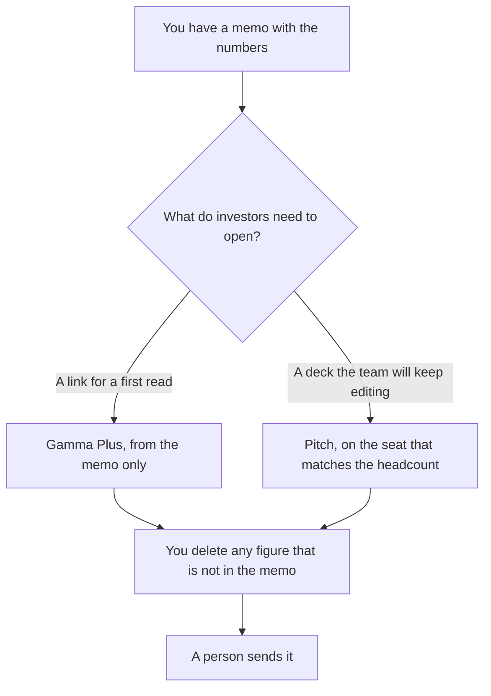

**Use Gamma when you need a first narrative from a memo you already wrote, and a link is an acceptable leave-behind. Use Pitch when the deck is a file the founders will edit together, with a template and a room you can track.** The model may order slides. It may not invent revenue, a round size, a logo, or a customer quote. Gamma versus Plus AI, which is the Slides-or-PowerPoint path, is [Gamma vs Plus AI for pitch decks](/blog/gamma-vs-plus-ai-for-pitch-decks-2026/). This page is Gamma versus [Pitch](/tools/pitch/).

Gamma's credits are [Gamma pricing explained](/blog/gamma-pricing-explained-2026/). Pitch's seats are [Pitch pricing explained](/blog/pitch-pricing-explained-2026/). The one-page version of the story, before any slides, is [how to write a product one-pager with AI](/blog/how-to-write-a-product-one-pager-with-ai-2026/).

Prices are US list prices excluding tax from directory pages checked October 16, 2026. Published October 24, 2026. We did not score decks or fundraising outcomes.

## Which deck you are actually making

| The deck | Start here | First paid step | The number rule |
|---|---|---|---|
| A first pass from a memo, shared as a link | [Gamma](/tools/gamma/) | Plus is $9 a seat a month. Annual is $108 a seat a year on the directory card | Every figure comes from the memo |
| One founder, a reusable template, PPTX export | [Pitch](/tools/pitch/) Free for up to 5 members, 100 AI credits that do not renew | Plus is $10 a seat a month billed yearly, and the directory says Plus is one member | The same rule |
| A team editing one deck, with tracked links | Pitch | Team is $15 a seat a month billed yearly | Commenters are not charged, on the directory card |
| The narrative in sentences before slides | [Claude](/tools/claude/) | Pro is $20 a month, or $17 billed annually | The memo is the source |

Pitch Free covers 1 to 5 members and unlimited presentations, with 100 AI credits that do not renew, on the directory card. Plus cannot be selected for a workspace with more than one member. If two founders will edit, Free until the credits run out, then Team at $15 a seat a month billed yearly, is the path the card describes. Business is $20 a seat a month billed yearly. The card says yearly billing is 17% off monthly and does not print a separate monthly dollar in the summary this site uses. Quote checkout for the monthly sticker.

Gamma Free credits do not refresh. Plus at $9 includes 1,000 credits a seat a month. Pro at $18, or $216 a seat a year, is the API tier. An investor deck does not need the API. It needs the memo.

## What the slides may claim

The problem, the proof, and the ask, in words you already wrote. A market size the model "knows" is the slide you delete. A logo you did not upload is the slide you delete. The factual check is [how to fact-check AI writing](/blog/how-to-fact-check-ai-writing-2026/).

**Gamma Plus** is the fast first narrative. The card format is not a traditional slide master. If the investor asked for a PPTX with your template, Gamma is the draft and Pitch or the Plus AI path is the file you send. Export, then check that the numbers survived.

**Pitch Plus or Team** is the file you will still be editing next week. AI credits speed the first layout. They do not replace the brand template you set up on purpose. Tracked links and pitch rooms sit on Team and higher, on the directory card. A founder who wants to know who opened the deck needs that tier, not Plus.

**Claude** can pressure-test the memo before either tool sees it: which claims have a source in the paste, which do not. It should not design the deck and the numbers in one breath.

A prompt that holds the line:

"Build slides only from the memo I pasted. If a number, a customer, or an ask is not in the memo, write Missing on that slide. Do not estimate a market."

## What not to delegate

Do not let the deck become the source of truth. The memo wins. Do not put a confidential round size into a free plan whose sharing defaults you have not read. Do not send a generated chart. If you need a chart, paste the table you calculated.

## FAQ

### Which one raises money?

We did not measure that. Gamma is the first narrative from a memo. Pitch is the shared deck with a template and, on Team, tracked links. Investors fund the business. The tool orders slides.

### Is Pitch Plus enough for a two-founder team?

The directory card says Plus is one member. Two editors need Free within the five-member cap, or Team at $15 a seat a month billed yearly. Confirm the seat rule at checkout.

### How is this different from Gamma versus Plus AI?

That article is for a deck that must open in Google Slides or PowerPoint, using Plus AI. This article is for Pitch, the collaborative editor. Read that one if the room will not leave PowerPoint.

### Can I start in Gamma and finish in Pitch?

Yes. Treat Gamma as the outline. Rebuild or export into Pitch, then delete any figure that did not survive the move. Two copies of the ask is how a number drifts.

## Last verified

October 16, 2026 for Gamma, Pitch, and Claude. Published October 24, 2026. Checkout is the price you pay if a promo is on the card.

**Sources:** [Gamma pricing](https://gamma.app/pricing), [Pitch pricing](https://pitch.com/pricing), [Claude pricing](https://claude.com/pricing).

*Published by Andrew for [AI Tools Optimizer](https://aitoolsoptimizer.com).*

[Pitch](/tools/pitch/) is in the [presentations directory](/tools/category/presentations/). Directory pages may use affiliate links. A purchase through them may earn us a commission at no extra cost to you.
