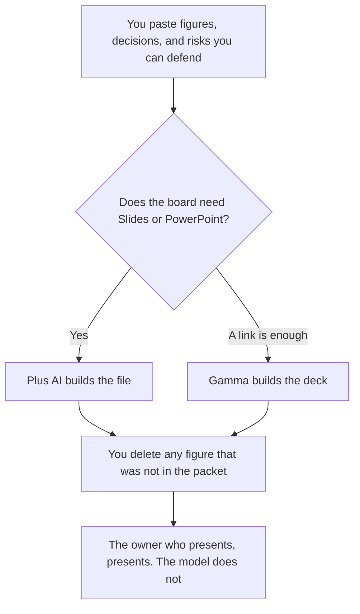

**Use Gamma when a link is an acceptable way for the board to open the deck. Use Plus AI when the packet has to be Google Slides or PowerPoint in the system finance already uses.** Either tool may order slides. Neither may invent revenue, churn, a headcount, or a risk. If the number is not in the packet you pasted, the slide says Missing. A board deck is a report of decisions and figures you already have. It is not a pitch.

An investor narrative, which is a different deck, is [Gamma vs Plus AI for pitch decks](/blog/gamma-vs-plus-ai-for-pitch-decks-2026/). A customer review, also different, is [how to write a QBR deck with AI](/blog/how-to-write-a-qbr-deck-with-ai-2026/). The file-format comparison is [Plus AI vs Gamma](/blog/plus-ai-vs-gamma-2026/).

Prices are US list prices excluding tax from directory pages checked October 16, 2026. Published October 24, 2026. We did not score slide design. We did not sit in a board meeting with either tool. A confidential packet stays in the workspace your policy allows.

## Which seat matches the packet

| The deck you are actually building | Start here | What you still do |
|---|---|---|
| A short update the board can open as a link | [Gamma](/tools/gamma/) Plus at $9 a seat a month, 1,000 credits | You paste the figures. You delete any number the draft adds |
| The file must be Slides or PowerPoint | [Plus AI](/tools/plus-ai/) Basic at $10 a user a month billed annually, or $15 monthly, 1,500 credits | Same rule. The file format is the reason, not the prose |
| Several people drafting against one credit pool | Plus AI Team at $30 a user a month billed annually, 6,000 credits | Basic is a smaller pool. Read the current sharing rules |
| More Gamma room, still a link | Gamma Pro at $18 a seat a month, 4,000 credits | Ultra is $90 a seat a month and is monthly only, on the card |
| The narrative under a chart you trust | [Claude](/tools/claude/) Pro at $20 a month, or $17 billed annually | Claude writes from the packet. It does not become the slide file |
| The appendix lives in the wiki | [Notion AI](/tools/notion-ai/) Business at $20 a seat a month | The wiki holds the source. The deck points at it |

Plus AI has no permanent free plan on the directory card. It lists a 7-day trial with 1,000 AI credits. Gamma Free holds non-refreshing credits, up to 2,000 at once. A board packet is a poor place to spend a trial if the export or the admin controls are the point. Read the plan that matches the file you must hand over.

## What the deck may say

The period, the figures you pasted, the decisions already made, and the risks you wrote down with an owner. It may not say the company is "ahead of plan" unless the packet says that in numbers. It may not add a market size, a competitor slide, or a hiring plan the board did not ask for. Empty stays empty.

**Gamma Plus at $9 a seat** is the link-first row. The review is [Gamma review](/blog/gamma-review-2026/). The ladder is [Gamma pricing explained](/blog/gamma-pricing-explained-2026/).

**Plus AI Basic at $10 billed annually** is the Office-file row. Pro is $20 a user a month billed annually with 3,000 credits. The ladder is [Plus AI pricing explained](/blog/plus-ai-pricing-explained-2026/).

A sales leave-behind is a different audience and a different standard of proof. That page is [Gamma vs Beautiful.ai for sales decks](/blog/gamma-vs-beautiful-ai-for-sales-decks-2026/). Do not reuse a board chart in a sales deck without checking what the board was told.

A prompt that holds the line:

"Build a board update from the figures, decisions, and risks I pasted. One slide per item. Do not add a number, a percentage, or a risk. If an item has no figure, write Missing. Do not write a vision slide. This is a draft for the person who will present."

## What not to delegate

Do not ask the model what the board wants to hear. Do not upload a packet that includes compensation or a financing discussion into a personal free account. Do not let a generated chart replace the spreadsheet the figure came from. The appendix link is the source. The slide is the pointer.

## FAQ

### Which one looks more like a board deck?

We did not score looks. Pick Gamma when the board will open a link. Pick Plus AI when the packet has to live in Slides or PowerPoint. The constraint is the number, then the file format.

### Can the model compute a new metric?

No. If a ratio is not in the packet, it is not on the slide. A computed margin the finance partner did not sign is a new number. Ask them. Then paste it.

### Is a QBR the same deck?

A QBR is for a customer. A board deck is for the people who govern the company. The tone, the confidentiality, and the figures differ. Use the QBR workflow for the customer meeting.

### Do we need Ultra or Max?

Gamma Ultra is $90 a seat and Plus AI Max is $200 a user billed annually, with unlimited credits on that Max row. A quarterly board update does not need either unless you are already out of credits for other work. Buy the seat that matches the file, then watch the credit receipt.

## Last verified

October 16, 2026 for Gamma, Plus AI, Claude, and Notion AI. Published October 24, 2026.

**Sources:** [Gamma pricing](https://gamma.app/pricing), [Plus AI pricing](https://plusai.com/pricing/), [Claude pricing](https://claude.com/pricing), [Notion pricing](https://www.notion.com/pricing).

*Published by Andrew for [AI Tools Optimizer](https://aitoolsoptimizer.com).*

[Gamma](/tools/gamma/) is in the [presentations directory](/tools/category/presentations/). Directory pages may use affiliate links. A purchase through them may earn us a commission at no extra cost to you.
