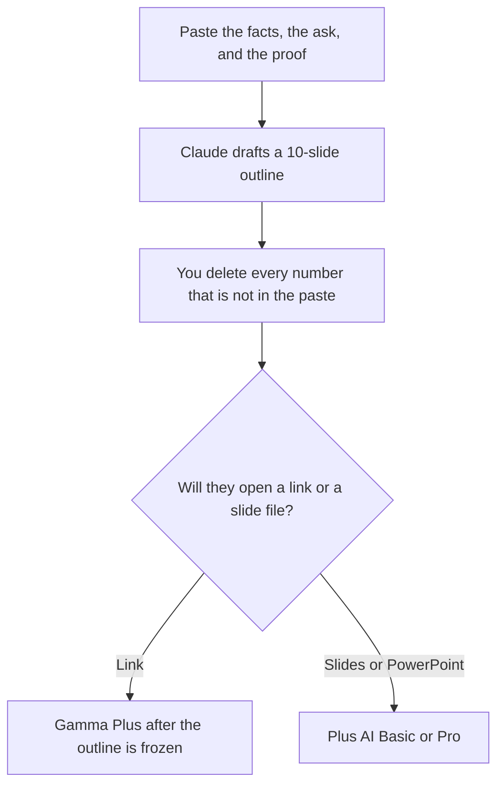

**Use Gamma or Plus AI for a pitch deck only after the problem, the proof, and the ask are numbers and sentences you already have.** Gamma Plus is $9 a seat a month when a link is an acceptable leave-behind. Plus AI Basic is $10 a user a month billed annually when the room will open Google Slides or PowerPoint. The model may order the slides. It may not invent revenue, a logo, a market size, or a customer quote. If those lines are not in your notes, the slide says Missing or the slide stays out.

The file-format comparison, which is the other question, is [Plus AI vs Gamma](/blog/plus-ai-vs-gamma-2026/). The three-way with Beautiful.ai is [Gamma vs Beautiful.ai vs Plus AI](/blog/gamma-vs-beautiful-ai-vs-plus-ai-2026/). The workflow for the outline is [how to create a pitch deck with AI](/blog/how-to-create-a-pitch-deck-with-ai-2026/).

Prices are US list prices excluding tax from directory pages checked October 16, 2026. Published October 24, 2026. We did not score pitch design. We did not raise money with either tool.

## What a pitch slide is allowed to say

| Slide | Who owns the fact | The model may |
|---|---|---|
| Problem | A sentence from your notes, in the buyer's words | Shorten it. It may not upgrade a annoyance into a market crisis |
| Product | What the build actually does this month | Describe it. It may not add a feature from a roadmap you did not paste |
| Proof | A metric export, a named customer you may name, or a quote you have permission to show | Place it. It may not round it |
| Ask | The round, the price, or the meeting you are actually requesting | One line. It may not pick a valuation |
| Appendix | The spreadsheet, linked, not retyped | Point at it |

A chart titled "growing fast" with no series is [a hallucination](/blog/what-is-ai-hallucination-2026/) in a room that will ask for the cell. The check is [how to fact-check AI writing](/blog/how-to-fact-check-ai-writing-2026/).

## Which seat, after the outline is true

**The outline.** [Claude](/tools/claude/) Pro is $20 a month, or $17 billed annually. Put the facts in a Project so the next draft cannot drift the ask. [ChatGPT](/tools/chatgpt/) Plus at $20 is the other seat if that is where the notes already live. The container is [Claude Projects vs ChatGPT Projects](/blog/claude-projects-vs-chatgpt-projects-2026/).

**A link the investor can open.** [Gamma](/tools/gamma/) Plus is $9 a seat a month, or $108 a year, with 1,000 monthly credits. Pro is $18 a seat, or $216 a year, with 4,000 credits. Free credits do not refresh. Generating with AI is about 1 to 3 credits a card on the card. A 12-slide pitch is a small credit event if you are not regenerating images all afternoon. The invoice is [Gamma pricing explained](/blog/gamma-pricing-explained-2026/).

**A file they will mark up.** [Plus AI](/tools/plus-ai/) Basic is $10 a user a month billed annually ($15 monthly) with 1,500 credits. Pro is $20 annually ($25 monthly) with 3,000 credits, and that is the tier that adds document uploads. There is a 7-day trial with 1,000 credits and no permanent free plan. Tasks often use 40 to 170 credits. One careful deck should fit in Basic. A week of remixes might not. The full ladder is [Plus AI pricing explained](/blog/plus-ai-pricing-explained-2026/).

**A team that will co-edit the story.** [Pitch](/tools/pitch/) Plus is $10 a seat a month billed yearly, with 500 AI credits a seat. Free covers up to 5 members and 100 AI credits that do not renew. Team at $15 a seat billed yearly is the row that adds pitch rooms. The invoice is [Pitch pricing explained](/blog/pitch-pricing-explained-2026/).

**A guardrail layout, if design consistency is the worry.** [Beautiful.ai](/tools/beautiful-ai/) Pro is $14.50 a month billed annually, or $45 monthly. No permanent free plan. A 14-day trial is on the card. The invoice is [Beautiful.ai pricing explained](/blog/beautiful-ai-pricing-explained-2026/).

A prompt that holds the line:

"Draft a 10-slide pitch outline. Sections: problem, product as it works today, proof from my paste only, ask, appendix pointer. If revenue, a logo, a market size, or a quote is missing, write Missing. Do not estimate a TAM. Speaker notes under 40 words."

The person in the room is [what human-in-the-loop AI is](/blog/what-is-human-in-the-loop-ai-2026/).

## What this deck is not

It is not a quarterly review for a customer you already have. That workflow is [how to write a QBR deck with AI](/blog/how-to-write-a-qbr-deck-with-ai-2026/). It is not an earnings script for a public company. That shelf is [best AI tools for investor relations](/blog/best-ai-tools-for-investor-relations-2026/). It is not permission to present a number the spreadsheet does not contain.

## FAQ

### How many slides should the pitch be?

Enough for the five rows in the table. Ten to fourteen is a common room. A model that fills forty slides is hiding a missing number. Cut to the paste.

### Gamma or Plus AI if the investor asked for PowerPoint?

Plus AI. The working copy is the file. Gamma can export, and you should still confirm the file they asked for opens in their tool before the meeting. The format page is the comparison linked above. This page assumes you already chose a room.

### Can AI write the market size?

Only if you paste a source, a date, and the figure. Otherwise the cell is Missing. A generated TAM is a story you will be asked to defend without a page.

### Is the $9 or $10 plan enough?

For one finished outline and a modest number of regenerations, usually yes. Count credits on the first real deck. Move to Gamma Pro or Plus AI Pro when the receipt says so, not because the tier name sounds like a fundraise.

## Last verified

October 16, 2026 for Gamma, Plus AI, Pitch, Beautiful.ai, Claude, and ChatGPT. Published October 24, 2026.

**Sources:** [Gamma pricing](https://gamma.app/pricing), [Plus AI pricing](https://plusai.com/pricing/), [Pitch pricing](https://pitch.com/pricing).

*Published by Andrew for [AI Tools Optimizer](https://aitoolsoptimizer.com).*

[Gamma](/tools/gamma/) is in the [presentations directory](/tools/category/presentations/). Directory pages may use affiliate links. A purchase through them may earn us a commission at no extra cost to you.
