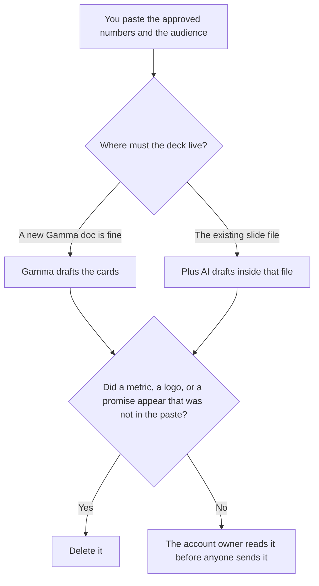

**Use Gamma when the QBR can be a new deck generated from a memo. Use Plus AI when the QBR has to stay inside the Google Slides or PowerPoint file the account team already edits.** Either tool may format numbers you pasted. Neither may invent a metric, a logo treatment, or a commitment the memo did not contain. A webinar deck, which is a different job, is [Gamma vs Beautiful.ai for webinar decks](/blog/gamma-vs-beautiful-ai-for-webinar-decks-2026/). The invoices are [Gamma pricing explained](/blog/gamma-pricing-explained-2026/) and [Plus AI pricing explained](/blog/plus-ai-pricing-explained-2026/).

Gamma and Plus AI prices below are from directory pages checked October 16, 2026. Claude's prices are from claude.com/pricing on October 24, 2026. Notion's price is from the October 16 card. Published October 24, 2026. We did not score slide design.

## Which QBR you are building

| The deck in front of you | Start here | First paid step | The limit |
|---|---|---|---|
| A memo that can become a new deck | [Gamma](/tools/gamma/) | Plus is $9 a seat a month, $108 a year, on the October 16 card | No number that was not in the memo |
| A slide file the team already owns | [Plus AI](/tools/plus-ai/) | Basic is $10 a user a month billed annually, or $15 monthly | The template stays. The model fills from the paste |
| The narrative before either tool | [Claude](/tools/claude/) | Pro is $17 a month billed annually, or $20 monthly | The narrative is not the deck |
| The page where the numbers were approved | [Notion AI](/tools/notion-ai/) | Business is $20 a seat a month | Plus at $10 is not the full AI tier |

A QBR that "rounds the quarter up" has edited the quarter. If the paste says the renewal is open, the slide says the renewal is open. The brand kit, if you have one, is an input. It is not something the model may approximate from memory.

## What each seat keeps

**Gamma Plus** is the seat for a deck you are willing to create as a Gamma document. Pro is $18 a seat a month, $216 a year, on the October 16 card, and that card lists API access on Pro. Business is contact sales on that card. Do not budget a Business dollar we did not record. The review path for the product is the pricing article above.

**Plus AI Basic** is the seat when you need the add-on and a modest credit pool: 1,500 credits a month on the October 16 card. Pro is $20 a user a month billed annually, or $25 monthly, with 3,000 credits. Team is $30 annually or $40 monthly, with 6,000 credits, and that card is the one that lists shared branding. A QBR the whole account team must remix in the company template is the Team conversation. Max is $200 annually or $240 monthly on that card. Read checkout before you treat Max as the default.

**Claude Pro** is where you turn the approved notes into a narrative the deck then follows. Do not ask Claude for the quarter's revenue if the number is not in the paste. The review is [Claude review](/blog/claude-review-2026/).

**Notion Business** holds the source page if that is where finance signed the numbers. The deck links to that page. The chat is not the system of record. The invoice is [Notion AI pricing explained](/blog/notion-ai-pricing-explained-2026/).

A prompt that holds the line:

"Build a QBR from the metrics, the audience, and the decisions I pasted. If a metric is missing, write Missing. Do not estimate a number. Do not add a customer logo. Do not promise a date I did not write."

## What not to delegate

Do not paste a customer's unpublished numbers into a personal free account your policy forbids. Do not let a theme pick a competitor's color and call it on brand. Do not send the deck because the cards look finished. The account owner sends it.

## FAQ

### Which one makes a better-looking QBR?

We did not measure that. Gamma fits a new deck from a memo. Plus AI fits the slide file you already have. The deck is usable when every number traces to the paste.

### Do I need both?

You need the one that matches where the file has to live. Running both on the same QBR produces two versions nobody can reconcile. Pick the home of the file first.

### What about charts?

A chart may use numbers you pasted. If a cell is blank, the chart omits it or the slide says Missing. A chart that fills the blank has invented the quarter.

### Who may share the deck?

The account owner, under the policy you already have. A share link is a distribution decision. Generating the cards does not make that decision.

## Last verified

October 16, 2026 for Gamma, Plus AI, and Notion. October 24, 2026 for Claude. Published October 24, 2026.

**Sources:** [Gamma pricing](https://gamma.app/pricing), [Plus AI pricing](https://plusai.com/pricing), [Claude pricing](https://claude.com/pricing), [Notion pricing](https://www.notion.com/pricing).

*Published by Andrew for [AI Tools Optimizer](https://aitoolsoptimizer.com).*

[Gamma](/tools/gamma/) is in the [presentations directory](/tools/category/presentations/). Directory pages may use affiliate links. A purchase through them may earn us a commission at no extra cost to you.
