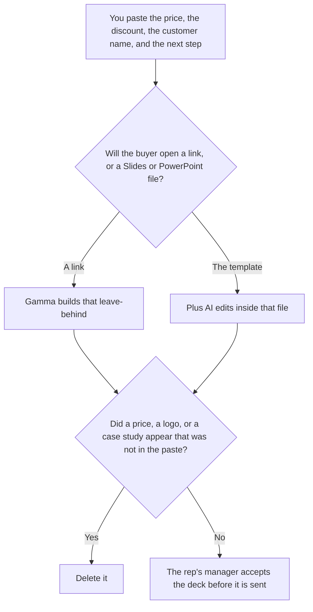

**Use Gamma when a link is an acceptable leave-behind after the call. Use Plus AI when the deck has to be a native Google Slides or PowerPoint file in the template the rep already uses.** The price, the discount, the customer name, and the next step are words a person already wrote. The model may order the slides. It may not invent a price, a logo, a case study, or a competitor's weakness. An investor deck, with an ask, is [Gamma vs Plus AI for pitch decks](/blog/gamma-vs-plus-ai-for-pitch-decks-2026/). A Canva file, which is a different template, is [Gamma vs Canva for sales decks](/blog/gamma-vs-canva-for-sales-decks-2026/).

The file-format comparison is [Plus AI vs Gamma](/blog/plus-ai-vs-gamma-2026/). The outline, before either tool, is [how to create a pitch deck with AI](/blog/how-to-create-a-pitch-deck-with-ai-2026/) when the deck is still a pitch, and the leave-behind a seller hands a buyer is [how to write a sales one-pager with AI](/blog/how-to-write-a-sales-one-pager-with-ai-2026/). This page is the sales deck after the call.

Prices are US list prices excluding tax from directory pages checked October 16, 2026. Published October 24, 2026. We did not score design. We did not sit in the sales call.

## Where the deck has to open

| The file | Start here | First paid step | The limit |
|---|---|---|---|
| A link the buyer can open | [Gamma](/tools/gamma/) | Plus is $9 a seat a month | No price that was not in the notes |
| A native Slides or PowerPoint file in the company template | [Plus AI](/tools/plus-ai/) | Basic is $10 a user a month billed annually, or $15 monthly | The template's locked slides stay locked |
| The sentence the rep must not reword | [Claude](/tools/claude/) | Pro is $17 a month billed annually, or $20 monthly | The Project holds the price and the next step |
| The page that stores the accepted deck | [Notion AI](/tools/notion-ai/) | Business is $20 a seat a month | Plus at $10 is not the full AI tier |

Gamma Free credits do not refresh, on the October 16 card. Plus is $9 a seat a month, or $108 a seat a year, with 1,000 monthly credits. Pro is $18 a seat a month, or $216 a year, with 4,000 credits. Ultra is $90 a seat a month. The card says generating with AI costs about 1 to 3 credits a card. Read the receipt. This page does not remeasure it. The invoice is [Gamma pricing explained](/blog/gamma-pricing-explained-2026/).

Plus AI has no free plan. The card lists a 7-day trial with 1,000 credits. Basic is 1,500 credits a month. Pro is $20 a user a month annually, or $25 monthly, with 3,000 credits, document uploads, and AI images. Team is $30 annually, or $40 monthly, with 6,000 credits and custom branding. Max is $200 annually, or $240 monthly, with unlimited credits. Tasks typically use 40 to 170 credits, on that card. If the deck must wear the company template, Team is the row that names custom branding. Basic can still draft into Slides or PowerPoint. The invoice is [Plus AI pricing explained](/blog/plus-ai-pricing-explained-2026/).

A QBR deck is [Gamma vs Plus AI for QBR decks](/blog/gamma-vs-plus-ai-for-qbr-decks-2026/). A board deck is [Gamma vs Plus AI for board decks](/blog/gamma-vs-plus-ai-for-board-decks-2026/). Those files have different numbers. Do not reuse a sales price slide as a board slide.

## What a sales slide is allowed to say

The price you pasted, the discount you pasted, the customer name you pasted, and the next step you pasted. A missing price stays as Price not in the notes. A competitor slide stays out unless you pasted the sentence and the source. Currency stays as written. This page does not convert euros or Canadian dollars into US dollars.

**Gamma Plus** is the link. The product page is [Gamma review](/blog/gamma-review-2026/).

**Plus AI Basic** is the native file when branding can wait. Team is the seat when the template is the reason you bought the tool. The product page is [Plus AI review](/blog/plus-ai-review-2026/).

**Claude Pro** holds the price sentence. The review is [Claude review](/blog/claude-review-2026/). The ladder is [Claude pricing explained](/blog/claude-pricing-explained-2026/).

**Notion Business** stores the accepted deck, the owner, and the date it was sent. The invoice is [Notion AI pricing explained](/blog/notion-ai-pricing-explained-2026/).

A prompt that holds the line:

"Draft the sales deck from the price, the discount, the customer name, and the next step I pasted. If a price is missing, write Price not in the notes. Do not add a case study. Do not add a competitor. Do not reword a sentence I marked locked."

## What not to delegate

Do not ask which story will "close." Do not paste a rival's deck so yours matches it. Do not send the file because the layout looks finished. The rep's manager accepts it. A generated slide is not an offer.

## FAQ

### How is this different from Gamma vs Plus AI for pitch decks?

That page is an investor pitch: the problem, the proof, and the ask, as numbers you already have. This page is the deck a rep leaves after a sales call. The ask on a pitch is not a discount on a quote. Use that page for the raise. Use this page for the leave-behind.

### How is this different from Gamma vs Canva for sales decks?

That page chooses Gamma or Canva. Canva is a design file. Plus AI is a native Slides or PowerPoint edit. This page is the choice when the company template already lives in Slides or PowerPoint. If the template lives in Canva, use that page. Do not export a Gamma link and call it the template.

### How is this different from a sales one-pager?

The one-pager is a single page: the offer and the next step. The deck is a sequence. If a number appears on both, it has to match. The model does not reconcile a mismatch by averaging. A person picks the number that was approved.

### Who may send the deck?

The rep's manager, or the rep if the manager already said the price and the discount are approved. A slide that adds a case study is not sent. Price not in the notes stays off the slide.

## Last verified

October 16, 2026 for Gamma, Plus AI, and Notion. October 24, 2026 for Claude. Published October 24, 2026.

**Sources:** [Gamma pricing](https://gamma.app/pricing), [Plus AI pricing](https://plusai.com/pricing), [Claude pricing](https://claude.com/pricing), [Notion pricing](https://www.notion.com/pricing).

*Published by Andrew for [AI Tools Optimizer](https://aitoolsoptimizer.com).*

[Plus AI](/tools/plus-ai/) is in the [presentations directory](/tools/category/presentations/). Directory pages may use affiliate links. A purchase through them may earn us a commission at no extra cost to you.
