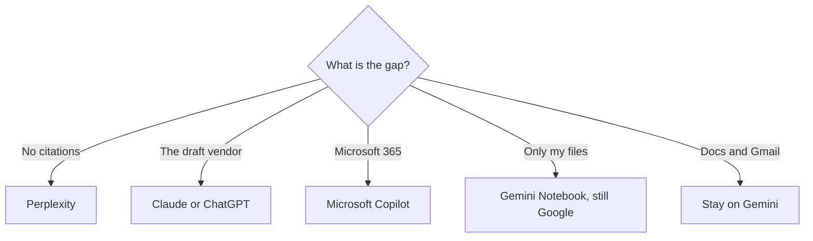

**Leave Gemini when the work is not inside a Google account: a cited web answer, a draft you want from another vendor, or Microsoft 365.** Stay when Gmail, Docs, and Drive are where the work already lives. The free Gemini plan is real. Plus at $4.99 a month is the cheapest paid step in this directory's general-assistant set.

[Gemini](/tools/gemini/) prices, checked October 16, 2026: Free with a Google account. Google AI Plus is $4.99 a month. Pro is $19.99. Ultra starts at $99.99. The product page is [Gemini review](/blog/gemini-review-2026/). The three-way is [ChatGPT vs Gemini vs Claude](/blog/chatgpt-vs-gemini-vs-claude-2026/).

Other prices below are US list prices excluding tax from the same directory check, unless a sentence names a later read. We did not rank model quality.

## Pick by what Gemini is not doing

| The gap | Try | First paid step |
|---|---|---|
| Answers need a link you will open | [Perplexity](/tools/perplexity/) | Pro is $17/month billed annually |
| A long draft, and you want Anthropic's assistant | [Claude](/tools/claude/) | Pro is $20/month, or $17 billed annually |
| You want OpenAI's product surface | [ChatGPT](/tools/chatgpt/) | Go is $8/month. Plus is $20 |
| The company runs on Microsoft 365 | [Microsoft Copilot](/tools/microsoft-copilot/) | Free with a Microsoft account. Personal is $9.99/month |
| You want a lower published non-Google seat | [Mistral Vibe](/tools/mistral-vibe/) | Pro is $14.99/month excluding tax |
| You want a free chat plus a posted API rate | [DeepSeek](/tools/deepseek/) | Chat is free. API input from $0.15 per 1 million tokens off-peak on a cache miss |
| You only needed your own files, with citations | [Gemini Notebook](/tools/gemini-notebook/) | This stays in Google. Free with a Google account |

Notebook is not an alternative to Gemini. It is the file-bound version of the same vendor. The study habit is [how to study with Gemini Notebook](/blog/gemini-notebook-study-workflows/). Use it when the source is a PDF you trust. Use the alternatives above when you are leaving Google.

## What you give up when you leave

Gemini's paid plans bundle more than chat. Plus includes video generation and 200 Google Flow credits. Pro at $19.99 includes 1,000 Flow credits and 5 TB of storage on the directory page. If you were paying Pro for Flow, a Claude seat does not replace those credits. Price [Google Flow](/tools/google-flow/) on its own page, and read [Google Flow review](/blog/google-flow-review-2026/), before you cancel.

Storage is the other quiet line. Free Gemini includes 15 GB. Plus moves to 400 GB. Pro to 5 TB. An alternative assistant does not move your Drive files. Keep the Google plan if the storage is the reason you pay.

[ChatGPT](/tools/chatgpt/) Plus at $20 is the usual "other assistant." It does not include Google storage. Go at $8 is closer to Plus's price and may include ads, per the directory page. The ladder is [ChatGPT Go vs Plus vs Pro](/blog/chatgpt-go-vs-plus-vs-pro-2026/).

[Claude](/tools/claude/) is the writing comparison. Pro matches ChatGPT Plus at $20 monthly, with an annual price of $17. The writing article is [ChatGPT vs Claude for writing](/blog/chatgpt-vs-claude-for-writing-2026/). A broader leave-ChatGPT list, useful if you are choosing among all three, is [ChatGPT alternatives](/blog/chatgpt-alternatives-2026/).

## Research, Microsoft, and a smaller seat

**Perplexity** when the output has to be a claim with a URL. The workflow is [how to use Perplexity for market research](/blog/how-to-use-perplexity-for-market-research-2026/). Pro at $17 billed annually is the working plan. The bill is [Perplexity pricing explained](/blog/perplexity-pricing-explained-2026/).

**Microsoft Copilot** when the draft has to land in Word, Excel, or Outlook and the login is a Microsoft account. Personal is $9.99 a month. Business SKUs on the directory page start from a promotional $18 per user per month billed yearly. Ask the admin which SKU the tenant actually owns. A personal Gemini subscription does not answer that.

**Mistral Vibe and DeepSeek** when the goal is a different vendor at a published price. Vibe Pro is $14.99. DeepSeek chat is free, and the API has a token card. Read [DeepSeek review](/blog/deepseek-review-2026/) before you point a work process at it. Neither one imports your Google Drive by default.

If the only problem is a wrong fact, switching assistants is the slow fix. Attach the source. That pattern is [what RAG is](/blog/what-is-rag-explained-2026/).

## FAQ

### What is the best Gemini alternative for writing?

Claude Pro or ChatGPT Plus, both $20 a month at the monthly rate, are the products people compare. Run the same brief through one of them and through Gemini before you pay for two.

### Is Perplexity a Gemini replacement?

It replaces Gemini for cited lookup. It does not replace Gmail or Drive. Keep Gemini, including the free plan, if those apps are the job.

### I pay for Google AI Pro. What else am I paying for?

On the October 16, 2026 directory page: higher usage, 1,000 Flow credits, and 5 TB. If you use the storage and the video credits, an outside assistant is an extra seat, not a swap.

### Is there a free alternative?

ChatGPT, Claude, Copilot, DeepSeek, and Perplexity all have free tiers with limits. Gemini's own free plan remains the one tied to your Google account.

## Last verified

October 16, 2026 for the plan prices named here. Perplexity Pro at $17 billed annually is also in the October 24, 2026 pricing article. Published October 24, 2026.

**Sources:** [Google Gemini](https://gemini.google.com/), [Claude pricing](https://claude.com/pricing), [Microsoft 365](https://www.microsoft.com/microsoft-365), [Perplexity pricing](https://www.perplexity.ai/pro).

*Published by Andrew for [AI Tools Optimizer](https://aitoolsoptimizer.com).*

[Gemini](/tools/gemini/), [ChatGPT](/tools/chatgpt/), and [Claude](/tools/claude/) are in the [chatbots directory](/tools/category/chatbots-assistants/). Directory pages may use affiliate links. A purchase through them may earn us a commission at no extra cost to you.
