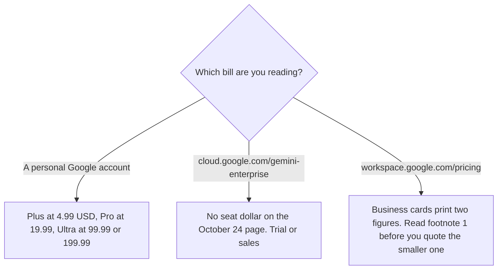

**Gemini Enterprise, on cloud.google.com/gemini-enterprise fetched October 24, 2026, does not print a public seat price.** The page says you can contact Google Cloud sales, or try Gemini Enterprise Plus at no cost for 30 days without sales assistance. That is the business-agent page. It is not Google AI Plus at $4.99 or Google AI Pro at $19.99. Those consumer subscriptions are [Gemini pricing explained](/blog/gemini-pricing-explained-2026/).

A Google Workspace seat that includes Gemini in Gmail is a third bill, with its own figures below. The notebook's enterprise row, which also prints no dollar, is [Gemini Notebook pricing explained](/blog/gemini-notebook-pricing-explained-2026/). The Microsoft work seat, when the files are in that suite, is [Microsoft 365 Copilot pricing explained](/blog/microsoft-365-copilot-pricing-explained-2026/).

Published October 24, 2026. We did not score answers. Some features on the Cloud page are marked early access. A missing dollar is not a price of zero beyond the trial the page names.

## Three products people collapse into one name

| What you opened | Price this fetch can cite | What it is |
|---|---|---|
| Gemini Enterprise, Cloud page | No public seat dollar. Gemini Enterprise Plus: 30 days at no cost, or contact sales | The business agent page fetched October 24 |
| Google AI Plus, Pro, Ultra | $4.99, $19.99, and $99.99 or $199.99 a month | The personal subscription on the October 16 directory card, matching the October 24 subscriptions record in the Notebook article |
| Workspace Business Starter | The card prints $3.50 and $7 per user per month, and a line that reads 1 user = $3.50 / mo | A Workspace plan. The card names Gemini in Gmail |
| Workspace Business Standard | The card prints $7 and $14, and 1 user = $7 / mo | The card names Gemini in Gmail, Docs, Meet, and more, plus expanded Gemini Notebook access |
| Workspace Business Plus | The card prints $11 and $22, and 1 user = $11 / mo | A Workspace plan. This fetch's Plus bullets did not repeat a Gemini line. Do not treat that silence as proof Gemini is absent |
| Workspace Enterprise Standard and Enterprise Plus | No self-serve dollar in the text captured | Columns on the Workspace page. Not the Cloud product's missing sticker |

Workspace footnote 1, on the page fetched October 24, says the introductory price is for new Google Workspace customers, the first 20 users, for 12 months, and that standard pricing applies after that. The Starter and Standard cards also print a window of Nov 7, 2026 through Feb 7, 2027. This article does not relabel the number pairs beyond that footnote and the "1 user =" line. Checkout shows the final price. Business Starter, Standard, and Plus can be purchased for a maximum of 300 users. The page says Enterprise plans have no minimum or maximum user limit. Business Plus and Enterprise Plus include 5 TB of pooled storage per user, on that page's storage note.

## What the Cloud page does say

Google's page says that when you use Gemini for your business, you own your data, that prompts, outputs, and model tuning are not used to train Google's models or models for any other customer, that Google does not sell customer data, and that Google does not use customer data for advertising. Those are Google's statements on the page we fetched. This article does not audit them.

The same page says not every feature shown is available now. It names delegating multi-step background tasks, Gemini on mobile and desktop, and third-party model choice as early access. A security review that assumes those are generally available is reading the marketing page too quickly.

**A consumer Pro seat** at $19.99 does not become Gemini Enterprise because the user has a work Gmail. The product review of the consumer app is [Gemini review](/blog/gemini-review-2026/).

**ChatGPT Enterprise**, if the other company workspace is the comparison, also has no list price on the plan page fetched the same day. That invoice is [ChatGPT Enterprise pricing explained](/blog/chatgpt-enterprise-pricing-explained-2026/).

## What not to assume

Do not quote Gemini Enterprise at $3.50, $7, $11, or $19.99. Those figures belong to Workspace intro lines or to the consumer card. Do not treat the 30-day trial as a permanent free enterprise plan. Do not add a consumer Ultra price to a Workspace seat and call the sum Gemini Enterprise. Do not assume early-access items are on the trial.

## FAQ

### How much is Gemini Enterprise?

The Cloud page fetched October 24, 2026 does not print a seat price. It offers a 30-day no-cost trial of Gemini Enterprise Plus without sales assistance, or a conversation with Google Cloud sales. If a quote names a dollar, the quote wins. This page will not invent one.

### Is Google AI Pro the enterprise plan?

No. Pro at $19.99 a month is the consumer subscription recorded on the October 16 directory card. Enterprise on the Cloud page is a different product, without that sticker.

### What are the $3.50 and $7 figures?

They are the two numbers on the Workspace Business Starter card fetched the same day, next to a line that reads 1 user = $3.50 / mo. Footnote 1 describes an introductory price for new customers, the first 20 users, for 12 months. That card is Workspace. It names Gemini in Gmail. It is not the Cloud page's Gemini Enterprise price.

### Does the notebook enterprise row have a price?

The Notebook pricing article, from Google's help page on October 24, says the enterprise row does not print a public seat price. Use that article for notebook caps. Do not copy a consumer "5x" line onto it.

## Last verified

October 24, 2026, from cloud.google.com/gemini-enterprise and from workspace.google.com/pricing. Consumer Gemini dollars are the October 16 directory card, consistent with the October 24 subscriptions record in the Notebook article. Published October 24, 2026.

**Sources:** [Gemini Enterprise](https://cloud.google.com/gemini-enterprise), [Google Workspace pricing](https://workspace.google.com/pricing), [Google AI subscriptions](https://gemini.google/subscriptions/), [Gemini](https://gemini.google.com).

*Published by Andrew for [AI Tools Optimizer](https://aitoolsoptimizer.com).*

[Gemini](/tools/gemini/) is in the [chatbots and assistants directory](/tools/category/chatbots-assistants/). Directory pages may use affiliate links. A purchase through them may earn us a commission at no extra cost to you.
