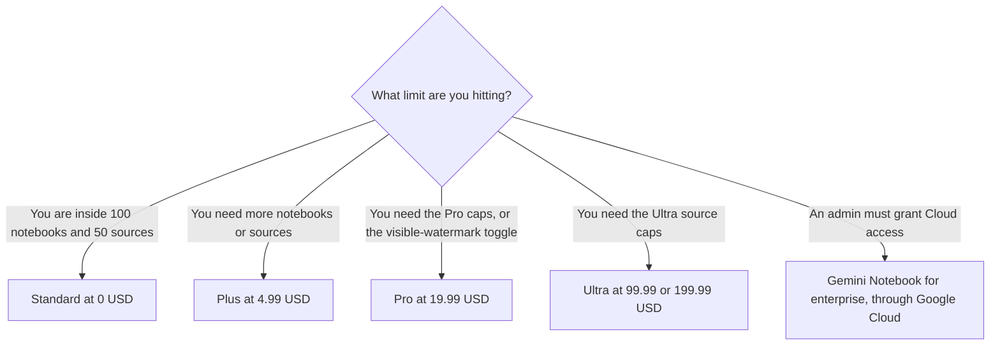

**Gemini Notebook is free with a Google account, inside caps the help page prints. Higher caps come with a Google AI plan: Plus at $4.99 a month, Pro at $19.99, or Ultra at $99.99 or $199.99.** The dollar prices are from gemini.google/subscriptions on October 24, 2026. The notebook and source caps are from Google's Gemini Notebook plans help page the same day. The help page says the limits are subject to change.

The product was formerly NotebookLM, on the directory card checked October 16, 2026. The product page is [Gemini Notebook](/tools/gemini-notebook/). Open-web citations are [Perplexity pricing explained](/blog/perplexity-pricing-explained-2026/). The video credits on the same Google AI plans are [Google Flow pricing explained](/blog/google-flow-pricing-explained-2026/).

Published October 24, 2026. We did not score summaries. A notebook is only as good as the sources you upload.

## The caps the help page listed

| Plan | How you get it | Notebooks | Sources | Visible watermark removal |
|---|---|---|---|---|
| Standard | Free with a Gmail account, or a qualifying Workspace or Workspace for Education license | 100 per user | 50 per notebook | No |
| Plus | Google AI Plus at $4.99 a month | 200 per user | 100 per notebook | No |
| Pro | Google AI Pro at $19.99 a month, or a qualifying Workspace license | 500 per user | 300 per notebook | Yes, with the country exception below |
| Ultra, 20 TB plan | Named by storage on the help page. The subscriptions page lists Ultra at $99.99 and $199.99 and says storage starts at 20 TB | 500 per user | 500 per notebook | Yes, same exception |
| Ultra, 30 TB plan | Named by storage on the help page. That subscriptions fetch did not print a 30 TB price | 500 per user | 600 per notebook | Yes, same exception |

The help page says a visible watermark is applied automatically if you reside in India, South Korea, or Vietnam, including on plans that otherwise list watermark removal. It also says outputs generated with Veo, Omni, or Nano Banana include invisible SynthID watermarks, and that eligible Pro and Ultra users get a "Visible watermarking" toggle. The explainer is [what an AI output watermark is](/blog/what-is-ai-output-watermark-2026/).

Enterprise, through Google Cloud, is a different row. The help page says it includes 5x or more notebook artifacts, including Audio Overviews, Video Overviews, and reports, plus advanced sharing, VPC-SC, and IAM controls. It does not print a dollar price. That is a Cloud conversation. The consumer "5x" line on the October 16 directory card is not how the October 24 consumer table is written. The consumer table uses the counts above.

Sharing a notebook does not change a collaborator's source limit, on that page. Some automatic overviews created when you first add sources do not count against limits, in the page's words. This article does not invent a separate Audio Overview quota the table did not print.

## What the dollars are actually buying

**Plus at $4.99** doubles the notebook cap and doubles the sources per notebook, against Standard, on this table. The subscriptions page also lists 2x [Gemini](/tools/gemini/) usage versus Free, video generation, 200 Google Flow credits, and 400 GB of storage. You are buying that bundle, not a notebook-only SKU.

**Pro at $19.99** is the row with 500 notebooks, 300 sources, and the visible-watermark control, subject to the three-country rule. The subscriptions page lists 4x usage versus Free, Gemini 4 Argon, 1,000 Flow credits, and 5 TB. If you only needed 200 notebooks, Plus is the smaller bill.

**Ultra** is the highest Gemini access on the subscriptions page, at $99.99 for 5x Pro's Gemini usage limits or $199.99 for 20x, with 10,000 or 25,000 Flow credits, and storage starting at 20 TB. The notebook help page also has a 30 TB Ultra row, with 600 sources per notebook. This fetch did not show a separate 30 TB dollar price, so match the storage label at checkout. On both Ultra rows the notebook cap stays 500 per user. The extra room in the table is sources, not notebooks.

**[Perplexity](/tools/perplexity/) Pro** is $17 a month billed annually on the October 16 directory card. It searches the web. Notebook answers from sources you add. The October 24 perplexity.ai/pro fetch returned HTTP 403, so the $17 figure stays on the directory record.

**[Elicit](/tools/elicit/)** Plus is $11 a user a month billed annually on the October 16 card, for literature workflows. The invoice is [Elicit pricing explained](/blog/elicit-pricing-explained-2026/). It is not a Google Drive notebook.

## What not to assume

Do not quote the October 16 "Pro is 5x" line as the consumer cap. The October 24 help table prints counts. Do not assume Workspace is free of charge. The notebook can be included with a qualifying Workspace license. Workspace itself has a price. Do not upload documents your policy forbids. The help page separates consumer data handling from the Cloud enterprise row. Read the row for the account you have. Do not subtract Flow credits from notebook limits. They are different meters on the same Google AI plan.

## FAQ

### How much does Gemini Notebook cost?

Standard is free with the caps in the table. Plus is $4.99 a month, Pro is $19.99, and Ultra is $99.99 or $199.99, on the October 24 subscriptions page. Enterprise through Google Cloud does not list a public seat price on the help page we read.

### Is it the same product as NotebookLM?

The October 16 directory says Gemini Notebook is the product previously known as NotebookLM. Price the Gemini Notebook help page and the Google AI subscription. An old NotebookLM screenshot is not the cap.

### Does Pro remove watermarks?

The help page says Pro and Ultra list visible watermark removal, with a toggle for eligible users, and that a visible watermark is still applied in India, South Korea, and Vietnam. Invisible SynthID on Veo, Omni, and Nano Banana outputs is a separate sentence on that page. Paying does not, in the text we read, remove SynthID.

### What if the help page changes the caps?

Use the help page that day. This article is October 24, 2026, and the page says limits are subject to change. A notebook you created under a higher cap can sit over a lower cap later. The page, not this article, decides.

## Last verified

October 24, 2026, from the Gemini Notebook plans help page and gemini.google/subscriptions. Perplexity and Elicit figures are from directory pages checked October 16, 2026. Published October 24, 2026.

**Sources:** [Gemini Notebook plans](https://support.google.com/gemininotebook/answer/16213268?hl=en), [Google AI subscriptions](https://gemini.google/subscriptions/), [Gemini Notebook](https://workspace.google.com/products/gemini-notebook/).

*Published by Andrew for [AI Tools Optimizer](https://aitoolsoptimizer.com).*

[Gemini Notebook](/tools/gemini-notebook/) is in the [research and search directory](/tools/category/research-search/). Directory pages may use affiliate links. A purchase through them may earn us a commission at no extra cost to you.
