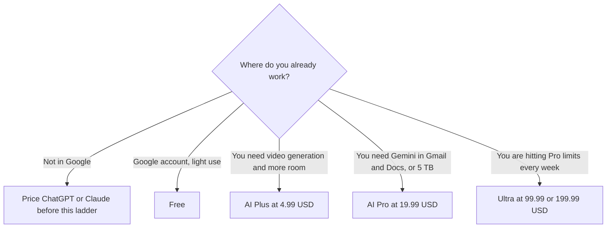

**Google Gemini is free with a Google account. Google AI Plus is $4.99 a month. Google AI Pro is $19.99 a month. Google AI Ultra is $99.99 a month or $199.99 a month.** Plus is the card's 2x usage row against Free. Pro is the card's 4x usage row against Free, with Gemini 4 Argon and 5 TB of storage. Ultra's two prices are 5x and 20x Pro's limits, on the same card. Those multiples describe the Gemini app plan. They are not a score, and they are not automatically the notebook's limits.

The product page is [Gemini review](/blog/gemini-review-2026/). The outline job inside a Google Doc is [Gemini vs Claude for slide outlines](/blog/gemini-vs-claude-for-slide-outlines-2026/). The Microsoft suite, when the files are in Word and Excel, is [Microsoft Copilot pricing explained](/blog/microsoft-copilot-pricing-explained-2026/).

Prices are US list prices from the Gemini subscriptions page as recorded in the directory on October 16, 2026. Published October 24, 2026. We did not score answers. Some features are limited by country on that card. The prices here are the US figures. Checkout in another country can differ, and this page does not invent a local price.

## The plans

| Plan | Price | What the card highlights |
|---|---|---|
| Free | $0 | Flash-Lite, image generation and editing, 15 GB storage |
| Google AI Plus | $4.99 a month | 2x usage versus Free, video generation, 200 Flow credits, 400 GB |
| Google AI Pro | $19.99 a month | 4x usage versus Free, Gemini 4 Argon, 1,000 Flow credits, Gemini in Gmail and Docs, 5 TB |
| Google AI Ultra | $99.99 a month | 5x Pro limits, 10,000 Flow credits, 20 TB or more |
| Google AI Ultra | $199.99 a month | 20x Pro limits, 25,000 Flow credits, YouTube Premium |

A year of Plus at the monthly rate on the card is 12 × $4.99 = $59.88. A year of Pro is 12 × $19.99 = $239.88. A year of the lower Ultra is 12 × $99.99 = $1,199.88. A year of the higher Ultra is 12 × $199.99 = $2,399.88. Those are multiplications of the monthly figures the directory recorded. The card we used does not print a separate annual discount for these rows, so this page does not invent one.

## What each step is for

**Free** is the assistant, image generation and editing, limited Nano Banana Pro access, and 15 GB, on the card. It is enough to learn whether you want Gemini in the apps you already open. It is the wrong plan to quote as "Gemini in Gmail and Docs." That line is on Pro.

**Plus at $4.99** is the small paid step: 2x usage, video generation, 200 Google Flow credits, more room at 400 GB. Buy it when Free is failing on usage or you need video, and you do not need the Pro bundle.

**Pro at $19.99** is the plan the directory ties to 4x usage, Gemini 4 Argon, 1,000 Flow credits, Gemini in Gmail and Docs, and 5 TB. The storage is part of the price. If you were going to pay for storage anyway, put that value on this row before you compare Pro with a $20 chat seat that includes no drive.

**Ultra** is two products on one name. $99.99 is 5x Pro limits and 10,000 Flow credits. $199.99 is 20x Pro limits, 25,000 Flow credits, and YouTube Premium. The directory's short takeaway also associates YouTube Premium and 20 TB or more with Ultra as a family. The table above is the detailed card. If a perk is the reason you are buying, confirm it on the Ultra tier in the cart. A person who is not hitting Pro's limits does not need either Ultra.

**Notebook is a different meter.** [Gemini Notebook](/tools/gemini-notebook/) is free with a Google account, and its directory page describes higher limits on the same Google AI plans, including a Pro multiple for notebooks that is not the "4x versus Free" line in the table above. Use the Notebook page when the job is a packet you uploaded. Use this page for the Gemini app subscription. Do not add the multiples together.

[ChatGPT](/tools/chatgpt/) Plus is $20 a month. [Claude](/tools/claude/) Pro is $20 a month, or $17 billed annually. Those are the seats to price when the work is not inside Google. Pro at $19.99 is in the same band and includes the storage and the app integration. It is not the same product.

## What not to assume

Do not call Plus "half of Pro" and stop. The 2x and 4x lines are usage multiples against Free, not a feature checklist. Gmail and Docs, 5 TB, and Gemini 4 Argon are why Pro exists. Do not quote Ultra as $99.99 if the cart is the 20x tier. Do not assume every feature on the US card is offered in every country. The directory says Plus is listed in more than 160 countries and territories, and Pro and Ultra in more than 150, with some features limited by country.

## FAQ

### Is Gemini free?

Yes, with a Google account, on the October 16 card: Flash-Lite, image generation and editing, and 15 GB. Video generation and Gemini in Gmail and Docs are reasons the paid rows exist.

### What is the difference between Plus and Pro?

Plus is $4.99, with 2x usage versus Free, video generation, 200 Flow credits, and 400 GB. Pro is $19.99, with 4x usage versus Free, Gemini 4 Argon, 1,000 Flow credits, Gemini in Gmail and Docs, and 5 TB. If you only needed a little more usage, Plus is the row. If you needed the apps and the storage, Pro is the row.

### Why are there two Ultra prices?

They are two limit multipliers. $99.99 is 5x Pro's limits. $199.99 is 20x, and the detailed card adds YouTube Premium on that tier. Pick the one whose limit you are actually hitting. The names match. The invoices do not.

### Does this include the API?

No. This page is the Gemini app subscription on the consumer card. An API bill is a token price this directory page does not print. Do not turn $19.99 into a per-million rate.

## Last verified

October 16, 2026, from the Gemini subscriptions page as recorded in the directory. Published October 24, 2026.

**Sources:** [Google AI subscriptions](https://gemini.google/subscriptions/), [Gemini](https://gemini.google.com).

*Published by Andrew for [AI Tools Optimizer](https://aitoolsoptimizer.com).*

[Gemini](/tools/gemini/) is in the [chatbots and assistants directory](/tools/category/chatbots-assistants/). Directory pages may use affiliate links. A purchase through them may earn us a commission at no extra cost to you.
