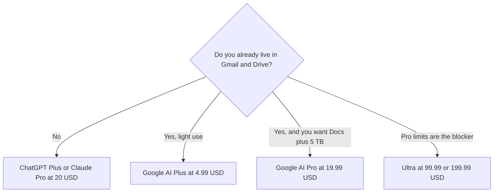

**[Gemini](/tools/gemini/) is Google's assistant, in the Gemini app and inside Google products.** The paid plans are Google AI subscriptions. On the United States view of Google's subscriptions page, Plus is $4.99 a month, Pro is $19.99 a month, and Ultra starts at $99.99 a month. You are buying usage, models, Flow credits, and storage together. That bundle is the product.

Those dollar amounts were read from the United States view of [gemini.google/subscriptions](https://gemini.google/subscriptions/) on October 24, 2026. Google's footnote says Plus, Pro, and Ultra are available in more than 140 countries, and some benefits are limited by country and to ages 18+. A price in another country, or in a mobile app store, can differ. We did not score Gemini against ChatGPT. The comparison is [ChatGPT vs Gemini vs Claude](/blog/chatgpt-vs-gemini-vs-claude-2026/).

## What each US plan lists

| Plan | US price on the page | What the page adds over the tier below |
|---|---|---|
| Free | $0 | Flash-Lite, image generation and editing, Deep Research, Gemini Live, Canvas, Gems, 15 GB storage |
| Google AI Plus | $4.99/month | Flash, about 2× Free usage, video generation, 200 Google Flow credits, 400 GB |
| Google AI Pro | $19.99/month | Gemini 4 Argon and Pro, about 4× Free usage, 1,000 Flow credits, Gemini in Gmail and Docs, 5 TB |
| Google AI Ultra | $99.99/month | About 5× Pro usage, 10,000 Flow credits, storage starting at 20 TB, YouTube Premium |
| Google AI Ultra | $199.99/month | About 20× Pro usage, 25,000 Flow credits. Project Genie is listed on Ultra |

The invoice is [Gemini pricing explained](/blog/gemini-pricing-explained-2026/).

Usage limits are compute-based. Google's footnote says they depend on prompt complexity, features, and chat length, and they refresh every five hours until a weekly limit. There is no message count to quote. Flow credits are a separate meter, explained in the [Google Flow review](/blog/google-flow-review-2026/).

## What the bundle is doing

Pro is the plan that competes with a $20 assistant, and it is not only a model. Five terabytes of storage is on the card. If you already pay Google for storage, subtract that from the $19.99 before you call Pro expensive. Gemini in Gmail and Docs is listed on Pro, not as a reason to buy Ultra. YouTube Premium Lite is described as a Pro perk in select countries. YouTube Premium individual is an Ultra perk, and Google says that individual plan is available in over 40 countries. Do not assume a perk on a US screenshot exists on your account.

Plus is the cheap step when Free is enough for text and you want video generation and a larger mailbox. It is a poor step if the missing feature is Gemini 4 Argon or Docs. Those are on the Pro card.

Ultra is a capacity and creator plan. The May 19, 2026 Google blog introduced the $100 tier and said the top tier moved from $250 to $200. The subscriptions page now prints $99.99 and $199.99. Buy Ultra when Pro's limit is the thing that stops work, or when the Flow credit pool is the point. Do not buy it for Gmail.

[Gemini Notebook](/tools/gemini-notebook/) is the surface for a class PDF that should stay on your uploads. The study workflow is [how to study with Gemini Notebook](/blog/gemini-notebook-study-workflows/). The general app is the wrong tool for "only these documents."

## Who should pay

**Stay on Free** if you have a Google account and the caps are rare. **Pay for Plus** if you want video and more room and you do not need the Pro model row. **Pay for Pro** if Gmail, Docs, and storage are part of the decision. **Pay for Ultra** only after Pro is the blocker, and check which Ultra features are offered in your country. **Skip Gemini** if you do not use Google and you wanted a writing assistant. That is [Claude](/tools/claude/) or [ChatGPT](/tools/chatgpt/), compared in [which AI subscription is worth paying for](/blog/which-ai-subscription-is-worth-paying-for/).

Students choosing a study stack, rather than a storage bundle, should read [best AI tools for students](/blog/best-ai-tools-for-students-2026/).

## FAQ

### Is Gemini free?

Yes, with a Google account. The free plan on the US subscriptions page includes Flash-Lite, image tools, Deep Research, and 15 GB of storage.

### How much is Google AI Pro?

$19.99 a month on the United States view we read. It includes about 4× Free usage, Gemini 4 Argon, 1,000 Flow credits, Gemini in Gmail and Docs, and 5 TB of storage. Confirm the price for your country.

### Does Pro include Google Flow?

Pro includes 1,000 Google Flow credits a month, on top of the 50 daily credits everyone gets. Credit costs per video are in the Flow review. They are not unlimited.

## Last verified

October 24, 2026, United States view of Google's AI subscriptions page. Country lists and perk footnotes on that page are part of the product. Recheck them at checkout.

**Sources:** [Google AI subscriptions](https://gemini.google/subscriptions/), [Google AI subscription updates from I/O 2026](https://blog.google/products-and-platforms/products/google-one/google-ai-subscriptions/).

[Gemini](/tools/gemini/) is in the [chatbots directory](/tools/category/chatbots-assistants/). Directory pages may use affiliate links. A purchase through them may earn us a commission at no extra cost to you.
